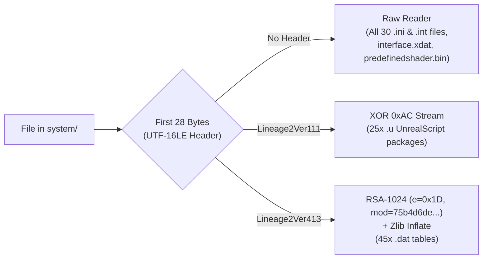

# Lineage 2 Gracia Epilogue (`CT2.4`) — Master Client Architecture, Reverse-Engineering & Linux Modernization Guide

**Client Root:** [`Client Lineage 2 Gracia Epilogue`](file:///home/dwea/Projects/L2/Client%20Lineage%202%20Gracia%20Epilogue)  
**System Directory:** [`Client Lineage 2 Gracia Epilogue/system`](file:///home/dwea/Projects/L2/Client%20Lineage%202%20Gracia%20Epilogue/system)  
**Paired Server Repository:** [`l2jmobius_dwea_fork`](file:///home/dwea/Projects/L2/l2jmobius_dwea_fork) (`L2J_Mobius_CT_2.4_Epilogue`)  
**Launcher & Automation Scripts:** [`launch-l2.sh`](file:///home/dwea/Projects/L2/Client%20Lineage%202%20Gracia%20Epilogue/launch-l2.sh), [`patch_gmwnd_client.py`](file:///home/dwea/Projects/L2/Client%20Lineage%202%20Gracia%20Epilogue/patch_gmwnd_client.py)

> [!IMPORTANT]
> **Purpose of This Document (For AI Agents & Developers):**
> This document is the single source of truth for the reverse-engineered **Lineage 2 Gracia Epilogue (`CT2.4`, Protocol `146`/`148`)** game client. It documents every encryption layer, binary DLL patch (`d3ddrv.dll`, `windrv.dll`, `l2.exe`, `dsetup.dll`), plain-text configuration override (`l2.ini`, `Option.ini`, `user.ini`), Linux/Wine/DXVK runtime requirement, modernized controller (`JOYPAD`) binding, and the Unified Native C++ `GMWnd` (`Alt+G`) Master Console (`interface.xdat` & `interface.u` bytecode patches).

---

## 1. Executive Summary & Client Forensics

The [`system/`](file:///home/dwea/Projects/L2/Client%20Lineage%202%20Gracia%20Epilogue/system) directory is a modified **Unreal Engine 2.5 (Package Version `123` / Licensee `37`, Protocol `146`/`148`)** 32-bit Windows (`PE32`) client from **August 20, 2010**, modernized for native-feeling execution on Linux (`Wine` / `Proton` + **32-bit DXVK Vulkan**) and Windows:

1. **Dual-Binary Startup & GameGuard Bypass:**
   * [`L2.bin`](file:///home/dwea/Projects/L2/Client%20Lineage%202%20Gracia%20Epilogue/system/L2.bin) (`2,229,208` bytes, Aug 20, 2010) is the original retail binary, while [`l2.exe`](file:///home/dwea/Projects/L2/Client%20Lineage%202%20Gracia%20Epilogue/system/l2.exe) (`434,176` bytes, May 28, 2010) paired with [`dsetup.dll`](file:///home/dwea/Projects/L2/Client%20Lineage%202%20Gracia%20Epilogue/system/dsetup.dll) (`8,704` bytes, Oct 31, 2009) is an unpacked private-server loader that neutralizes nProtect `GameGuard.des` and overrides the retail `Lineage2Ver413` RSA modulus with the standard modding keypair.
2. **100% Stripped Config Encryption (Plain-Text `.ini` & `.int` Files):**
   * All **30 `.ini` and `.int` files** in [`system/`](file:///home/dwea/Projects/L2/Client%20Lineage%202%20Gracia%20Epilogue/system) (`l2.ini`, `user.ini`, `Option.ini`, `env.int`, `systemmsg` localization configs, etc.) have had their `Lineage2Ver111` / `Lineage2Ver413` encryption permanently stripped into plain, human-editable UTF-8/ASCII text. Original encrypted files are preserved in [`system/backup_encrypted/`](file:///home/dwea/Projects/L2/Client%20Lineage%202%20Gracia%20Epilogue/system/backup_encrypted).
3. **32-Bit DXVK (Direct3D 9 $\rightarrow$ Vulkan) & Silenced 2004 AGP Check (`d3ddrv.dll`):**
   * Renders via Vulkan using 32-bit DXVK (`d3d9.dll` + `dxgi.dll`), eliminating legacy D3D9 driver overhead and delivering crisp font rendering and high frame pacing.
   * [`system/d3ddrv.dll`](file:///home/dwea/Projects/L2/Client%20Lineage%202%20Gracia%20Epilogue/system/d3ddrv.dll) is binary-patched at raw offset `0xC2494` (`74 22` $\rightarrow$ `90 90`) to silence the obsolete 2004 AGP deactivation warning popup at startup.
4. **Dynamic Window Resizing, OS Maximize & Borderless Windowed Mode (`windrv.dll`):**
   * [`system/windrv.dll`](file:///home/dwea/Projects/L2/Client%20Lineage%202%20Gracia%20Epilogue/system/windrv.dll) has 5 surgical x86 binary patches enabling real-time drag-resizing (`WM_SIZE` $\rightarrow$ `UD3DRenderDevice::SetRes`), OS titlebar Maximize without cursor-trapping or forced exclusive fullscreen, XWayland/Wayland asynchronous geometry compatibility, and `(0,0)` `WS_POPUP` Borderless Windowed mode (`UseWindowFrame=False`).
5. **Modernized Controller (`JOYPAD`) Support (`user.ini`, `Option.ini`, `l2.ini`):**
   * Configured for modern XInput / SDL2 / Linux `winebus.sys` controllers (Xbox, DualSense, DualShock 4, 8BitDo, Steam Deck) with `UseJoystick=True`, Right Stick camera rotation (`JoyU`/`JoyR`/`JoyV`), `DeadZone=0.07`, unbound `JoyZ` trigger axis collision, and D-Pad (`JoyPov*`) hotbar/target cycling.
6. **Unified Native C++ `GMWnd` (`Alt+G`) Master Console (`interface.xdat` & `interface.u`):**
   * Expanded the native `Alt+G` GM window from `350x355` to `992x544` px, organizing all 19 native C++ controls into a left dock (`x=10..225`) and embedding a `744x492` `GMWnd.HtmlViewer` on the right that renders server-sent `NpcHtmlMessage(0, 1, html)` (`//gmw` & `//admin`) with zero `PageLock` and zero popup conflict.

---

## 2. File Encryption & Encoding Architecture (`Lineage2VerXXX`)

When `Core.dll` / `l2.exe` opens any file in `system/`, `FFileManagerL2` inspects the first **28 bytes** (`UTF-16LE` string `"Lineage2VerXXX"`). **If those 28 bytes are not present, the engine falls back to `FFileManagerWindows` and reads the file as raw plain bytes.**



| Header / Format | Algorithm & Key in This Client | Files Currently Using It |
| :--- | :--- | :--- |
| **Raw (Unencrypted)** | Plain text or raw binary (zero encryption header) | **All 30 `.ini` & `.int` files** ([`l2.ini`](file:///home/dwea/Projects/L2/Client%20Lineage%202%20Gracia%20Epilogue/system/l2.ini), [`Option.ini`](file:///home/dwea/Projects/L2/Client%20Lineage%202%20Gracia%20Epilogue/system/Option.ini), [`user.ini`](file:///home/dwea/Projects/L2/Client%20Lineage%202%20Gracia%20Epilogue/system/user.ini), [`env.int`](file:///home/dwea/Projects/L2/Client%20Lineage%202%20Gracia%20Epilogue/system/env.int), etc.), [`interface.xdat`](file:///home/dwea/Projects/L2/Client%20Lineage%202%20Gracia%20Epilogue/system/interface.xdat), [`predefinedshader.bin`](file:///home/dwea/Projects/L2/Client%20Lineage%202%20Gracia%20Epilogue/system/predefinedshader.bin), `*.gly` |
| **`Lineage2Ver111`** | 28-byte UTF-16LE header + every payload byte XORed with `0xAC` | All **25 `.u`** UnrealScript packages ([`interface.u`](file:///home/dwea/Projects/L2/Client%20Lineage%202%20Gracia%20Epilogue/system/interface.u), [`engine.u`](file:///home/dwea/Projects/L2/Client%20Lineage%202%20Gracia%20Epilogue/system/engine.u), [`nwindow.u`](file:///home/dwea/Projects/L2/Client%20Lineage%202%20Gracia%20Epilogue/system/nwindow.u), [`lineagesceneinfo.u`](file:///home/dwea/Projects/L2/Client%20Lineage%202%20Gracia%20Epilogue/system/lineagesceneinfo.u), etc.) |
| **`Lineage2Ver413`** | 28-byte UTF-16LE header + 128-byte RSA blocks (`e = 0x1D`, `mod = 0x75b4d6de...` embedded in `l2.exe` at `0x0045B7A8`) wrapping a `[uint32 uncompressed_size] + zlib` stream | All **45 `.dat`** client tables ([`itemname-e.dat`](file:///home/dwea/Projects/L2/Client%20Lineage%202%20Gracia%20Epilogue/system/itemname-e.dat), [`skillgrp.dat`](file:///home/dwea/Projects/L2/Client%20Lineage%202%20Gracia%20Epilogue/system/skillgrp.dat), [`npcgrp.dat`](file:///home/dwea/Projects/L2/Client%20Lineage%202%20Gracia%20Epilogue/system/npcgrp.dat), [`systemmsg-e.dat`](file:///home/dwea/Projects/L2/Client%20Lineage%202%20Gracia%20Epilogue/system/systemmsg-e.dat), etc.) |

### Standalone Python Decrypter / Encrypter Snippet (`Lineage2Ver111` & `Lineage2Ver413`)
```python
import zlib

# Standard modding RSA-1024 keypair embedded in system/l2.exe (VA 0x0045B7A8)
MOD_413 = int(
    "75b4d6de5c016544068a1acf125869f43d2e09fc55b8b1e289556daf9b875763"
    "5593446288b3653da1ce91c87bb1a5c18f16323495c55d7d72c0890a83f69bfd"
    "1fd9434eb1c02f3e4679edfa43309319070129c267c85604d87bb65bae205de3"
    "707af1d2108881abb567c3b3d069ae67c3a4c6a3aa93d26413d4c66094ae2039", 16
)
EXP_413 = 0x1D
PRIV_413 = int(
    "596461598f0915298f46b3b09126d999e85d0f20c9942a4f500e4f281f29a81d"
    "0761d24c22e84d3a7f56332f582b574899923d4f3d67d7081529156789506201"
    "8381d31135197e29a6f6b41c7d413b00501b957363413919283a241f9151d691"
    "6c4c63a1529225263d12c5677b16a9b683b419b32111605895875a31d991c7d5", 16
)

def decrypt_l2_file(data: bytes) -> bytes:
    if len(data) < 28:
        return data
    hdr = data[:28].decode("utf-16le", errors="ignore")
    if hdr == "Lineage2Ver111":
        return bytes(b ^ 0xAC for b in data[28:])
    elif hdr == "Lineage2Ver413":
        payload = data[28:]
        out = bytearray()
        for i in range(len(payload) // 128):
            blk = payload[i*128:(i+1)*128]
            dec = pow(int.from_bytes(blk, "big"), EXP_413, MOD_413).to_bytes(128, "big")
            sz = dec[3]
            if sz <= 124:
                pad = (124 - sz) % 4
                out.extend(dec[128 - sz - pad : 128 - pad])
        return zlib.decompress(bytes(out[4:]))
    return data
```

---

## 3. Binary DLL Patches (`d3ddrv.dll` & `windrv.dll`)

All binary patches are automatically verified and applied idempotently by [`launch-l2.sh`](file:///home/dwea/Projects/L2/Client%20Lineage%202%20Gracia%20Epilogue/launch-l2.sh). Clean unpatched originals are backed up in [`system/backup_encrypted/d3ddrv.dll.orig`](file:///home/dwea/Projects/L2/Client%20Lineage%202%20Gracia%20Epilogue/system/backup_encrypted/d3ddrv.dll.orig) and [`system/backup_encrypted/windrv.dll.orig`](file:///home/dwea/Projects/L2/Client%20Lineage%202%20Gracia%20Epilogue/system/backup_encrypted/windrv.dll.orig).

### 3.1 [`system/d3ddrv.dll`](file:///home/dwea/Projects/L2/Client%20Lineage%202%20Gracia%20Epilogue/system/d3ddrv.dll) — Silence Obsolete 2004 AGP Popup
On modern PCIe/Vulkan systems (`DXVK`), the 2004 AGP memory aperture check in `d3ddrv.dll` fails and pops up a modal warning dialog (`"AGP is deactivated. Please activate AGP for consistency in gameplay."`) before creating the D3D9 device.

| File | Raw Offset | Virtual Address | Original Bytes | Patched Bytes | Effect |
| :--- | :--- | :--- | :--- | :--- | :--- |
| [`system/d3ddrv.dll`](file:///home/dwea/Projects/L2/Client%20Lineage%202%20Gracia%20Epilogue/system/d3ddrv.dll) | `0xC2494` | `0x100C3094` | `74 22` (`je +0x22`) | `90 90` (`nop; nop`) | Unconditionally skips the AGP warning `MessageBoxW` popup. |

### 3.2 [`system/windrv.dll`](file:///home/dwea/Projects/L2/Client%20Lineage%202%20Gracia%20Epilogue/system/windrv.dll) — Dynamic Window Resizing, Maximize & Borderless Windowed Mode
In unpatched Unreal Engine 2.5 (`windrv.dll`, ImageBase `0x11100000`, `.text` RVA `0x1000`, raw `0x400`), windowed mode had four major bugs on modern Windows and Linux (`XWayland` / `GNOME Wayland`):
1. **Clicking the OS Maximize Button (`wParam == SIZE_MAXIMIZED == 2`)** in `UWindowsViewport::ViewportWndProc` (`0x11111baf`) DID NOT resize the viewport — instead, it set `bMaximized = 1` (`[esi+0x1c8] = 1`), trapped the mouse cursor via `SetCapture`, hid the cursor, and forced the next resize into **Exclusive Fullscreen**!
2. **When `ResizeViewport` (`0x1110df30`) was called from `WM_SIZE`**, it called `WWindow::MoveWindow` (`0x1110e0ab`) back onto the window that the OS window manager had *just* resized, fighting GNOME Wayland / XWayland maximizing and edge-tiling.
3. **Immediately after `MoveWindow`**, `ResizeViewport` called `GetClientRect` (`0x1110e0b0`) and overwrote `Viewport->SizeX` (`[esi+0x94]`) and `Viewport->SizeY` (`[esi+0x98]`) with `rect.right` / `rect.bottom` (`0x1110e0b9`). Because X11/XWayland `ConfigureNotify` is asynchronous, `GetClientRect` returned stale pre-resize dimensions (`1024x768`), desynchronizing mouse coordinates and UI scale from the D3D9 backbuffer!
4. **`UWindowsViewport::OpenWindow` (`0x1110f438`)** passed `CW_USEDEFAULT` (`0x80000000`) for `PosX` and `PosY` even when creating a `WS_POPUP` borderless window (`UseWindowFrame=False`), causing borderless windows to spawn slightly offset from `(0,0)`.

We verified that **zero PE `.reloc` entries** overlap any of the 5 patch sites below:

| Patch ID | Function & Location | Raw Offset | Virtual Address | Original Bytes (Hex) | Patched Bytes (Hex) | Assembly & Technical Explanation |
| :--- | :--- | :--- | :--- | :--- | :--- | :--- |
| **Patch 1a** | `UWindowsViewport::ViewportWndProc` (`WM_SIZE` `SIZE_MAXIMIZED` check) | `0x10FAF` | `0x11111BAF` | `83 f8 02 75 3d` | `eb 40 90 90 90` | `jmp 0x11111bf1; nop x3` — Bypasses the broken `SIZE_MAXIMIZED` (`wParam==2`) cursor-trap handler and routes `SIZE_MAXIMIZED` directly into the `SIZE_RESTORED` dynamic `SetRes` handler. |
| **Patch 1b** | `UWindowsViewport::ViewportWndProc` (`WM_SIZE` `SetRes` call prep) | `0x11141` | `0x11111D41` | `83 be c8 00 00 00 00 75 08 83 7d 3c 00 75 02 33 c0` (17B) | `33 c0 c7 86 34 02 00 00 04 00 00 00 90 90 90 90 90` (17B) | `xor eax, eax; mov dword ptr [esi+0x234], 4; nop x5` — Guarantees `Fullscreen=0` (`eax=0`) when resizing a window via `WM_SIZE` and sets one-shot flag `[esi+0x234] = 4` before calling `UD3DRenderDevice::SetRes(Viewport, NewX, NewY, ColorBytes, 0)`. |
| **Patch 2** | `UWindowsViewport::ResizeViewport` (windowed branch before `MoveWindow`) | `0x0D43A` | `0x1110E03A` | `8b 4e 3c f7 81 b8 05 00 00 00 02 00 00 0f 85 91 00 00 00` (19B) | `33 c0 87 86 34 02 00 00 83 f8 04 90 90 0f 84 91 00 00 00` (19B) | `xor eax, eax; xchg [esi+0x234], eax; cmp eax, 4; nop x2; je 0x1110e0de` — Atomically reads and clears `[esi+0x234]`. When `ResizeViewport` was triggered by `WM_SIZE` (`eax == 4`), skips the redundant `AdjustWindowRect` + `MoveWindow` and jumps straight to `Viewport->SizeX = NewX; Viewport->SizeY = NewY`. When triggered from in-game Options dropdown (`eax != 4`), executes `MoveWindow` normally. |
| **Patch 3** | `UWindowsViewport::ResizeViewport` (post-`GetClientRect` overwrite) | `0x0D4B9` | `0x1110E0B9` | `8b 45 40` (3B) | `eb 1c 90` (3B) | `jmp 0x1110e0d7; nop` — Prevents asynchronous XWayland `GetClientRect` after `MoveWindow` from overwriting `Viewport->SizeX` / `SizeY` with stale pre-resize dimensions. |
| **Patch 4** | `UWindowsViewport::OpenWindow` (`PosX` / `PosY` fallback) | `0x0E865` | `0x1110F465` | `c7 45 18 00 00 00 80 39 45 1c 75 07 c7 45 1c 00 00 00 80` (19B) | `c7 45 18 00 00 00 00 39 45 1c 75 07 c7 45 1c 00 00 00 00` (19B) | Replaces `CW_USEDEFAULT` (`0x80000000`) with `0` (`PosX=0, PosY=0`) so `WS_POPUP` borderless windows (`UseWindowFrame=False`) align pixel-for-pixel at `(0,0)` across the monitor. |

### 3.3 Why `Option.ini` Overrides `l2.ini` Resolution at Startup
Reverse-engineering `UWindowsClient::Init` (`windrv.dll` at `0x11113a25`) and `UWindowsViewport::OpenWindow` (`0x1110f5b6`) revealed:
* `UWindowsClient::Init` reads `GamePlayViewportX` and `GamePlayViewportY` from [`system/Option.ini`](file:///home/dwea/Projects/L2/Client%20Lineage%202%20Gracia%20Epilogue/system/Option.ini) (`[Video]`) and overwrites `WindowedViewportX/Y` and `FullscreenViewportX/Y` from `l2.ini`!
* `UWindowsViewport::OpenWindow` reads `StartupFullScreen` from [`system/Option.ini`](file:///home/dwea/Projects/L2/Client%20Lineage%202%20Gracia%20Epilogue/system/Option.ini) (`[Video]`).
* `UWindowsViewport::OpenWindow` (`0x1110f438`) computes `dwStyle = (Client->UseWindowFrame ? 0x90CF0000 : 0) + 0x80000000`, where `UseWindowFrame` is read from [`system/l2.ini`](file:///home/dwea/Projects/L2/Client%20Lineage%202%20Gracia%20Epilogue/system/l2.ini) (`[WinDrv.WindowsClient]`).
  * **Borderless Windowed Mode (`--borderless`):** `StartupFullScreen=False` (`Option.ini`), `StartupFullscreen=False` (`l2.ini`), `UseWindowFrame=False` (`l2.ini`) $\rightarrow$ creates a `WS_POPUP` (`0x80000000`) borderless window at `(0,0)`.
  * **Framed Resizable Windowed Mode (`--windowed`):** `StartupFullScreen=False` (`Option.ini`), `StartupFullscreen=False` (`l2.ini`), `UseWindowFrame=True` (`l2.ini`) $\rightarrow$ creates a `WS_OVERLAPPEDWINDOW` (`0x10CF0000`) window with titlebar, maximize button, and dynamic drag-resizing.

---

## 4. Linux Client Launcher (`launch-l2.sh`) & CLI Connection Flags

### 4.1 Why Command-Line Arguments Cannot Be Passed Directly to `l2.exe`
Disassembling `WinMain` in [`system/l2.exe`](file:///home/dwea/Projects/L2/Client%20Lineage%202%20Gracia%20Epilogue/system/l2.exe) (`0x0041C900` $\rightarrow$ `0x0041B234`) proved that NCSoft strips standard Unreal Engine URL CLI parameters and checks only for `-L2ProtocolVersion` or `Seekori!`. Instead, all connection and auto-login settings are read natively from [`system/l2.ini`](file:///home/dwea/Projects/L2/Client%20Lineage%202%20Gracia%20Epilogue/system/l2.ini):
* **`[URL]` Section:**
  * `ServerAddr=127.0.0.1` (Auth/LoginServer IP; connects to TCP port `2106`, then GameServer port `7777`).
  * `L2UseKeyCrypt=false` (Bypasses the broken Win98/XP ring-0 `npkcrypt.sys` keyboard hook while keeping `npkcrypt.dll` in `system/` to satisfy `NWindow.dll`'s static import table).
  * `IsL2Console=True`, `IsUseCommand=True`, `EnableSecondWindow=true`.
* **`[AutoLogOn]` Section:**
  * `IsL2AutoLogOn=True` / `False` (Fixed from the original client's `IsL2AutoLogOn=Ture` typo!).
  * `L2ID=<username>`, `L2Passwd=<password>`, `L2Slot=<0..6>` (Bypasses the login & character-select screens and boots straight into the world on character slot `L2Slot`).

### 4.2 [`launch-l2.sh`](file:///home/dwea/Projects/L2/Client%20Lineage%202%20Gracia%20Epilogue/launch-l2.sh) CLI Reference
```bash
# Launch in default 1920x1080 Borderless Windowed mode with DXVK (Vulkan):
./launch-l2.sh

# Launch with server IP and instant auto-login into character slot 0:
./launch-l2.sh -server 127.0.0.1 -login dwea -pass 123 -slot 0

# Switch to Framed Resizable Windowed mode (with OS titlebar, drag-resize & Maximize button):
./launch-l2.sh --windowed --res 1600x900

# Switch back to 1920x1080 Borderless Windowed mode:
./launch-l2.sh --borderless --res 1920x1080

# Run pre-flight diagnostics & verify all binary patches without launching the game:
./launch-l2.sh --check
```

### 4.3 Critical Linux / Wine / DXVK Runtime Requirements Handled by `launch-l2.sh`
1. **Working Directory (`cd system/`):** `l2.exe` MUST be launched with `Cwd` set to `system/` because `l2.ini` uses relative paths (`Paths=../Maps/*.unr`, `Paths=../Textures/*.utx`, `L2ShaderPath=..\system\`).
2. **Case-Sensitivity Symlinks on Linux (`ext4`/`btrfs`):**
   * `System -> system`, `Maps -> MAPS`, `Music -> music` in the client root.
   * `SmallFont-e.gly -> smallfont-e.gly`, `LargeFont-e.gly -> largefont-e.gly`, `SmallFont.gly -> smallfont.gly`, `LargeFont.gly -> largefont.gly` inside `system/`.
3. **TrueType Fonts (`tahoma.ttf`, `times.ttf`, `arial.ttf`):**
   * `interface.xdat` and `ttfontinfo.ini` require `Tahoma` (`tahoma.ttf`), `Times New Roman` (`times.ttf`), and `Arial` (`arial.ttf`). Without these `.ttf` files in `drive_c/windows/Fonts` and `system/`, the login screen, damage numbers, and UI windows render zero text.
4. **DLL Overrides (`WINEDLLOVERRIDES`):**
   * `d3d9=n,b;dxgi=n,b;dsetup=n,b;vcomp=n,b;msxml4=n,b;openal32=n,b;wrap_oal=n,b;mscoree=d;mshtml=d` (`dsetup=n,b` is mandatory so the client loads `system/dsetup.dll` instead of Wine's built-in DirectSetup stub).

---

## 5. Modernized Controller (`JOYPAD`) Architecture

Lineage 2 Gracia Epilogue has a native DirectInput controller subsystem (`JOYPAD`) compiled into `WinDrv.dll` (`UWindowsClient` / `UWindowsViewport`), `Engine.dll` (`UInput`), and `Interface.u` (`Shortcut` window).

### 5.1 What Was Fixed & Modernized in [`system/user.ini`](file:///home/dwea/Projects/L2/Client%20Lineage%202%20Gracia%20Epilogue/system/user.ini#L218-L258)
1. **Enabled `UseJoystick=True`** in both [`system/Option.ini`](file:///home/dwea/Projects/L2/Client%20Lineage%202%20Gracia%20Epilogue/system/Option.ini) (`[Game]`) and [`system/l2.ini`](file:///home/dwea/Projects/L2/Client%20Lineage%202%20Gracia%20Epilogue/system/l2.ini) (`[WinDrv.WindowsClient]`).
2. **Fixed XInput / SDL2 Right-Stick & Trigger Axis Collision:**
   * In 2004 DirectInput, `JoyZ` was the right-stick horizontal axis, whereas on modern XInput / Wine SDL2 (`winebus.sys`) controllers, `JoyZ` is the **L2/R2 analog triggers**! Leaving `JoyZ=CameraYaw` caused the camera to spin whenever triggers were touched.
   * **Modernized Axis Mapping in `[WinDrv.WindowsClient]` (`system/user.ini`):**
     * **Left Stick (`JoyX` / `JoyY`):** `MoveStrafe` / `MoveForward` (`DeadZone=0.07`, reduced from sluggish `0.15`).
     * **Right Stick (`JoyU` / `JoyR` / `JoyV`):** `CameraYaw` / `CameraPitch` (`Factor=42000`, `DeadZone=0.07`) supporting both XInput (`Rx`/`Ry` = `JoyU`/`JoyR`) and Raw DirectInput (`Rz` = `JoyV`), with `JoyZ=` unbound.
3. **Uncommented & Widened D-Pad (`JoyPov*`) Bindings:**
   * Expanded POV angle tolerance `range=1000` $\rightarrow$ `range=3000` (`±30°`) so diagonal D-Pad presses register reliably:
     * **D-Pad Up / Down (`JoyPovUp` / `JoyPovDown`):** Cycle hotbar page (`ShortcutUp` / `ShortcutDown`).
     * **D-Pad Left / Right (`JoyPovLeft` / `JoyPovRight`):** Cycle nearby NPC/Monster targets (`NPCTargetPrev` / `NPCTargetNext`).
4. **36 Virtual Hotbar Slots via Shoulder Modifiers:**
   * **Face Buttons (`Joy1`..`Joy4`):** Hotbar Slots 1–4 (`JoypadShortcut 0..3`).
   * **Hold `L1` (`Joy5` = `JoypadLButton`) + Face Buttons:** Hotbar Slots 5–8 (`F5`–`F8`).
   * **Hold `R1` (`Joy6` = `JoypadRButton`) + Face Buttons:** Hotbar Slots 9–12 (`F9`–`F12`).
   * **Hold `L1 + R1` (`JoypadLRButton`) + Face Buttons:** Secondary Skill Bar!
   * **Left Stick Click (`Joy9`):** Jump / Fly (`Space`).
   * **Right Stick Click (`Joy10`):** Reset Camera Behind Character (`JoypadWheelPush`).

---

## 6. Unified Native C++ `GMWnd` (`Alt+G`) Master Console (`interface.xdat` & `interface.u`)

Implemented by **Agent 1** via [`patch_gmwnd_client.py`](file:///home/dwea/Projects/L2/Client%20Lineage%202%20Gracia%20Epilogue/patch_gmwnd_client.py) (with clean originals backed up in [`system/backup_encrypted/interface.xdat.orig`](file:///home/dwea/Projects/L2/Client%20Lineage%202%20Gracia%20Epilogue/system/backup_encrypted/interface.xdat.orig) and [`system/backup_encrypted/interface.u.orig`](file:///home/dwea/Projects/L2/Client%20Lineage%202%20Gracia%20Epilogue/system/backup_encrypted/interface.u.orig)):

### 6.1 [`system/interface.xdat`](file:///home/dwea/Projects/L2/Client%20Lineage%202%20Gracia%20Epilogue/system/interface.xdat) Layout Expansion
* Expanded `GMWnd` (`Alt+G` native C++ GM window) from `350x355` to **`992x544` px**.
* Re-arranged the 19 native C++ controls (`EditBox`, 6 Graphical Player Inspector buttons, 3 client-side `.dat` Search Tree buttons, and Quick Action buttons) into a 2-column `105x26` left control dock (`x=10..225`), preserving full `105px` button widths so no English labels clip.
* Updated `ChangeServerButton` label to `sysstring[415]` (`Administrator`).
* Appended `GMWnd.texBack` (`GroupBox_DF`, `752x500` @ `x=232, y=34`) and `GMWnd.HtmlViewer` (`HtmlCtrl` / `NCHtmlViewer`, `744x492` @ `x=236, y=38`), incrementing `GMWnd` child count `19 -> 21`.

### 6.2 [`system/interface.u`](file:///home/dwea/Projects/L2/Client%20Lineage%202%20Gracia%20Epilogue/system/interface.u) Zero-Length-Delta Bytecode Patches
All 6 UnrealScript bytecode patches preserve both disk byte size and in-memory deserialized `ScriptSize` 1:1:
1. **`GMFindTreeWnd.ShowSkillList` (`Export #13529`):** Enabled `bSummon = true` (`0x28 -> 0x27`) so double-clicking a skill in the `Alt+G` Skill Search Tree executes `//summon`.
2. **`GMFindTreeWnd.FindAllSkill` (`Export #13526`):** Offset skill IDs by `+ 2000000` (`string(cID.ClassID + 2000000)`) so `//summon` distinguishes Items (`< 1,000,000`), NPCs (`1,000,000..1,999,999`), and Skills (`>= 2,000,000`).
3. **`GMWnd.HandleTargetUpdate` (`Export #12137`):** Prevents untargeting (`m_nowTargetID < 1`) from wiping text typed in `GMWnd.EditBox`.
4. **`GMWnd.OnClickChangeServerButton` (`Export #12081`):** Executes `ExecuteCommand("//admin")`.
5. **`GMWnd.HandleShowGMWnd` (`Export #12139`):** Executes `ExecuteCommand("//gmw")` when opening `GMWnd` (`Alt+G`) so `GMWnd.HtmlViewer` immediately loads the live RBAC Admin Console.
6. **`ItemDescWnd.OnLoad` (`Export #12029`) & `ItemDescWnd.OnEvent` (`Export #12028`):** Binds `m_hItemDescWnd = GetWindowHandle("GMWnd")` and `m_hHtmlViewer = GetHtmlHandle("GMWnd.HtmlViewer")` gated by `if (!IsBuilderPC()) return;` so server-sent `NpcHtmlMessage(0, 1, html)` renders directly inside `GMWnd.HtmlViewer` with zero `PageLock` and zero popup conflict.

---

## 7. Complete Catalog of the 45 Client Data Tables (`.dat`)

All 45 `.dat` files in [`system/`](file:///home/dwea/Projects/L2/Client%20Lineage%202%20Gracia%20Epilogue/system) begin with a `uint32` row count after `Lineage2Ver413` decompression and map directly to server-side IDs in `L2J_Mobius_CT_2.4_Epilogue`:

### 7.1 Items, Equipment, Recipes & Augmentation
| File | Rows | Decompressed Size | Purpose & Server Counterpart |
| :--- | ---: | ---: | :--- |
| [`itemname-e.dat`](file:///home/dwea/Projects/L2/Client%20Lineage%202%20Gracia%20Epilogue/system/itemname-e.dat) | `16,801` | `3.64 MB` | Item display names, yellow sub-names, descriptions, and set bonus tooltips (`data/stats/items/*.xml`). |
| [`weapongrp.dat`](file:///home/dwea/Projects/L2/Client%20Lineage%202%20Gracia%20Epilogue/system/weapongrp.dat) | `3,553` | `4.05 MB` | Weapon meshes, textures, icons, grade, soulshot/spiritshot counts, enchant glow offsets, and attack sounds. |
| [`armorgrp.dat`](file:///home/dwea/Projects/L2/Client%20Lineage%202%20Gracia%20Epilogue/system/armorgrp.dat) | `3,046` | `7.97 MB` | Per-race (`MFighter`..`FKamael`) armor meshes, textures, icons, P.Def/M.Def/MP display values, and equip sounds. |
| [`etcitemgrp.dat`](file:///home/dwea/Projects/L2/Client%20Lineage%202%20Gracia%20Epilogue/system/etcitemgrp.dat) | `10,202` | `4.01 MB` | Consumables, scrolls, quest items, materials, stackability flag, and drop/inventory icons. |
| [`britemgrp.dat`](file:///home/dwea/Projects/L2/Client%20Lineage%202%20Gracia%20Epilogue/system/britemgrp.dat) | `16,801` | `1.01 MB` | Extra item metadata for Cash Shop / event items. |
| [`productname-e.dat`](file:///home/dwea/Projects/L2/Client%20Lineage%202%20Gracia%20Epilogue/system/productname-e.dat) | `1,074` | `155 KB` | PrimeShop / Item Mall product catalog names and descriptions. |
| [`optiondata_client-e.dat`](file:///home/dwea/Projects/L2/Client%20Lineage%202%20Gracia%20Epilogue/system/optiondata_client-e.dat) | `24,949` | `1.64 MB` | Augmentation / Life Stone (`option_data`) tooltip strings shown on augmented weapons/jewelry. |
| [`variationeffectgrp-e.dat`](file:///home/dwea/Projects/L2/Client%20Lineage%202%20Gracia%20Epilogue/system/variationeffectgrp-e.dat) | `352` | `25 KB` | Augmentation visual particle effects and icons. |
| [`hennagrp-e.dat`](file:///home/dwea/Projects/L2/Client%20Lineage%202%20Gracia%20Epilogue/system/hennagrp-e.dat) | `180` | `16 KB` | Dye/Henna IDs, icons, and stat modifier strings (`+4 WIT -4 MEN`, etc.). |
| [`recipe-c.dat`](file:///home/dwea/Projects/L2/Client%20Lineage%202%20Gracia%20Epilogue/system/recipe-c.dat) | `935` | `100 KB` | Dwarven & Common recipe book client ingredient lists (`data/recipes.xml`). |
| [`hairaccessorylocgrp.dat`](file:///home/dwea/Projects/L2/Client%20Lineage%202%20Gracia%20Epilogue/system/hairaccessorylocgrp.dat) | `128` | `57 KB` | 3D bone attachment translations/rotations for hair accessories across races. |

### 7.2 Skills, Animations & Audio
| File | Rows | Decompressed Size | Purpose & Server Counterpart |
| :--- | ---: | ---: | :--- |
| [`skillgrp.dat`](file:///home/dwea/Projects/L2/Client%20Lineage%202%20Gracia%20Epilogue/system/skillgrp.dat) | `60,101` | `7.21 MB` | Skill ID + Level (`sub_level` for enchant routes `101..330`), active/passive/toggle type, MP cost display, cast range, cast time, `LineageSkillEffect` animation class, and icon (`data/stats/skills/*.xml`). |
| [`skillname-e.dat`](file:///home/dwea/Projects/L2/Client%20Lineage%202%20Gracia%20Epilogue/system/skillname-e.dat) | `60,101` | `11.43 MB` | Skill names, descriptions, and enchant route descriptions (`Power`, `Cost`, `Duel`, `Element`, etc.). |
| [`skillsoundgrp.dat`](file:///home/dwea/Projects/L2/Client%20Lineage%202%20Gracia%20Epilogue/system/skillsoundgrp.dat) | `4,086` | `2.72 MB` | Cast/shot/explosion sound effects and per-race vocal grunts (`Voice/*.uax`) per skill. |
| [`mobskillanimgrp.dat`](file:///home/dwea/Projects/L2/Client%20Lineage%202%20Gracia%20Epilogue/system/mobskillanimgrp.dat) | `8,900` | `808 KB` | Maps NPC/Raid Boss `(npc_id, skill_id)` pairs to specific monster attack/cast animation sequences. |
| [`musicinfo.dat`](file:///home/dwea/Projects/L2/Client%20Lineage%202%20Gracia%20Epilogue/system/musicinfo.dat) | `502` | `33 KB` | Maps `PlaySound` music IDs to `.ogg` files in [`music/`](file:///home/dwea/Projects/L2/Client%20Lineage%202%20Gracia%20Epilogue/music). |

### 7.3 NPCs, Raids, Zones, Instances & Cutscenes
| File | Rows | Decompressed Size | Purpose & Server Counterpart |
| :--- | ---: | ---: | :--- |
| [`npcgrp.dat`](file:///home/dwea/Projects/L2/Client%20Lineage%202%20Gracia%20Epilogue/system/npcgrp.dat) | `9,802` | `8.66 MB` | NPC ID, Unreal class (`LineageMonster.gremlin`), skeletal mesh, textures, collision radius/height, attack/cast speed multipliers, equipped RHand/LHand items, and passive skill badges (`data/stats/npcs/*.xml`). |
| [`npcname-e.dat`](file:///home/dwea/Projects/L2/Client%20Lineage%202%20Gracia%20Epilogue/system/npcname-e.dat) | `9,802` | `280 KB` | NPC name, title, and title RGB color (`9C E8 A9` for normal, `FF 00 00` for raid/quest, etc.). |
| [`raiddata-e.dat`](file:///home/dwea/Projects/L2/Client%20Lineage%202%20Gracia%20Epilogue/system/raiddata-e.dat) | `266` | `82 KB` | World Map (`Alt+M` -> Raid Info) Raid Boss list, levels, world coordinates `(X, Y, Z)`, and descriptions. |
| [`huntingzone-e.dat`](file:///home/dwea/Projects/L2/Client%20Lineage%202%20Gracia%20Epilogue/system/huntingzone-e.dat) | `287` | `15 KB` | World Map (`Alt+M` -> Hunting Zones) level brackets, coordinates, and region names. |
| [`zonename-e.dat`](file:///home/dwea/Projects/L2/Client%20Lineage%202%20Gracia%20Epilogue/system/zonename-e.dat) | `489` | `39 KB` | On-screen zone title banners (when crossing map Z-volumes) and town map sub-maps. |
| [`instantzonedata-e.dat`](file:///home/dwea/Projects/L2/Client%20Lineage%202%20Gracia%20Epilogue/system/instantzonedata-e.dat) | `133` | `3.7 KB` | Maps Instance ID (`1..135`) to the dungeon name displayed in `/instancezone` (`9 = Dark Cloud Mansion`, `10 = Crystal Caverns`, `110 = Seed of Destruction`, `115..122 = Seed of Infinity`, `5..8 = Tully's Workshop 1st/3rd/5th/7th Floor`). |
| [`sceneplayerdata.dat`](file:///home/dwea/Projects/L2/Client%20Lineage%202%20Gracia%20Epilogue/system/sceneplayerdata.dat) | `18` | `877 B` | Maps `ExStartScenePlayer` packet IDs (`1..14`, `1000..1003`) to camera cutscene classes in [`lineagesceneinfo.u`](file:///home/dwea/Projects/L2/Client%20Lineage%202%20Gracia%20Epilogue/system/lineagesceneinfo.u). |
| [`questname-e.dat`](file:///home/dwea/Projects/L2/Client%20Lineage%202%20Gracia%20Epilogue/system/questname-e.dat) | `2,685` | `1.41 MB` | Quest ID, step number, quest journal text, map pin coordinates `(X, Y, Z)`, required item counts, and level brackets. |
| [`staticobject-e.dat`](file:///home/dwea/Projects/L2/Client%20Lineage%202%20Gracia%20Epilogue/system/staticobject-e.dat) | `1,216` | `38 KB` | Names for doors, throne chairs, siege walls, and town map boards (`data/DoorData.xml`). |
| [`castlename-e.dat`](file:///home/dwea/Projects/L2/Client%20Lineage%202%20Gracia%20Epilogue/system/castlename-e.dat) | `83` | `7.5 KB` | Names and descriptions for Castles, Fortresses, Devastated Castle, and Territory War Dominions (`1..89`). |
| [`transformdata.dat`](file:///home/dwea/Projects/L2/Client%20Lineage%202%20Gracia%20Epilogue/system/transformdata.dat) | `204` | `31 KB` | Transformation ID (`1..20000`), male/female NPC appearance ID, combat/mount/flying type, and transform effect. |
| [`ridedata.dat`](file:///home/dwea/Projects/L2/Client%20Lineage%202%20Gracia%20Epilogue/system/ridedata.dat) | `16` | `8 KB` | Mount data (Strider, Wyvern, Fenrir, Tawny-Maned Lion, Steam Beatle, Light Purple Maned Horse). |
| [`vehiclepartsgrp.dat`](file:///home/dwea/Projects/L2/Client%20Lineage%202%20Gracia%20Epilogue/system/vehiclepartsgrp.dat) | `4` | `2.7 KB` | Gracia Clan Airship helm/fuel/part visuals. |

### 7.4 System Messages, UI Strings, Commands & Character Creation
| File | Rows | Decompressed Size | Purpose & Server Counterpart |
| :--- | ---: | ---: | :--- |
| [`systemmsg-e.dat`](file:///home/dwea/Projects/L2/Client%20Lineage%202%20Gracia%20Epilogue/system/systemmsg-e.dat) | `3,020` | `348 KB` | `SystemMessageId` (`0..3020`): chat message templates (`$c1`, `$s1`, `$s2`), RGBA chat colors, audio alerts, and built-in `on_screen` popup banners. |
| [`sysstring-e.dat`](file:///home/dwea/Projects/L2/Client%20Lineage%202%20Gracia%20Epilogue/system/sysstring-e.dat) | `2,222` | `43 KB` | All static UI button labels, window titles, and `<fstring>` tags usable in server HTML packets. |
| [`commandname-e.dat`](file:///home/dwea/Projects/L2/Client%20Lineage%202%20Gracia%20Epilogue/system/commandname-e.dat) | `131` | `2.6 KB` | Maps `/command` text strings (e.g., `/loc`, `/time`, `/instancezone`, `/unstuck`, `/olympiadstat`) to numeric `RequestUserCommand` IDs. |
| [`actionname-e.dat`](file:///home/dwea/Projects/L2/Client%20Lineage%202%20Gracia%20Epilogue/system/actionname-e.dat) | `179` | `34 KB` | Actions in the `Alt+C` Action Window (Basic, Social, Tactical Sign, Pet/Servitor, Airship actions). |
| [`shortcutalias.dat`](file:///home/dwea/Projects/L2/Client%20Lineage%202%20Gracia%20Epilogue/system/shortcutalias.dat) | `152` | `5.4 KB` | Keybind alias definitions exposed in the in-game Options -> Shortcut Key tab. |
| [`servername-e.dat`](file:///home/dwea/Projects/L2/Client%20Lineage%202%20Gracia%20Epilogue/system/servername-e.dat) | `127` | `2.7 KB` | Maps LoginServer `server_id` (`1 = Bartz`, `2 = Sieghardt`, etc.) to the name shown on the Server Select screen. |
| [`chargrp.dat`](file:///home/dwea/Projects/L2/Client%20Lineage%202%20Gracia%20Epilogue/system/chargrp.dat) & [`charcreategrp.dat`](file:///home/dwea/Projects/L2/Client%20Lineage%202%20Gracia%20Epilogue/system/charcreategrp.dat) | `56` | `151 KB` | Base character hair/face mesh & texture tables and character-creation lobby camera coordinates. |
| [`classinfo-e.dat`](file:///home/dwea/Projects/L2/Client%20Lineage%202%20Gracia%20Epilogue/system/classinfo-e.dat) | `12` | `4.6 KB` | Character creation race/class lore descriptions. |
| [`entereventgrp.dat`](file:///home/dwea/Projects/L2/Client%20Lineage%202%20Gracia%20Epilogue/system/entereventgrp.dat) | `1,451` | `154 KB` | Ambient particle/sound triggers when entering specific zones. |
| [`gametip-e.dat`](file:///home/dwea/Projects/L2/Client%20Lineage%202%20Gracia%20Epilogue/system/gametip-e.dat), [`eula-e.dat`](file:///home/dwea/Projects/L2/Client%20Lineage%202%20Gracia%20Epilogue/system/eula-e.dat), [`creditgrp-e.dat`](file:///home/dwea/Projects/L2/Client%20Lineage%202%20Gracia%20Epilogue/system/creditgrp-e.dat), [`obscene-e.dat`](file:///home/dwea/Projects/L2/Client%20Lineage%202%20Gracia%20Epilogue/system/obscene-e.dat), [`symbolname-e.dat`](file:///home/dwea/Projects/L2/Client%20Lineage%202%20Gracia%20Epilogue/system/symbolname-e.dat), [`logongrp.dat`](file:///home/dwea/Projects/L2/Client%20Lineage%202%20Gracia%20Epilogue/system/logongrp.dat) | — | — | Loading screen tips (`253` rows), login agreement text, credits, chat profanity filter (`13` words), chat macros, and login lobby camera angles. |
