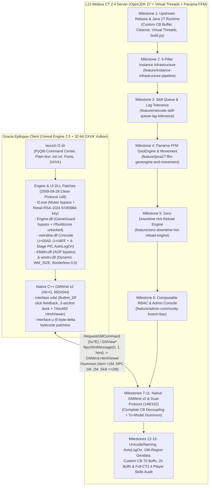

# Lineage 2 Gracia Epilogue (`CT2.4`) — Full Project Context & Engineering Ledger

**Repository:** `dwea0935/l2jmobius_dwea_fork.git` (`master` + 7 dedicated feature/client branches)  
**Server Workspace:** [`/home/dwea/Projects/L2/l2jmobius_dwea_fork`](file:///home/dwea/Projects/L2/l2jmobius_dwea_fork)  
**Client Workspace:** [`/home/dwea/Projects/L2/Client Lineage 2 Gracia Epilogue`](file:///home/dwea/Projects/L2/Client%20Lineage%202%20Gracia%20Epilogue) (and version-controlled [`client/system/`](file:///home/dwea/Projects/L2/l2jmobius_dwea_fork/client/system))  
**Target Runtime:** OpenJDK 27 (`javac --release 27`, Generational ZGC, Project Panama FFM, Project Loom Virtual Threads) + Unreal Engine 2.5 (`PE32` + 32-bit DXVK Vulkan)

---

## 1. Index of Persistent Project Documentation (Committed to `master`)

To keep project context durable across machines and future AI sessions, the repository maintains **8 specialized markdown documents** at the root of [`l2jmobius_dwea_fork`](file:///home/dwea/Projects/L2/l2jmobius_dwea_fork):

| Document | Scope & Purpose |
| :--- | :--- |
| 1. [`FULL_PROJECT_ENGINEERING_LEDGER.md`](file:///home/dwea/Projects/L2/l2jmobius_dwea_fork/FULL_PROJECT_ENGINEERING_LEDGER.md) | **This Master Index:** Chronological ledger of every milestone, branch, commit, binary patch, and server subsystem built since project inception. |
| 2. [`MASTER_HANDOFF_AND_CLIENT_SERVER_GUIDE.md`](file:///home/dwea/Projects/L2/l2jmobius_dwea_fork/MASTER_HANDOFF_AND_CLIENT_SERVER_GUIDE.md) | **Unified Client + Server Handoff Guide:** Consolidates work from both autonomous agents, including `GMWnd` (`Alt+G`) C++ console architecture, `interface.xdat`/`interface.u` patches, `.dat` catalog, and work-PC agent prompt. |
| 3. [`CLIENT_MASTER_ARCHITECTURE_AND_GUIDE.md`](file:///home/dwea/Projects/L2/l2jmobius_dwea_fork/CLIENT_MASTER_ARCHITECTURE_AND_GUIDE.md) | **Client Reverse-Engineering & Linux Guide:** Deep dive into `Lineage2Ver111`/`413` encryption, `d3ddrv.dll` & `windrv.dll` x86 patches, `launch-l2.sh`, DXVK Vulkan, TrueType fonts, and `JOYPAD` controller bindings. |
| 4. [`PROJECT_MASTER_CONTEXT_AND_ROADMAP.md`](file:///home/dwea/Projects/L2/l2jmobius_dwea_fork/PROJECT_MASTER_CONTEXT_AND_ROADMAP.md) | **Server Vision, 5-Pillar Instance Pipeline & Roadmap:** Server progression philosophy, Crystal Caverns / Hellbound / Tully / Naia forensics, the 5-Pillar Instance Pipeline, and next queued tasks (Tasks B & C). |
| 5. [`SKILL_QUEUE_AND_LAG_TOLERANCE.md`](file:///home/dwea/Projects/L2/l2jmobius_dwea_fork/SKILL_QUEUE_AND_LAG_TOLERANCE.md) | **Combat Netcode & Input Buffering:** Retail skill queue (`_queuedSkill`), cooldown-boundary tolerance (`_pendingReuseSkill`), `Ctrl` force-cast fix, cached `NetPing` RTT, and `.queue` / `.latency` player commands. |
| 6. [`GEOENGINE_AND_MOVEMENT_ARCHITECTURE.md`](file:///home/dwea/Projects/L2/l2jmobius_dwea_fork/GEOENGINE_AND_MOVEMENT_ARCHITECTURE.md) | **Java 27 Panama FFM GeoEngine & Movement:** Off-heap `MemorySegment` geodata (~15M heap objects eliminated), $O(1)$ multilayer cell offsets, fused `getNearestZAndNswe`, CAS `NodeBuffer` pool, and lock-free `MovementTaskManager`. |
| 7. [`HOT_RELOAD_ENGINE_ARCHITECTURE.md`](file:///home/dwea/Projects/L2/l2jmobius_dwea_fork/HOT_RELOAD_ENGINE_ARCHITECTURE.md) | **Zero-Downtime Script Hot-Reload Engine:** Child-first disposable `ScriptClassLoader`, Java 27 `ClassFile` bytecode validation, compile-before-unload transaction safety, live NPC adoption (`_handoverSpawns`), and `< 2ms` skill effect hot-swap. |
| 8. [`ADMIN_COMMUNITY_BOARD_RBAC_ARCHITECTURE.md`](file:///home/dwea/Projects/L2/l2jmobius_dwea_fork/ADMIN_COMMUNITY_BOARD_RBAC_ARCHITECTURE.md) | **Java 27 RBAC & Admin Console:** 13 composable `AdminScope` capabilities across 8 GM tiers (`10..100`), 2009 client HTML 3.2 crash fixes, automatic `NpcHtmlMessage` RBAC scrubber, and purge/consolidation of 11 legacy handlers (`80 -> 69`). |
| 9. [`LESSONS_LEARNED_AND_FORENSICS.md`](file:///home/dwea/Projects/L2/l2jmobius_dwea_fork/LESSONS_LEARNED_AND_FORENSICS.md) | **Reverse-Engineering & Forensics Dossier (Sections 1–10):** Deep-dive post-mortems on `[AutoLogOn]`, CLI `WinMain` stripping, `Option.ini` `FirstRun < 2110` trap, `00010084 1289` crash, Protocol `148` vs `152`, PE `.reloc` rebasing trap, DualSense controller quirks, `///buildzone` geodata builder, player skill/channelizer backports, 3rd-prof passives/triggers, and custom CB/config audits. |
| 10. [`AGENT_SYNC_AND_RECONCILIATION.md`](file:///home/dwea/Projects/L2/l2jmobius_dwea_fork/AGENT_SYNC_AND_RECONCILIATION.md) | **Multi-Agent Reconciliation & Ownership Ledger:** Tracks the 4-Agent engineering topology (Server, Client, DevOps, Auditor), cross-repo synchronization status, and automated audit routines (`tools/auditor/l2_auditor.py`). |
| 11. [`ADMIN_CB_COUPLING_AUDIT.md`](file:///home/dwea/Projects/L2/l2jmobius_dwea_fork/ADMIN_CB_COUPLING_AUDIT.md) | **Admin Console ↔ Community Board Decoupling Spec:** Audit and verification checklist for separating the player Community Board (`Alt+B`) from the native C++ `GMWnd` (`Alt+G`) Admin Console. |

---

## 2. End-to-End Architecture & Branch Topology

---

## 3. Chronological Engineering Ledger (All 15 Milestones)

### Milestone 1: Upstream Rebase, Chronicle Pruning & Java 27 Upgrade
* **Commits:** `074d3d6a33c`, `b4269b6fc70`, `bf4067a3553`
* **Key Accomplishments:**
  1. **Rebased Custom Epilogue Features onto Upstream Mobius (`074d3d6a33c`):** Preserved custom Community Board Buffer UI (`data/html/CommunityBoard/Custom/buffer/*.html`), `.cleanse`, and Premium Buff integration in [`HomeBoard.java`](file:///home/dwea/Projects/L2/l2jmobius_dwea_fork/L2J_Mobius_CT_2.4_Epilogue/dist/game/data/scripts/handlers/bypass/communityboard/HomeBoard.java) and [`PremiumManager.java`](file:///home/dwea/Projects/L2/l2jmobius_dwea_fork/L2J_Mobius_CT_2.4_Epilogue/java/org/l2jmobius/gameserver/managers/PremiumManager.java).
  2. **Single-Chronicle Focus (`b4269b6fc70`):** Removed non-Epilogue chronicle folders from the repository so the workspace exclusively targets `L2J_Mobius_CT_2.4_Epilogue`.
  3. **Java 27 & Project Loom Virtual Threads (`bf4067a3553`):**
     * Upgraded [`build.xml`](file:///home/dwea/Projects/L2/l2jmobius_dwea_fork/L2J_Mobius_CT_2.4_Epilogue/build.xml) and added [`build.py`](file:///home/dwea/Projects/L2/l2jmobius_dwea_fork/L2J_Mobius_CT_2.4_Epilogue/build.py) targeting `javac --release 27`.
     * Added `ThreadPool.executeVirtual(...)` (`Executors.newVirtualThreadPerTaskExecutor()`) in [`ThreadPool.java`](file:///home/dwea/Projects/L2/l2jmobius_dwea_fork/L2J_Mobius_CT_2.4_Epilogue/java/org/l2jmobius/commons/threads/ThreadPool.java) for non-blocking asynchronous database and I/O tasks.

---

### Milestone 2: The 5-Pillar Core Instance Infrastructure Pipeline
* **Branch:** `origin/feature/instance-infrastructure-pipeline` (Merged to `master`, commits `b3488df54f5`, `09dcbd9a178`)
* **Problem Solved:** Stock L2J Mobius suffered from catastrophic dungeon state loss whenever a player crashed or disconnected inside an instance (duo parties immediately disbanded, disconnected players logged back into empty "Instance 0" behind locked doors, and static `QuestTimer` names collided across concurrent party instances).
* **5 Architectural Pillars Implemented:**
  1. **Pillar 1 — Offline SQL Batch Evacuation & Instance 0 Sentinel:**
     * [`Instance.java`](file:///home/dwea/Projects/L2/l2jmobius_dwea_fork/L2J_Mobius_CT_2.4_Epilogue/java/org/l2jmobius/gameserver/entity/instancezone/Instance.java): When an instance expires or is destroyed, `removePlayers()` collects all offline player IDs and executes an async Virtual Thread SQL batch (`UPDATE characters SET x=?, y=?, z=? WHERE charId=?`) moving them to `_exitLocation`.
     * [`EnterWorld.java`](file:///home/dwea/Projects/L2/l2jmobius_dwea_fork/L2J_Mobius_CT_2.4_Epilogue/java/org/l2jmobius/gameserver/network/clientpackets/EnterWorld.java): If a player logs in with `instanceId == 0` inside a `ZoneId.NO_RESTART` dungeon boundary, they are automatically evacuated to the nearest town.
  2. **Pillar 2 — Party Slot Reservation & Disconnect Grace Period:**
     * [`Party.java`](file:///home/dwea/Projects/L2/l2jmobius_dwea_fork/L2J_Mobius_CT_2.4_Epilogue/java/org/l2jmobius/gameserver/entity/groups/Party.java): Added a `DisconnectedMember` state machine with a configurable 5-minute grace window (`GeneralConfig.INSTANCE_DISCONNECT_GRACE_PERIOD = 300` in [`General.ini`](file:///home/dwea/Projects/L2/l2jmobius_dwea_fork/L2J_Mobius_CT_2.4_Epilogue/dist/game/config/General.ini)). A duo party no longer implodes when one player disconnects; reconnecting within 5 minutes seamlessly restores party membership, leadership, and Party UI windows (`PartySmallWindowAll`) **after** `player.spawnMe()` in `EnterWorld.java`.
  3. **Pillar 3 — Re-Entry Coordinate Tracking & `getResumeLocation` Hook:**
     * [`InstanceWorld.java`](file:///home/dwea/Projects/L2/l2jmobius_dwea_fork/L2J_Mobius_CT_2.4_Epilogue/java/org/l2jmobius/gameserver/entity/instancezone/InstanceWorld.java) & [`InstanceScript.java`](file:///home/dwea/Projects/L2/l2jmobius_dwea_fork/L2J_Mobius_CT_2.4_Epilogue/java/org/l2jmobius/gameserver/mechanics/script/InstanceScript.java): Records last valid inside-dungeon coordinates on disconnect and exposes `getResumeLocation(Player, InstanceWorld)` for multi-wing dungeons (`CrystalCaverns`, `DarkCloudMansion`).
  4. **Pillar 4 — Instance-Scoped Timer Engine:**
     * [`InstanceWorld.java`](file:///home/dwea/Projects/L2/l2jmobius_dwea_fork/L2J_Mobius_CT_2.4_Epilogue/java/org/l2jmobius/gameserver/entity/instancezone/InstanceWorld.java): Added `scheduleTimer`, `scheduleRepeatingTimer`, and `cancelTimer` scoped strictly to the `InstanceWorld` lifecycle (`ConcurrentHashMap<String, ScheduledFuture<?>>`), automatically cancelling all tasks on `Instance.destroy()`.
  5. **Pillar 5 — Multi-Script `EventDispatcher` Chaining Verification:**
     * [`EventDispatcher.java`](file:///home/dwea/Projects/L2/l2jmobius_dwea_fork/L2J_Mobius_CT_2.4_Epilogue/java/org/l2jmobius/gameserver/mechanics/events/EventDispatcher.java): Verified and documented that multiple scripts (`TullyWorkshop` and `TowerOfNaia`) can safely register `onFirstTalk` listeners on shared NPC IDs (`32370`).

---

### Milestone 3: Combat Netcode — Skill Queue & Dynamic Action Lag Tolerance
* **Branch:** `origin/feature/netcode-skill-queue-lag-tolerance` (Merged to `master`, commit `6c824e6faf8`, plus `ctrlPressed` fix in `db33430559f`)
* **Documentation:** [`SKILL_QUEUE_AND_LAG_TOLERANCE.md`](file:///home/dwea/Projects/L2/l2jmobius_dwea_fork/SKILL_QUEUE_AND_LAG_TOLERANCE.md)
* **Key Accomplishments:**
  1. **Recast & Combo Buffering (`_queuedSkill` in [`Player.java`](file:///home/dwea/Projects/L2/l2jmobius_dwea_fork/L2J_Mobius_CT_2.4_Epilogue/java/org/l2jmobius/gameserver/entity/actor/Player.java)):** Eliminated the recast lockout in `Player.useMagic()` so mages and fighters can buffer consecutive casts (including same-skill recasts and `Ctrl`-forced casts via `SkillUseHolder.isCtrlPressed()`) with 0ms dead air between animations.
  2. **Pre-Cooldown Expiration Scheduling (`_pendingReuseSkill` in [`Player.java`](file:///home/dwea/Projects/L2/l2jmobius_dwea_fork/L2J_Mobius_CT_2.4_Epilogue/java/org/l2jmobius/gameserver/entity/actor/Player.java)):** If a player presses a skill within `queueWindow` (`50..500ms`) of its cooldown expiring, the server schedules execution on the exact millisecond the reuse timer finishes instead of dropping the input.
  3. **Mid-Movement Skill Queuing:** Allows buffering a spell while moving so it fires immediately on arrival.
  4. **Zero-Syscall RTT Tracking & `.queue` / `.latency` Voiced Commands:**
     * Added `NetPing` / `RequestNetPing` RTT measurement cached in `GameClient` (`player.getPing()`) and wired [`SkillQueue.java`](file:///home/dwea/Projects/L2/l2jmobius_dwea_fork/L2J_Mobius_CT_2.4_Epilogue/dist/game/data/scripts/handlers/chat/commands/voiced/SkillQueue.java) (`.queue auto`, `.queue <ms>`, `.queue off`).
     * Tuned [`Network.ini`](file:///home/dwea/Projects/L2/l2jmobius_dwea_fork/L2J_Mobius_CT_2.4_Epilogue/dist/game/config/Network.ini) (`UseNagle = False` / `TCP_NODELAY`, `128 KB` socket buffers).

---

### Milestone 4: Java 27 Project Panama FFM Off-Heap GeoEngine & Lock-Free Movement
* **Branch:** `origin/feature/java27-ffm-geoengine-and-movement` (Merged to `master`, commit `6b08afaa1d2`, plus dynamic mutation fix in `db33430559f`)
* **Documentation:** [`GEOENGINE_AND_MOVEMENT_ARCHITECTURE.md`](file:///home/dwea/Projects/L2/l2jmobius_dwea_fork/GEOENGINE_AND_MOVEMENT_ARCHITECTURE.md)
* **Key Accomplishments:**
  1. **Zero-Copy Off-Heap `MemorySegment` Geodata ([`Region.java`](file:///home/dwea/Projects/L2/l2jmobius_dwea_fork/L2J_Mobius_CT_2.4_Epilogue/java/org/l2jmobius/gameserver/geoengine/geodata/regions/Region.java), [`GeoEngine.java`](file:///home/dwea/Projects/L2/l2jmobius_dwea_fork/L2J_Mobius_CT_2.4_Epilogue/java/org/l2jmobius/gameserver/geoengine/GeoEngine.java)):**
     * Replaced `IBlock[65536]` (~15,000,000 heap objects across 130 regions, ~1.5 GB heap) with a Project Panama `MemorySegment` (`Arena.ofAuto()`) and a packed `int[65536] _blockDescriptors` table (`DESC_FLAT`, `DESC_COMPLEX`, `DESC_MULTILAYER`, `DESC_MUTATED` Copy-on-Write for Doors/Fences).
     * Parallelized startup `.l2j` region loading across Java 27 Virtual Threads.
  2. **$O(1)$ Multilayer Cell Offset Indexing & Fused `getNearestZAndNswe` ([`MultilayerBlock.java`](file:///home/dwea/Projects/L2/l2jmobius_dwea_fork/L2J_Mobius_CT_2.4_Epilogue/java/org/l2jmobius/gameserver/geoengine/geodata/blocks/MultilayerBlock.java), [`ComplexBlock.java`](file:///home/dwea/Projects/L2/l2jmobius_dwea_fork/L2J_Mobius_CT_2.4_Epilogue/java/org/l2jmobius/gameserver/geoengine/geodata/blocks/ComplexBlock.java), [`NodeBuffer.java`](file:///home/dwea/Projects/L2/l2jmobius_dwea_fork/L2J_Mobius_CT_2.4_Epilogue/java/org/l2jmobius/gameserver/geoengine/pathfinding/NodeBuffer.java)):**
     * Precomputed `_mlCellOffsets` / `_cellOffsets` tables (eliminating the $O(64)$ linear byte-scanning loop) and fused `getNearestZAndNswe(geoX, geoY, worldZ)` (cutting A* pathfinding `NodeBuffer.touch()` geodata lookups by **80%**, from 5 calls per node to 1).
  3. **Virtual-Thread-Safe Striped CAS `NodeBuffer` Pool ([`PathFinding.java`](file:///home/dwea/Projects/L2/l2jmobius_dwea_fork/L2J_Mobius_CT_2.4_Epilogue/java/org/l2jmobius/gameserver/geoengine/pathfinding/PathFinding.java)):**
     * Replaced `ThreadLocal<NodeBuffer[]>` with a bounded striped `AtomicReferenceArray<NodeBuffer>[]` pool leased via lock-free `AtomicBoolean.compareAndSet`.
  4. **Lock-Free Fibonacci-Sharded `MovementTaskManager` ([`MovementTaskManager.java`](file:///home/dwea/Projects/L2/l2jmobius_dwea_fork/L2J_Mobius_CT_2.4_Epilogue/java/org/l2jmobius/gameserver/taskmanagers/MovementTaskManager.java)):**
     * Removed global `synchronized` monitor contention and $O(P)$ `.contains()` scans, routing moving Players (`4` shards @ 50ms) and Creatures (`8` shards @ 100ms) in $O(1)$ lock-free time via Fibonacci hashing on `objectId`.

---

### Milestone 5: Zero-Downtime Transactional Script Hot-Reload Engine
* **Branch:** `origin/feature/zero-downtime-hot-reload-engine` (Merged to `master`, commit `40131d79438`)
* **Documentation:** [`HOT_RELOAD_ENGINE_ARCHITECTURE.md`](file:///home/dwea/Projects/L2/l2jmobius_dwea_fork/HOT_RELOAD_ENGINE_ARCHITECTURE.md)
* **Key Accomplishments:**
  1. **Disposable Child-First `ScriptClassLoader` & Java 27 `ClassFile` Validation ([`ScriptClassLoader.java`](file:///home/dwea/Projects/L2/l2jmobius_dwea_fork/L2J_Mobius_CT_2.4_Epilogue/java/org/l2jmobius/gameserver/scripting/engine/ScriptClassLoader.java), [`ScriptExecutor.java`](file:///home/dwea/Projects/L2/l2jmobius_dwea_fork/L2J_Mobius_CT_2.4_Epilogue/java/org/l2jmobius/gameserver/scripting/engine/ScriptExecutor.java)):**
     * Fixed the upstream static `SCRIPT_CLASS_LOADER` bug where `findLoadedClass` always returned stale boot-time classes.
     * Validates compiled bytecode with `java.lang.classfile.ClassFile.of().parse(bytes)` and groups `$` inner/lambda nestmates (`JEP 181`) in the same disposable loader while reusing unchanged base classes (`AbstractNpcAI`) in $O(1)$ time.
  2. **Compile-Before-Unload Transaction & Live Init-Spawn NPC Adoption ([`ScriptManager.java`](file:///home/dwea/Projects/L2/l2jmobius_dwea_fork/L2J_Mobius_CT_2.4_Epilogue/java/org/l2jmobius/gameserver/managers/ScriptManager.java), [`Quest.java`](file:///home/dwea/Projects/L2/l2jmobius_dwea_fork/L2J_Mobius_CT_2.4_Epilogue/java/org/l2jmobius/gameserver/mechanics/script/Quest.java)):**
     * Syntax errors abort compilation *before* `prepareHotReload` unloads the live script.
     * Alive constructor-spawned open-world NPCs are staged in `_handoverSpawns` and adopted by `Quest.addSpawn` (`tryAdoptInitSpawn`), preserving HP, aggro, and combat state without duplicate spawns.
  3. **In-Memory Skill `AbstractEffect` Hot-Swap (`< 2ms`, Zero XML I/O):**
     * Reloading any `AbstractEffect` script (`//reload script Blink`) automatically calls `SkillData.getInstance().refreshEffectHandler(name)`, swapping live `AbstractEffect` instances across all loaded `Skill`s in `< 2ms`.
  4. **Surgical Single-File Reloading (`//reload script <name|path>`):**
     * Upgraded all 8 `*Handler` registries to `ConcurrentHashMap` and added standalone handler/effect auto-registration (~29ms single-file hot-swap).

---

### Milestone 6: Java 27 Composable RBAC (`AdminScope`), 2009 Client HTML Safety & Cross-Pillar Audit
* **Branch:** `origin/feature/admin-community-board-rbac` (Merged to `master`, commits `8a6534aefce`, `db33430559f`)
* **Documentation:** [`ADMIN_COMMUNITY_BOARD_RBAC_ARCHITECTURE.md`](file:///home/dwea/Projects/L2/l2jmobius_dwea_fork/ADMIN_COMMUNITY_BOARD_RBAC_ARCHITECTURE.md)
* **Key Accomplishments:**
  1. **13 Composable `AdminScope` Capabilities ([`AdminScope.java`](file:///home/dwea/Projects/L2/l2jmobius_dwea_fork/L2J_Mobius_CT_2.4_Epilogue/java/org/l2jmobius/gameserver/data/enums/AdminScope.java), [`AccessLevels.xml`](file:///home/dwea/Projects/L2/l2jmobius_dwea_fork/L2J_Mobius_CT_2.4_Epilogue/dist/game/config/AccessLevels.xml)):**
     * Replaced flat integer checks with composable RBAC scopes across 8 functional staff roles (`10 Chat Moderator` through `100 Master`), while `User (0)` and `Banned (-1)` have `isGM="false"` and `scopes="NONE"`.
     * Synced `UserInfo.java` (`builderLevel = _player.isGM() && _player.getAccessLevel().allowAltG()`), `RequestGMCommand.java` (`PLAYER_SUPPORT` scope check), and `EnterWorld.java` (`EVENT_GM` scope check for GM special skills).
  2. **2009 Gracia Epilogue Client `ShowBoard` Crash Fixes ([`ShowBoard.java`](file:///home/dwea/Projects/L2/l2jmobius_dwea_fork/L2J_Mobius_CT_2.4_Epilogue/java/org/l2jmobius/gameserver/network/serverpackets/ShowBoard.java), [`HtmlUtil.java`](file:///home/dwea/Projects/L2/l2jmobius_dwea_fork/L2J_Mobius_CT_2.4_Epilogue/java/org/l2jmobius/gameserver/util/HtmlUtil.java)):**
     * Fixed `null` `"102\u0008null"` string corruption in `ShowBoard` and restored `4,090`-char per-packet chunking (`12,270` chars max across `101`/`102`/`103`) matching `NWindow.dll`'s buffer limits.
  3. **Dynamic `NpcHtmlMessage` Interceptor & RBAC HTML Scrubber ([`AdminBoardManager.java`](file:///home/dwea/Projects/L2/l2jmobius_dwea_fork/L2J_Mobius_CT_2.4_Epilogue/java/org/l2jmobius/gameserver/managers/AdminBoardManager.java)):**
     * Built 6 wide-screen 740px workspaces (`Dashboard`, `Support & Players`, `World & Spawns`, `Events & GM`, `Items & Chars`, `Server & Reload`) with max 2-level table nesting, automatic legacy `NpcHtmlMessage` capture, unauthorized button/link scrubbing, and `qbox` `<edit>` deduplication.
  4. **Legacy Admin Handler Purge & Consolidation (`80 -> 69` Handlers):**
     * Deleted 5 broken/obsolete 2004 handlers (`AdminCamera`, `AdminFightCalculator`, `AdminPathNode`, `AdminTargetSay`, `AdminTest`) and merged 6 redundant handlers (`AdminDisconnect` $\rightarrow$ `AdminKick`, `AdminSuperHaste` $\rightarrow$ `AdminGmSpeed`, `AdminInstanceZone` $\rightarrow$ `AdminInstance`, `AdminPledge` $\rightarrow$ `AdminClan`, `AdminZoneBuild` $\rightarrow$ `AdminZone`, `AdminShowQuests` $\rightarrow$ `AdminQuest`).

---

### Milestone 7: Client Reverse-Engineering, Linux/DXVK Launcher & Unified Native C++ `GMWnd` (`Alt+G`) Master Console
* **Branches:** `origin/feature/native-gmwnd-console` & `origin/client/gracia-epilogue-system` (Merged to `master`, commits `9a029c459a8`..`9ddf57e6c12`)
* **Documentation:** [`MASTER_HANDOFF_AND_CLIENT_SERVER_GUIDE.md`](file:///home/dwea/Projects/L2/l2jmobius_dwea_fork/MASTER_HANDOFF_AND_CLIENT_SERVER_GUIDE.md) & [`CLIENT_MASTER_ARCHITECTURE_AND_GUIDE.md`](file:///home/dwea/Projects/L2/l2jmobius_dwea_fork/CLIENT_MASTER_ARCHITECTURE_AND_GUIDE.md)
* **Key Accomplishments (Multi-Agent Collaboration):**
  1. **100% Decrypted Plain-Text `.ini` & `.int` Configs + `launch-l2.sh` (Agent 2):**
     * Stripped `Lineage2Ver111`/`413` encryption from all 30 `.ini`/`.int` files in [`client/system/`](file:///home/dwea/Projects/L2/l2jmobius_dwea_fork/client/system) (backups in [`client/system/backup_encrypted/`](file:///home/dwea/Projects/L2/l2jmobius_dwea_fork/client/system/backup_encrypted)).
     * Created [`launch-l2.sh`](file:///home/dwea/Projects/L2/l2jmobius_dwea_fork/client/launch-l2.sh) with 32-bit DXVK (`d3d9.dll` $\rightarrow$ Vulkan), TrueType UI fonts (`tahoma.ttf`, `times.ttf`, `arial.ttf`), `dsetup=n,b` override, CLI flags (`-server`, `-login`, `-pass`, `-slot`, `--res`, `--borderless`, `--windowed`, `--fullscreen`, `--gamepad`, `--check`), and modernized XInput/SDL2 `JOYPAD` bindings in `user.ini`.
  2. **Binary Engine DLL Patches (`d3ddrv.dll` & `windrv.dll` — Agent 2):**
     * [`d3ddrv.dll`](file:///home/dwea/Projects/L2/l2jmobius_dwea_fork/client/system/d3ddrv.dll) (`0xC2494`/`0xC24A4`: `74 22` $\rightarrow$ `90 90`): Silenced obsolete 2004 AGP warning dialog.
     * [`windrv.dll`](file:///home/dwea/Projects/L2/l2jmobius_dwea_fork/client/system/windrv.dll) (5 x86 patches): Enabled real-time drag window resizing (`WM_SIZE` $\rightarrow$ `SetRes`), OS Maximize button without cursor-trapping or forced exclusive fullscreen, XWayland async geometry safety, and `(0,0)` Borderless Windowed mode (`UseWindowFrame=False`).
  3. **Unified Native C++ `GMWnd` (`Alt+G`) Master Console ([`interface.xdat`](file:///home/dwea/Projects/L2/l2jmobius_dwea_fork/client/system/interface.xdat), [`interface.u`](file:///home/dwea/Projects/L2/l2jmobius_dwea_fork/client/system/interface.u), [`patch_gmwnd_client.py`](file:///home/dwea/Projects/L2/l2jmobius_dwea_fork/client/patch_gmwnd_client.py), [`AdminBoardManager.java`](file:///home/dwea/Projects/L2/l2jmobius_dwea_fork/L2J_Mobius_CT_2.4_Epilogue/java/org/l2jmobius/gameserver/managers/AdminBoardManager.java), [`AdminSummon.java`](file:///home/dwea/Projects/L2/l2jmobius_dwea_fork/L2J_Mobius_CT_2.4_Epilogue/dist/game/data/scripts/handlers/chat/commands/admin/AdminSummon.java) — Agent 1):**
     * Expanded `GMWnd` (`Alt+G`) to `992 x 544` px with a 2-column native C++ left control dock (`x=10..225`) and an embedded right-hand `GMWnd.HtmlViewer` (`744 x 492` px).
     * Patched 7 UnrealScript functions in `interface.u` with 0-byte size delta so `NpcHtmlMessage(0, 1, html)` (`EV_ItemDescWndLoadHtmlFromString`) renders directly into `GMWnd.HtmlViewer` with zero `PageLock`, `Alt+G` auto-triggers `//gmw`, `Administrator` triggers `//admin`, untargeting preserves `GMWnd.EditBox`, and `GMFindTreeWnd` -> `Skill Search` enables `Summon` with `+ 2,000,000` skill ID offset handled by `AdminSummon.java` and `AdminSkill.java`.

---

### Milestone 8: Local Dockerized Test Environment & `build.py` Packaging Fixes (Agent 3)
* **Files:** [`docker-compose.yml`](file:///home/dwea/Projects/L2/docker-compose.yml), [`docker/run-server.sh`](file:///home/dwea/Projects/L2/docker/run-server.sh), [`docker/db-init/01-l2jmobius-schema.sh`](file:///home/dwea/Projects/L2/docker/db-init/01-l2jmobius-schema.sh), [`build.py`](file:///home/dwea/Projects/L2/l2jmobius_dwea_fork/L2J_Mobius_CT_2.4_Epilogue/build.py), [`AGENT_SYNC_AND_RECONCILIATION.md`](file:///home/dwea/Projects/L2/AGENT_SYNC_AND_RECONCILIATION.md)
* **Key Accomplishments & Findings:**
  1. **3-Container Host-Networked Docker Stack (`l2-db`, `l2-login`, `l2-game`):**
     * `l2-db` (`mariadb:11.8` on `127.0.0.1:3306`) automatically initializes `l2jmobiusepilogue` with all **116 SQL tables** (`db_installer/sql/login/*.sql` + `sql/game/*.sql`) on first volume boot via `01-l2jmobius-schema.sh`.
     * `l2-login` (`0.0.0.0:2106`, GS link `127.0.0.1:9014`) and `l2-game` (`0.0.0.0:7777`, registered as **Server 2: Sieghardt**) run on `eclipse-temurin:27-jdk` with `-Djava.awt.headless=true` and `--enable-native-access=ALL-UNNAMED`.
  2. **Root-Cause Fix for `LoginServer.jar` Missing `gameserverpackets` (`InitLS`):**
     * Agent 3 discovered that [`build.py`](file:///home/dwea/Projects/L2/l2jmobius_dwea_fork/L2J_Mobius_CT_2.4_Epilogue/build.py#L125-L127) used `exclude_patterns=["*databaseinstaller*", "*gameserver*"]` when building `LoginServer.jar`. Because Python's `fnmatch` `*` matches `/`, `*gameserver*` inadvertently stripped `org/l2jmobius/loginserver/network/gameserverpackets/**` (18 classes including `InitLS`), crashing the GameServer↔LoginServer handshake.
     * Fixed `build.py` to anchor the exclusion to `"org/l2jmobius/gameserver/*"`, repacked `LoginServer.jar` (`153 -> 171` entries), and restored the full `META-INF/MANIFEST.MF` (`Main-Class` & `Class-Path`) in `GameServer.jar`.

---

### Milestone 9: Client Login Crash (`00010084 1289`) Forensic Resolution & Clean `2009-09-28` (`L2 Epilogue Clean`) Unification
* **Commits:** `7636477796b`..`d35432adcb8`
* **Files:** [`client/system/l2.exe`](file:///home/dwea/Projects/L2/l2jmobius_dwea_fork/client/system/l2.exe), [`client/system/Engine.dll`](file:///home/dwea/Projects/L2/l2jmobius_dwea_fork/client/system/Engine.dll), [`client/system/Core.dll`](file:///home/dwea/Projects/L2/l2jmobius_dwea_fork/client/system/Core.dll), [`client/system/windrv.dll`](file:///home/dwea/Projects/L2/l2jmobius_dwea_fork/client/system/windrv.dll), [`client/system/d3ddrv.dll`](file:///home/dwea/Projects/L2/l2jmobius_dwea_fork/client/system/d3ddrv.dll), [`client/system/dsetup.dll`](file:///home/dwea/Projects/L2/l2jmobius_dwea_fork/client/system/dsetup.dll), [`client/system/interface.xdat`](file:///home/dwea/Projects/L2/l2jmobius_dwea_fork/client/system/interface.xdat), [`client/system/interface.u`](file:///home/dwea/Projects/L2/l2jmobius_dwea_fork/client/system/interface.u), [`client/launch-l2.sh`](file:///home/dwea/Projects/L2/l2jmobius_dwea_fork/client/launch-l2.sh)
* **Root Causes & Resolution:**
  1. **Hybrid Binary / Vtable Mismatch (`2010-07-16` vs `2009-09-28`):** Replaced the mixed `2010-07-16` (`Protocol 152`) / `2009-09-28` (`Protocol 148`) binaries with the **100% unpacked, version-matched `2009-09-28` (`Protocol 148`) build** from `/home/dwea/Projects/L2/L2 Epilogue Clean/system/` (preserving backups in `system/backup_hybrid_152/` and removing `unichat.dll`).
  2. **`l2.exe` (`434,176` B) & `dsetup.dll` (`8,704` B) Patches:** Aliased `?GL2RunningFirstHandle@@3PAXA` $\rightarrow$ `?GIsServer@@3HA`, NOPed the mutex handle store at `0x25CEE` (`89 01` $\rightarrow$ `90 90`), updated the `Lineage2Ver413` RSA-1024 modulus (`0x2F500`) and exponent (`0x2F604`) to NCSoft's official retail key (`97df3984...`, `e = 0x35`), and rebased `dsetup.dll` to `0x12000000`.
  3. **`Engine.dll`, `d3ddrv.dll` & `windrv.dll` (`2009-09-28`) Patches:** Bypassed GameGuard in `Engine.dll` (`0x39B750`: `33 c0 fe c0 c3`), silenced the AGP warning in `d3ddrv.dll` (`0xC24A4`: `90 90`), and applied all 5 dynamic window-resize/borderless patches to `windrv.dll` (`+0x70` offsets: `0x1101F`, `0x111B1`, `0x0D4AA`, `0x0D529`, `0x0E8D5`).

---

### Milestone 10: `2009-09-28` `Engine.dll` 439-Handler Packet Alignment & Option C Dual-Protocol (`148` + `152`) Hardening
* **Commits:** `33205b9c184`, `e0eb703f9e6`, `7604d41d265`, `14933860a51`, `9419c4d7b5a`
* **Key Accomplishments:**
  1. **Protocol-Conditional Item Serialization (`70` B vs `76` B):** Gated the trailing 3× `short` `EnchantOptions` (`6` bytes) on `isProtocol152(client)` across [`AbstractItemPacket.java`](file:///home/dwea/Projects/L2/l2jmobius_dwea_fork/L2J_Mobius_CT_2.4_Epilogue/java/org/l2jmobius/gameserver/network/serverpackets/AbstractItemPacket.java) and all 21 item/shop/warehouse/trade/pet/store/mail packet classes, eliminating the `NConsoleWindow.cpp:4212` `iWorkType` assertion crash on Protocol `148` clients while simultaneously supporting Protocol `152` clients (`AllowedProtocolRevisions = 148;152`).
  2. **Swapped Extended Opcode Branching (`0xFE:0xBD` vs `0xFE:0xBE`) & Broadcast-Cache Opt-Out (`isProtocolSensitive()`):** Updated `ExBrExtraUserInfo.java` and `ExBrBroadcastEventState.java` to branch on `isProtocol152(client)`, added `isProtocolSensitive()` and `_broadcastRequested` tripwire in [`ServerPacket.java`](file:///home/dwea/Projects/L2/l2jmobius_dwea_fork/L2J_Mobius_CT_2.4_Epilogue/java/org/l2jmobius/gameserver/network/serverpackets/ServerPacket.java), ordered `sendSkillList()` before `ShortcutInit` in `EnterWorld.java` and `Player.java`, and added Protocol-148 `SystemMessageId.S1_2` (`$s1`) text fallback for IDs `3093..3207` in [`SystemMessage.java`](file:///home/dwea/Projects/L2/l2jmobius_dwea_fork/L2J_Mobius_CT_2.4_Epilogue/java/org/l2jmobius/gameserver/network/serverpackets/SystemMessage.java).

---

### Milestone 11: Admin Console ↔ Community Board Full Decoupling & Native C++ `GMWnd` (`Alt+G`) Admin Panel v2
* **Commits:** `9973fd039af`, `a9bc33c79ff`, `3dc24796dcd`
* **Documentation:** [`ADMIN_CB_COUPLING_AUDIT.md`](file:///home/dwea/Projects/L2/l2jmobius_dwea_fork/ADMIN_CB_COUPLING_AUDIT.md), [`AGENT_SYNC_AND_RECONCILIATION.md`](file:///home/dwea/Projects/L2/l2jmobius_dwea_fork/AGENT_SYNC_AND_RECONCILIATION.md) (§4)
* **Key Accomplishments:**
  1. **100% Decoupling of Player Community Board (`Alt+B`):** Removed all GM banners, `tryInterceptAdminBoardHtml` hooks, content-sniffing in `Player.sendPacket`, and `ShowBoard` rendering paths from [`HomeBoard.java`](file:///home/dwea/Projects/L2/l2jmobius_dwea_fork/L2J_Mobius_CT_2.4_Epilogue/dist/game/data/scripts/handlers/bypass/communityboard/HomeBoard.java), [`HtmlUtil.java`](file:///home/dwea/Projects/L2/l2jmobius_dwea_fork/L2J_Mobius_CT_2.4_Epilogue/java/org/l2jmobius/gameserver/util/HtmlUtil.java), [`AdminBoardManager.java`](file:///home/dwea/Projects/L2/l2jmobius_dwea_fork/L2J_Mobius_CT_2.4_Epilogue/java/org/l2jmobius/gameserver/managers/AdminBoardManager.java), and [`RequestBypassToServer.java`](file:///home/dwea/Projects/L2/l2jmobius_dwea_fork/L2J_Mobius_CT_2.4_Epilogue/java/org/l2jmobius/gameserver/network/clientpackets/RequestBypassToServer.java). Restored strict `HtmlActionScope.NPC_ITEM_HTML` (`itemId=1`) action validation for GM console bypasses.
  2. **Native C++ `GMWnd` Admin Panel v2 (`patch_gmwnd_client.py`):**
     * Rebased [`patch_gmwnd_client.py`](file:///home/dwea/Projects/L2/l2jmobius_dwea_fork/client/patch_gmwnd_client.py) onto clean `2009-09-28` `interface.u` (`4,061,011` B, 0-byte delta) and `interface.xdat` (`1,305,499` B).
     * Fixed NCSoft's broken button visual feedback across all 17 `GMWnd` buttons (`NormalTex=L2UI_CT1.Button.Button_DF`, `PushedTex=Button_DF_Click`, `HighlightTex=Button_DF_Over`, `NoHighlight=-1`).
     * Reorganized the left C++ dock into 3 framed sections (**1. Primary Console**: `Admin Home`, `Player Panel`, `Legacy Tools`, `Target Debug`, `Teleport To`, `Instant Move`; **2. `.dat` Search**: `Search Item`, `Search NPC`, `Search Skill`; **3. Legacy GM Inspector**: `View Status/Items/Skills/Quests/Warehouse/Clan`, `Recall Chr`, `Send Home`) and added `//gmw player [target]`, `//gmw legacy`, and `//gmw legacy_view <type> [target]` server endpoints.

---

### Milestone 12: International Unicode Chat/Mail/Title Input (`NWindow.dll`), PE `.reloc` Neutralization & English Naming Policy
* **Commits:** `360e662efb3`, `200253715b8`, `9175038c30f`, `2696ea9b508`
* **Files:** [`client/patch_nwindow_unicode.py`](file:///home/dwea/Projects/L2/l2jmobius_dwea_fork/client/patch_nwindow_unicode.py), [`client/system/nwindow.dll`](file:///home/dwea/Projects/L2/l2jmobius_dwea_fork/client/system/nwindow.dll), [`Server.ini`](file:///home/dwea/Projects/L2/l2jmobius_dwea_fork/L2J_Mobius_CT_2.4_Epilogue/dist/game/config/Server.ini)
* **Key Accomplishments:**
  1. **Unlocked Wide Unicode Input (`U+00A0..U+04FF` excl. Combining Marks `U+0300..U+036F`) with `Language=0`:** Patched `NCEditBox::OnChar` (`0x000D38EE`), `NCMultiEditBox::OnChar` (`0x000A2868`), `NWndUtil::GetNativeStrLen` (`0x001D8726`), and `IsObsceneWord` (`0x002153BB`) in `NWindow.dll` so Latin-Extended, Greek, and full Cyrillic (`Ё/ё`, `Є/І/Ї/Ґ`, `Ђ/Ѓ/Ј/Љ/Њ/Ћ/Ќ/Џ`) work natively in chat, whispers, mail, titles, and boards while keeping English UI (`Language=0`).
  2. **PE `.reloc` Rebasing Trap Neutralization (`2696ea9b508`):** Zeroed the 3 `IMAGE_REL_BASED_HIGHLOW` entries (`0x004C80C2`, `0x004CAC1C`, `0x004E2024`) that previously pointed at the `GLanguage` global operand inside the patched instructions, preventing Wine/Windows DLL rebasing from corrupting the instructions at runtime.
  3. **Strict English-Only (`[A-Za-z0-9]`) Naming Policy (`360e662efb3`):** Enforced ASCII alphanumeric validation for character, pet, clan, sub-pledge, and alliance names on the server while preserving full UTF-16LE support for chat, titles, and mail.

---

### Milestone 13: 4-Stage One-Shot `[AutoLogOn]` PIC State Machine (`NWindow.dll`) & DualSense PS5 Controller Mapping
* **Commits:** `4b3ed650e09`, `293ec8acd1b`, `e678b53289b`, `1f152ce8abe`, `3ff1221b202`
* **Files:** [`client/patch_nwindow_unicode.py`](file:///home/dwea/Projects/L2/l2jmobius_dwea_fork/client/patch_nwindow_unicode.py), [`client/system/nwindow.dll`](file:///home/dwea/Projects/L2/l2jmobius_dwea_fork/client/system/nwindow.dll), [`client/system/user.ini`](file:///home/dwea/Projects/L2/l2jmobius_dwea_fork/client/system/user.ini)
* **Key Accomplishments:**
  1. **100% Position-Independent (`PIC`) 4-Stage `[AutoLogOn]` State Machine in `NWindow.dll`:** Because retail Gracia Epilogue stripped the `[AutoLogOn]` parser from all binaries, implemented a 477-byte PIC code cave (`VA 0x102dbe20..0x102dbffd`) and `.data` state block (`VA 0x104ba960..0x104ba9e0`) hooking `NCAuthWnd::ShowWindow` (Stage 1), `NConsoleWnd::AcceptLogin` (Stage 2 EULA skip), `NCServerSelectWnd::EndServerInfo` (Stage 3 server select), and `NConsoleWnd::ReceiveCharacterInfo` / `AddCharacterInfo` (Stage 4 character lobby stop when `L2Slot` is empty/`-1`, or auto-enter world when `0 <= L2Slot < numChars`).
  2. **Sony DualSense PS5 Right-Stick & Trigger Axis Fix (`1f152ce8abe`):** Under Linux `hid-playstation` + Wine DirectInput, `JoyU`/`JoyR` (`Rx`/`Ry`) map to the L2/R2 analog triggers (resting at `-1.0`), whereas `JoyZ` (`Z`) and `JoyV` (`Rz`) are the Right Stick axes. Bound `JoyZ` (`CameraYaw`) and `JoyV` (`CameraPitch`) with `DeadZone=0.07` and unbound `;JoyU=` / `;JoyR=`.

---

### Milestone 14: GameServer Config Purge, Virtual-Thread Loader, Custom CB Buffer, FakePlayers, 196-Region Geodata & 2-Hour Buffs
* **Commits:** `4c29c75ef25`, `8aa3b62f4d2`, `afd3d5d84b6`
* **Key Accomplishments:**
  1. **Config Cleanup & Virtual-Thread XML Loader (`4c29c75ef25`):** Purged 13 dead config keys across `GeoEngine.ini`, `Server.ini`, `General.ini`, `NPC.ini`, `Feature.ini`, `ConquerableHallSiege.ini`, and `Pvp.ini`; replaced the busy-wait spin-loops and non-atomic counter race in `IXmlReader.java`, `ItemData.java`, and `SkillData.java` with `Executors.newVirtualThreadPerTaskExecutor()`.
  2. **Custom Community Board Buffer Completion & FakePlayers Fix (`4c29c75ef25`):** Added all 70 skills from `Custom/buffer/*.html` to `CommunityAvailableBuffs` in `CommunityBoard.ini`, fixed `HomeBoard.java` to validate buffs before deducting currency, fixed the `buffer/main-damces` typo in `main-dances.html`, wired `main-presets.html`, fixed the impossible boolean guard `(npcId < 80000) || (npcId > 89999)` in `SpawnData.java:164`, and enabled `FakePlayers`.
  3. **196-Region Off-Heap FFM Geodata & 2-Hour (`7200s`) Buff Durations (`8aa3b62f4d2`, `afd3d5d84b6`):** Provisioned all 196 `.l2j` geodata region files (`1.2 GB`, gitignored via `.gitignore`) in `dist/game/data/geodata/` and `build/dist/game/data/geodata/` (196 regions loaded by Panama FFM `GeoEngine`), and configured `EnableModifySkillDuration = True` with 2-hour (`7200s`) durations for all 110 buffer/song/dance/prophecy/summon support skills in `Player.ini`.

---

### Milestone 15: Native Client Geodata Builder (`///buildzone`) Disassembly & Converter + Full `CT2.4` Player Skills & 3rd-Prof Passives/Triggers Audit + 4-Agent Auditor Governance
* **Commits:** `121c6d69dd6`, `ff520e82973`, `1b35c07a259`, `e9a8b96d6a2`, `1a4b56efd31`, `a0b1b54be95`
* **Documentation:** [`LESSONS_LEARNED_AND_FORENSICS.md`](file:///home/dwea/Projects/L2/l2jmobius_dwea_fork/LESSONS_LEARNED_AND_FORENSICS.md) (§7, §8, §9, §10), [`AGENTS.md`](file:///home/dwea/Projects/L2/AGENTS.md)
* **Key Accomplishments:**
  1. **`Engine.dll` `FWorldBuilder::buildWorldStructure` (`///buildzone`) Disassembly & Bidirectional Converter (`121c6d69dd6`):** Documented all `///` builder commands (`///buildzone`, `///loadpath`, `///c_rmode geodata`), proved why `NSWE` bits map to `East=1, West=2, South=4, North=8` (`VA 0x20467b08`), and built [`client/tools/convert_buildzone_to_l2j.py`](file:///home/dwea/Projects/L2/l2jmobius_dwea_fork/client/tools/convert_buildzone_to_l2j.py) supporting `<X>_<Y>_path.txt` $\leftrightarrow$ `<X>_<Y>.l2j` and `<X>_<Y>_conv.dat` $\rightarrow$ `<X>_<Y>.l2j`.
  2. **Player Skills, Momentum Charges (8 Max), Channeling Engine & `+Duel` Enchant Door Scope (`ff520e82973`):** Fixed `FocusMaxEnergy.java` and `FocusEnergy.java` to resolve max 8 charges from Epilogue active skills `8` (*Sonic Focus*) and `50` (*Focused Force*) (`918`, `919`, `345`, `346`, `5127`, `54`); guarded `SkillChannelizer.java` `effectRange` check for `GROUND` channeling skills (`Volcano` `1419`, `Cyclone` `1420`, `Raging Waves` `1421`, `Gehenna` `1423`) and restored 7-arrow channeling on `924` (*Seven Arrow*) and `1472`/`1545` (*Soul Sucking*); removed High Five `CallSkill` `23299` from `772` (*Arrow Rain*); uncommented `DamOverTime` on `1467` (*Meteor*) and `1468` (*Star Fall*); and fixed `+Duel` enchant PvE scope against `Door` and `SiegeFlag` targets in `Skill.java`.
  3. **3rd-Profession Passives, Toggles, Tank Lv83 Seeds/Ultimates & Triggered Sub-Skills Audit (`e9a8b96d6a2`, `1a4b56efd31`):**
     * Moved Ghost Sentinel's 8 Lv81–82 Forgotten Scroll skills (`755`–`759`, `773`, `924`, `946`) from `2ndClass/PhantomRanger.xml` to `3rdClass/GhostSentinel.xml`.
     * Fixed `TriggerSkillByDamageDealt.java:91` (`if (_isCritical && !event.isCritical()) return;`) so critical hits proc `758` (*Fighter's Will*), `759` (*Archer's Will*), `1498` (*Mutual Response*), Subclass Master Abilities, and PvP Weapons.
     * Added `<targetType>SELF</targetType>` to Tank Lv83 Seed sub-skills `5561`–`5564` and `Creature.makeTriggerCast` fallback so all 4 Tank Seeds (`761`, `784`, `786`, `788`) grow to Stage 4 and unlock all 4 Tank Lv83 Ultimates (`762` *Insane Crusher*, `785` *Flame Icon*, `787` *Touch of Eva*, `789` *Spirit of Shilen*).
     * Fixed `5426` (*Counter Chance*) `mAtkSpd` multiplier (`0.85` $\rightarrow$ `1.15`), `CreatureStat.getMCriticalHit` integer truncation for `945` (*Magician's Will* `+5%` M.Crit), `Formulas.calcEffectAbnormalTime` `Skill Mastery` (`330`/`331`) `-1 -> -2` passive/toggle duration bug, `335` (*Fortitude*) `MpConsumePerLevel`, `767`/`5565` (*Expose Weak Point*), and `1498` (*Mutual Response*) `<allowSkillAttack>true</allowSkillAttack>`.
  4. **4-Agent Auditor Governance & Automated `l2_auditor.py` Suite (`a0b1b54be95`):** Established Agent 4 (`38e33746-e411-44db-8ed9-525f8cf93b55`) as dedicated Project Auditor, built [`tools/auditor/l2_auditor.py`](file:///home/dwea/Projects/L2/l2jmobius_dwea_fork/tools/auditor/l2_auditor.py) (`--check`, `--sync`, `--json`) and [`AGENTS.md`](file:///home/dwea/Projects/L2/AGENTS.md), and reconciled all shared documentation, `GameServer.jar` manifest, `General.ini` `GMAudit = True`, and spawn XMLs across `dist/` and `build/dist/`.

---

### Milestone 16: GM Console v3 (`948px` + CT1 Top Tabs + Breadcrumb Stack), Transactional Delta Script Hot-Reload (`//reload changed`), Pre-Public Tiers 1–3 Forensic Bug Fixes, Tactical Utility-AI + Virtual-Thread LLM FakePlayer Engine & Java 27 / UE2.5 Optimizations
* **Commits:** `abcc9bec4b6`, `decaf386a5e`, `3917083adbc` & `44288d5e295`, `1b0a4ac10b0`, `29652ca9e5e`, `a4baf9a9f51`, `192599cbea7`, `6baa530a970`
* **Key Accomplishments:**
  1. **Phase 1 — `GMWnd` (`Alt+G`) v3 Community-Board-Style Top-Tab Console & Transactional Delta Script Hot-Reload (`abcc9bec4b6`):**
     * **Client (`patch_gmwnd_client.py`, `interface.xdat` `1,306,456` B, `interface.u` `4,061,011` B 0-byte delta):** Removed the 228px left button dock, styled 7 contiguous native C++ category tabs (`y=31.0, h=23, x=7..695`: `Dashboard`, `Players`, `World`, `Instances`, `Events & GM`, `Items & Char`, `Server & Reload`) with genuine CT1 `L2UI_CT1.tab.Tab_DF_Tab_Unselected`/`Selected` textures + `BoardWnd` `Tab_DF_bg_line` & `Tab_DF_bg` frame, kept 3 top-right `.dat` search tree buttons (`Item .dat`, `NPC .dat`, `Skill .dat`), and expanded `GMWnd.HtmlViewer` to **`968×472` px**.
     * **Server (`ScriptEngine.java`, `AdminReload.java`, `AdminBoardManager.java`, `AdminInstance.java`):** Added `_scriptLastModified` tracking across all 1,185 `.java` scripts and transactional `reloadModifiedScripts()` (`//reload changed` / `//reload delta`); widened `AdminBoardManager` tables to `948px`, added per-GM `Deque<NavEntry>` breadcrumb navigation with **`[ ^ Back 1 Level ]`** (`//gmw back`), added the `Instances` tab (`//gmw instances`) with active runtime instance table and 1-click dungeon/raid teleports, and added `admin_ghoston`/`admin_ghostoff`.
  2. **Phase 2 — All 3 Tiers of Pre-Public Forensic Bug Fixes (`decaf386a5e`):**
     * **Tier 1 (`CrystalCaverns.java`):** Fixed Emerald Square `world.cleanedRooms` soft-lock (`roomsStatus[i] == 1 -> 2`), replaced all 18 global `cancelQuestTimers(...)` calls with instance-scoped `cancelQuestTimer(...)` / `cancelSteamTimers(CCWorld, ...)`, implemented `"baylor_despawn"` timer handler and `"BaylorMinions"` case-insensitive matching, spawned Darnel's chamber traps (`18379..18389`), and fixed disconnect re-entry stranding by routing reconnecting players to their active branch/stage coordinate (`activeBranch` + `world.getStatus()`).
     * **Tier 2 (`HeartInfinityAttack.java`, `TowerOfNaia.java`, `TullyWorkshop.java`, `25700-25799.xml`, `Kamaloka.java`, `PailakaInjuredDragon.java`):** Moved `tumorRespawnTime`, `conquestBegun`, `conquestEnded`, and `houndBlocked` into `HIAWorld`, fixed `_deadTumor` assignment in `TumorRevival`/`RegenerationCoffinSpawn`, and implemented `handleEkimusStats(HIAWorld)` with `FuncSet` stat modifiers; removed duplicate `DWARVEN_GHOST` (`32370`) registration from `TowerOfNaia.java`; scheduled `TullyWorkshop.java` `3%` heal after `healSkill.getHitTime()`; created `25700-25799.xml` (`25706..25712`) and wired Level 73/83 `Kamaloka.java` (`index 18`); and added `<= 900` distance + `GeoEngine.canSeeTarget` LOS check to `PailakaInjuredDragon.java`.
     * **Tier 3 (`CreatureTemplate.java`, `CreatureStat.java`, `Creature.java`, `NpcData.java`, `TerritoryWarSuperClass.java`, `CastleChamberlain.java`, `FortressOfResistance.java`):** Restored parsed XML `_baseAccuracy`, `_baseEvasion`, and `_baseReuseDelay` across all 9,883 NPCs in `CreatureTemplate`/`CreatureStat`/`Creature`; implemented `TerritoryWarSuperClass.getTerritoryIdForThisNPCId(int)` (`36499..36599` $\rightarrow$ `81..89`); wired `castle.getTaxPercent()` in `CastleChamberlain.java`; and fixed per-talk `NpcHtmlMessage(npc.getObjectId())` + `_damageToNurka.clear()` in `FortressOfResistance.java`.
  3. **Phase 3 — Tactical Utility-AI (`250ms`) + Java 27 Virtual-Thread LLM FakePlayer Engine (`3917083adbc` & `44288d5e295`, `1b0a4ac10b0`, `29652ca9e5e`, `a4baf9a9f51`, `192599cbea7`):**
     * Built `FakePlayerAiEngine.java` (`250ms` periodic Utility-AI loop classifying FakePlayers into `ARCHER`, `MAGE`, `DAGGER`, `HEALER`, `TANK`, `WARRIOR` with 6 real-time micro-tactics: 6-slot radial Squad Follow & Assist, Healer Triage `1218`, Tank Hate-Intercept `28`, Archer/Mage `GeoEngine`-validated Standoff Kiting, Dagger Backstab Flanking `263`, and `< 35%` HP Second Wind Potion `2037`).
     * Upgraded `FakePlayerChatManager.java` (`CopyOnWriteArrayList`, shared Java 27 `HttpClient` on `Executors.newVirtualThreadPerTaskExecutor()`, instant whisper tactical directives `"assist me"`, `"kite"`, `"aggressive"`, `"guard"`, `"heal me"`, `"status"`, and non-blocking OpenAI-compatible LLM completion bridge with `[MODE:...]` tag parsing).
     * Added 6 Level 85 tactical squad templates (`81001` `Gladus` Duelist, `81002` `Lyra` Sagittarius, `81003` `Seraphina` Cardinal, `81004` `Aegis` Phoenix Knight, `81005` `Vex` Adventurer, `81006` `Zephyr` Archmage) in `fpc_combat.xml` and built the `948px` `AdminFakePlayers.java` (`//fakeplayer`) Control Center.
  4. **Client UE2.5/DXVK Tuning & Local Docker Java 27 (`Temurin-27+35`) Lilliput + ZGC Optimization:**
     * **Client (`l2.ini`, `Option.ini`, `launch-l2.sh`):** Set `CacheSizeMegs=512` (16× increase), `L2MaxPawnResourceLoad=5.0` (5× increase), `GPUAnimation=True`, `ReduceMouseLag=False`, `UseTripleBuffering=True`, `LevelOfAnisotropy=16`, and `DXVK_STATE_CACHE=1`.
      * **Docker (`docker/run-server.sh`, `docker-compose.yml`):** Enabled `-XX:+UseCompactObjectHeaders` (JEP 519), `-XX:+AlwaysPreTouch`, `-XX:+UseStringDeduplication`, `-XX:+ExplicitGCInvokesConcurrent`, `-XX:SoftMaxHeapSize=3g`, `-XX:ZUncommitDelay=300`, rotating `log/gc.log`, passive `/proc/net/tcp{,6}` `0A` (`TCP_LISTEN`) healthchecks, and MariaDB 11.8 tuning (`--innodb-buffer-pool-size=512M`, `--max-connections=250`), reducing `l2-game` startup heap by **`-152 MB` (`-7.5%`)** (`1,866 MB`, `9s` boot).

---

### Milestone 17: QA Pass Round 2 Fixes, First-Open `GMWnd` `EV_ShowGMWnd` Dispatch, Full `{PvP}` Weapon & Armor Passive Overhaul & In-JVM Java 27 SIMD Neural Curriculum Engine
* **Commits:** `edf803d59e4`, `4a8261554bb`, `ce6cf0d5fa0`, `d48182717ae`
* **Key Accomplishments:**
  1. **First-Open `Alt+G` (`GMWnd`) Blank Dashboard Fix & Close/Reopen `TabCtrl` Sync (`4a8261554bb`, `192599cbea7`, `d48182717ae`):**
     * Disassembled `Shortcut.HandleShortcutKeyEvent` (`#14343`) in `interface.u` and `NCTabControl::AddTabControl` (`VA 0x100829d0`) in `NWindow.dll`. Found that `Alt+B` (`BoardWnd`) had an explicit `case "BoardWnd": ExecuteEvent(EV_ShowBBS);` in `Shortcut.HandleShortcutKeyEvent`, whereas `Alt+G` (`GMWnd`) had no `case "GMWnd":` in the second `switch (WNDName)` (only a legacy NCsoft typo `case "GMFind":`) and fell through to `Default: WNDNameHandle.ShowWindow();` without firing `EV_ShowGMWnd` (`2280`). Additionally, `NCTabControl::AddTabControl` sets `NW_HIDDEN` on the `target` child window of tabs `1..6` during `InitTabCtrl`.
     * Updated `patch_gmwnd_client.py` to point `TabCtrl`'s 7 `XMLTabButtonData` `target` fields at the off-canvas dummy `TextBox` and patched `Shortcut.HandleShortcutKeyEvent` (`0-byte` delta) so `case "GMWnd":` immediately fires `ExecuteEvent(EV_ShowGMWnd)`.
     * Updated `AdminBoardManager.handleGmwSubCommand` (`d48182717ae`) so `//gmw` (empty `args` sent on `Alt+G` reopen) calls `refreshCurrentView(player)` rather than forcing `openTab(player, "dashboard")`, added `//gmw root` (`[Tab Root]`), and locked `session.activeTab` so legacy `main_menu.htm`/`gm_menu.htm` callbacks never desynchronize the HTML view from the active `GMWnd.TabCtrl` tab.
  2. **Breadcrumb Stack Deduplication, `AdminFakePlayers` Summon Fix & `LoginServer Menu` Cleanup (`edf803d59e4`):**
     * Removed `extractDistinctSubHeading` from `AdminBoardManager.java` and updated `pushNavEntry` to unwind/update in-place whenever either `commandOrFile` or `label` matches an existing stack entry, eliminating breadcrumb growth on `Reload Panel` pagination (`Page 1/4`..`Page 4/4`) and `FakePlayer Tactical AI` action buttons; added distinct `<title>GrandBoss: <Name></title>` tags across all `grandboss_*.htm` pages.
     * Fixed `AdminFakePlayers.spawnFakePlayer` (`spawn.doSpawn(false)` before `spawn.stopRespawn()`, since `stopRespawn()` sets `_doRespawn = false` and caused `doSpawn()` to return `null`).
     * Removed the `Max Players` input/button and `admin_server_max_player` from `login.htm`, `AdminLogin.java`, and `AdminCommands.xml`.
  3. **Full `{PvP}` Weapon & Body Armor Passive Overhaul & `Formulas.java` Fixes (`edf803d59e4`):**
     * Updated `{PvP}` Armor passive skills `3660` (*PvP Armor - Critical Down*, Robe), `3662` (*PvP Armor - Speed Down*, Heavy), and `3663` (*PvP Armor - Mirage*, Light) in `03600-03699.xml` with 5% `pvpPhysDef`/`pvpMagicalDef`/`pvpPhysSkillsDef` and 15% `TriggerSkillByDamageReceived` (`5691`/`5693`/`5694`), and attached `<skills><skill id="3662|3663|3660" level="1" /></skills>` directly to all 49 `{PvP}` body armors (`10793..10835`, `14520..14525`) in `10700-10799.xml`, `10800-10899.xml`, and `14500-14599.xml`.
     * Added the 3 missing Dynasty Tier-2 `{PvP}` armor sets (`10819` $\rightarrow$ `8219`, `10824` $\rightarrow$ `8223`, `10827` $\rightarrow$ `8229`) to `s80_dynasty_pvp.xml` and deduplicated `8193..8232` and `8301..8306`.
     * Enabled `<allowSkillAttack>true</allowSkillAttack>`, `<attackerType>Creature</attackerType>`, and `<minDamage>1</minDamage>` across all `{PvP}` weapon passives (`3650..3659`), and removed erroneous `<activateRate>0</activateRate>` from `5685` (*PvP Weapon - Casting*).
     * Updated `Creature.makeTriggerCast`, `TriggerSkillByDamageReceived.java`, and `TriggerSkillByDamageDealt.java` so reactive combat triggers are never blocked by `player.checkPvpSkill` when the defender isn't holding `Ctrl` or when fighting FakePlayers; updated `TargetCancel.java` (`5694` *Mirage*) to succeed at 100% when `_chance >= 100` and send `TargetUnselected` to player attackers; and updated `Formulas.java` (`isPvP` with FakePlayer support, `PVP_PHYSICAL_ATTACK_DEFENCE_MULTIPLIERS` when `skill == null`, and `Stat.PHYSICAL_SKILL_POWER` in `calcBlowDamage` & `calcBackstabDamage`).
  4. **In-JVM Java 27 SIMD Neural Curriculum Engine & Part-5 Forensic Audit Fixes (`FakePlayerNeuralPolicy.java`, `FakePlayerAiEngine.java`, `AdminFakePlayers.java`, `Attackable.java`, `Creature.java`, `edf803d59e4`, `ce6cf0d5fa0`):**
     * Implemented a cache-resident `16 -> 32 -> 16 -> 8` MLP (`FakePlayerNeuralPolicy.java`, `< 64 KB` footprint) accelerated via Java 27 `jdk.incubator.vector.FloatVector` FMA dot products (`--add-modules=jdk.incubator.vector` in `java.cfg`), initialized with Expert Warm-Start Priors, trained online via full 3-layer LeakyReLU backpropagation (`W3 -> W2 -> W1`) and Boltzmann Softmax sampling with EMA baseline and binary weight persistence (`data/neural_fakeplayer_weights.bin`).
      * Added `FakePlayerAiEngine.isRivalOrArenaMatch(a, b)` in `Attackable.addDamageHate`, `Creature.onHitTimer`, and `AttackableAI` so `1v1 Duel` (`//fakeplayer duel`) and `3v3 Sim` (`//fakeplayer squadsim`) deal full Bot-vs-Bot damage while town NPCs remain peaceful; wired solo `AGGRESSIVE` monster acquisition (`1000` range LOS) in `resolveCurrentCombatTarget`; and wired `PRIMARY_NUKE_SHOT` to cast real template skills (`261`, `6`, `101`, `19`, `92`, `263`, `1230`).

---

### Milestone 18: Vanilla Community Board Merchant (`NG–B` Ceiling, Mana Potion `728`, `NCHtmlFrame::CreateTableFrame` Fix), `x10` `Rates.ini` & Wave 1 Real-Player Autonomous Citizen & QA Engine (`Lv 1 -> 85`)
* **Commits:** `5628d8860c1`, `2d954a4eb5d`, `bd36ef946ab`, `3a77b5e7f0c`
* **Key Accomplishments:**
  1. **Bare-Minimum Vanilla Community Board Merchant (`NG–B` Luxury Ceiling), `<npc>-1</npc>` Multisell Authorization & `NCHtmlFrame::CreateTableFrame` Client Crash Fix (`5628d8860c1`, `2d954a4eb5d`, `bd36ef946ab`, `3a77b5e7f0c`):**
     * **Multisell Authorization (`<npc>-1</npc>`):** Added `<npc>-1</npc>` to 167 custom multisell XML files (`50039*.xml`, `50040*.xml`, `50060*.xml`, `50330*.xml`, `600012.xml`, `600024.xml`) so `HomeBoard.java` (`MultisellData.separateAndSend(..., npc = null, ...)`) permits Community Board purchases for non-GM players, and added dual-delimiter (`<id>,<page>` and `<page>;<id>`) parsing in `HomeBoard.java`.
     * **Forensic Fix for `FMallocWindows::Malloc <- Size 2244 new <- NCHtmlFrame::CreateTableFrame` Client Crash (`bd36ef946ab`, `3a77b5e7f0c`):** Wrapping `%navigation%` (`<table valign="top">...</table>` from `navigation.html`) inside `<tr><td>%navigation%</td><td>` and isolating every inline ``, ``, and `<button ...>` into its own `<tr><td>` row (matching `buffer/main.html` and `gatekeeper/main.html`) eliminated the infinite `2244`-byte `NCHtmlFrame` allocation loop in `NWindow.dll` (`NCBBSHtmlViewer::LoadHtmlFormString`).
     * **Stripped Vanilla Progression Supply Hub (`merchant/main.html`, `weapons.html`, `armors.html`, `jewels.html`):** Curated the Community Board Merchant strictly to bare-minimum vanilla progression essentials: **Weapons (`NG–B`, `50039001..50039035`)**, **Armors & Shields (`NG–B`, `50039951..50039954`)**, **Jewelry (`NG–B`, `50039960..50039963`)**, **HP & Mana Potions (`50039928.xml` — stripped of CP potions `5591`/`5592`, Quick Healing Potions `1540`, dyes, and event items)**, **Soulshots & Spiritshots (`NG–B`, `50039938.xml`)**, **Arrows & Bolts (`NG–B`, `50039979.xml`)**, **Escape & Resurrection Scrolls (`50039930.xml`)**, and **Sell Items (`_bbssell;merchant/main`)**.
     * **Mana Potion (`728`) & Mana Drug (`726`):** Added `728` (`2,000` Adena) and `726` (`500` Adena) at the top of `50039928.xml`, removed `<player isPvpFlagged="false" />` from `726`/`728` in `00700-00799.xml`, and configured skill `10001` (`custom/10000-10099.xml`) to restore `400` MP with a `2000ms` reuse delay.
     * **Classic-Like `x10` Progression Rates (`Rates.ini`):** Configured `RateXp = 10`, `RateSp = 10`, `RatePartyXp = 1`, `RatePartySp = 1`, `QuestItemDropAmountMultiplier = 5`, `RateQuestRewardXP/SP/Adena = 10`, `DeathDropAmountMultiplier = 2`, `SpoilDropAmountMultiplier = 3`, `DeathDropChanceMultiplier = 5`, `SpoilDropChanceMultiplier = 5`, and `DropAmountMultiplierByItemId = 57,10;6656,1;...` in `dist/game/config/Rates.ini` and `build/dist/game/config/Rates.ini`.
  2. **Wave 1: Real-Player Autonomous Citizen & Self-Reporting QA Engine (`Lv 1 -> 85`, `org.l2jmobius.gameserver.ai.autonomous`, `5628d8860c1`, `2d954a4eb5d`):**
     * Implemented `AutonomousPlayerManager.java`, `AutonomousCitizen.java`, `ProgressionKnowledgeGraph.java`, and `GameplayAnomalyAuditor.java`, plus party auto-accept in `RequestJoinParty.java` and management/telemetry controls in `AdminFakePlayers.java` (`//fakeplayer`).
     * Spawns real `Player` instances at Level 1 across all 6 racial starting villages (`SPAWN_AND_ORIENT -> TOWN_ROUTINE -> GUILD_SKILL_LEARN -> CLASS_TRANSFER -> TRAVEL_TO_HUNTING_ZONE -> HUNT_AND_FARM -> RETURN_TO_TOWN -> PARTY_COOP`), strictly requires real SP to learn skills from `SkillTreeData` (recording `"Disappointed: Short <N> SP for <Skill> -> Farming SP"` when SP-starved), caps equipment progression at the B-Grade Luxury Shop ceiling, and logs structured JSONL QA anomalies (`GEO_STUCK_LOOP`, `ZERO_DAMAGE_SKILL`, `DROP_OR_XP_STARVATION`, `SKILL_TREE_GAP`, `MULTISELL_MISSING_INGREDIENT`) to `log/qa_autonomous_anomalies.jsonl`.

---

### Milestone 19: Zero-Shortcut Autonomous Citizen Lifecycle (`Lv 1 -> 85`), Multi-Stage Profession/Subclass/Noblesse Quest Chains, 4-Archetype Tactical Combat Doctrines + UCB1 Toolkit Exploration, `EconomyProgressionAuditor`, Unified `NG–B` Merchant & Mana Potion/Drug Fix
* **Commits:** `7d59d9ba0e9`, `b23447f1917`, `babe943ad19`
* **Key Accomplishments:**
  1. **Mana Potion (`728`) & Mana Drug (`726`) Restoration Fix (`ManaHeal.java`, `ManaHealByLevel.java`, `Heal.java`, `00700-00799.xml`, `10000-10099.xml`, `b23447f1917`):**
     * Fixed `ManaHeal.java`, `ManaHealByLevel.java`, and `Heal.java` where `effected.isInvul()` blocked potion/heal restoration on GM accounts with `GMStartupInvulnerable = True` (`EnterWorld.java:246` `player.setInvul(true)`), changing the guard to `(effected.isInvul() && !effected.isGM())`.
     * Removed duplicate `<itemConsumeId>` from skills `10000`/`10001` in `10000-10099.xml`, configured **Mana Potion (`728`, skill `10001`)** as `<operateType>A1</operateType>` instant `+400 MP` (`2000ms` reuse), and configured **Mana Drug (`726`, skill `10000`)** as `<operateType>A2</operateType>` 20-second continuous buff (`MP_RECOVER`, `icon.etc_potion_blue_i00`) granting **2.0× + 15 Mana Regeneration** (`regMp`) + `ManaHealOverTime` (`15 MP/s`).
  2. **Community Board Merchant Unification (`4` Grade Weapon Multisells, Clean B-Grade Jewelry, Single `Consumables` Button & C-Grade Armor Icon Fix, `b23447f1917`):**
     * Replaced the 35-button weapon grid in `merchant/weapons.html` with **4 unified Grade multisells** (`50039941.xml` No-Grade `44` items, `50039942.xml` D-Grade `104` items, `50039943.xml` C-Grade `192` items, `50039944.xml` B-Grade `126` items), deleting `50039001..50039035.xml` and stripping all NPC/monster-only weapons (`for_npc="true"`, `icon.weapon_monster_i00`) and `(Not In Use)` items.
     * Stripped **Ring of Queen Ant (`6660`)** and the 11 unobtainable C1 jewelry sets from `50039963.xml`, leaving only genuine retail B-Grade **Adamantite (`887/856/918`)** and **Black Ore (`895/864/926`)**.
     * Combined HP/Mana Potions (`728`, `726`), Soulshots/Spiritshots (`NG–B`), Arrows/Bolts (`NG–B`), and Escape/Resurrection Scrolls into a single **`Consumables`** button (`50039990.xml`) on `merchant/main.html`, and fixed the broken C-Grade Armor icon in `merchant/armors.html` (`icon.armor_t61_ul_i00`).
  3. **Zero-Shortcut Autonomous Citizen Lifecycle (`Lv 1 -> 85`), Multi-Stage Profession/Subclass/Noblesse Quests, Strict Dwarven Trade, 4-Archetype Combat Doctrines + UCB1 Toolkit Exploration & `EconomyProgressionAuditor` (`7d59d9ba0e9`, `b23447f1917`):**
     * **Strict Dwarven Role Separation & Inter-Citizen Trade:** Only **Spoiler citizens (`Fortune Seeker`)** cast `Spoil (254)` via `_player.useMagic` and `Sweeper (42)` via `monster.takeSweep()`; only **Crafter citizens (`Maestro`)** use `Create Item (172)`. Non-Dwarf citizens trade Adena with active Dwarf citizens (`AutonomousPlayerManager.commissionDwarvenCraft`) for A-Grade (`Tier 4`) and S-Grade + SA (`Tier 5`) equipment.
     * **Multi-Stage Profession Quest Chains (`CLASS_TRANSFER_QUEST`):** Citizens complete all 3 Path stages at `Lv 20`, all **3 separate Trial (`Lv 35`), Testimony (`Lv 37`), and Test (`Lv 39`) Occupation Marks** at `Lv 40`, and all **6 Resonance Amulets / Tablets of Vision (`7284`–`7289`)** at `Lv 76` before unlocking `targetEndgameClass` + `Giant's Codex (6622)`.
     * **Zero-Shortcut Subclass (`Q00234 -> Q00235` + Real `Lv 40 -> 75` Leveling) & 4-Part Noblesse (`Q00241 -> Q00242 -> Q00246 -> Q00247` + *Barakiel `25325`* Raid):** Citizens contest Cabrio (`25035`), Hallate (`25220`), Kernon (`25054`), and Golkonda (`25126`), stain the Pipette Knife (`4665 -> 4673`), trade a B-Grade Weapon + 984 B-Crystals for Star of Destiny (`5011`), synthesize Mimir's Elixir (`6319`), level their Subclass from `Lv 40 -> 75` through real monster kills, and complete all 4 *Possessor of a Precious Soul* quests (including full Raid Party victory over **Flame of Splendor Barakiel `25325`** at `SubLv 65+`) before earning Noblesse status (`7694` + `1323`).
     * **4-Archetype Tactical Combat Doctrines + UCB1 Contextual Toolkit Exploration (`AutonomousCitizen.java`):** Implemented Elemental Mage Combo (`Surrender/Gloom -> Elemental Vortex -> Vortex Buster/Crusher/Slug -> Nuke`), Duelist/Khavatari Momentum Charge & Release (`Sonic Rage/Focus -> Triple Sonic Slash/Hurricane Assault` + `< 2.5s` cooldown Auto-Attack weave), Dreadnought Polearm Monster-Train & Vampiric Cleave (`Provoke/Tag 3-8 mobs -> Shock Blast/Thunder Storm -> Vampiric Rage Multi-Target Auto-Attack`), Archer Range-Preservation & Auto-Attack Supremacy (discarding short-range skills when `castRange < dist <= pAtkRange`), and **UCB1 Contextual Toolkit Exploration Memory (`_contextualSkillQ`)** across 16 situational buckets (`[targetHighHp, targetDebuffed, multiMobCluster, closeRange]`).
      * **Citizen Economy & Wealth Progression Auditor (`EconomyProgressionAuditor.java`):** Audits Adena inflows (`MOB_DROP_ADENA`, `QUEST_REWARD_ADENA`, `SPOIL_AND_CRAFT_TRADE_ADENA`, `SEVEN_SIGNS_ANCIENT_ADENA`), Adena sinks (`SINK_CONSUMABLES`, `SINK_TELEPORTS`, `SINK_GEAR_MERCHANT`, `SINK_CLASS_AND_MAMMON`, `SINK_DWARVEN_CRAFT_COMMISSION`), Adena/Hr (`APH`), and **Sink-to-Source Flush Ratio (`%`)** across 6 level brackets to `log/citizen_economy_audit.jsonl` and `//fakeplayer`.
  4. **Wave 3: Genuine Server-Side `Quest` & `QuestState` Execution, True Tank PvE `TopOfAggro+N` & PvP `3s` Target-Lock, and Full 7-Archetype Doctrines + Treasure Chest `Unlock` Gambling (`5de1a5d4bac`):**
     * **Genuine Server-Side `Quest` & `QuestState` Execution (`ProgressionKnowledgeGraph.java` & `AutonomousCitizen.java`):** Mapped all 1st/2nd/3rd Class Profession (`Q00401`–`Q00418`, `Q00062`–`Q00100`, `Q00211`–`Q00233`), Subclass (`Q00234`–`Q00236`, `Q00136`), Noblesse (`Q00241`–`Q00247`), and Pailaka (`Q00128`, `Q00129`, `Q00144`) quests to live `ScriptManager.getInstance().getQuest(questId)` instances, replacing all raw `addItem(ItemProcessType.QUEST, ...)` calls with `QuestState` (`startQuest()`, `setCond()`, `exitQuest(false, true)`) and `Quest` (`notifyTalk`, `notifyEvent`, `onKill`, `giveItems`, `takeItems`, `giveAdena`, `addExpAndSp`) persistence in `character_quests`.
     * **True Tank PvE `TopOfAggro+N` (`GetAgro.java`, `AddHate.java`) & PvP 3-Second Forced Target-Lock (`Player.java:5090`, `TargetMe.java`, `TargetMeProbability.java`):** Updated `GetAgro.onStart` to compute `neededHateToTopPlusN = Math.max(skillAggroPower, (currentTopHate - myCurrentHate) + skillAggroPower)` and call `attackable.addDamageHate(effector, 0, neededHateToTopPlusN)` so `Aggression (28)` and `Aura of Hate (18)` immediately place the Tank at `#1` on the monster/raid aggro meter; updated `Player.setTarget` and `TargetMe.onStart` so taunted enemy players in PvP are locked onto the Tank for the full 3-second `TARGET_LOCK` window.
     * **Expanded 8-Archetype Combat Doctrines (incl. Kamael Hybrid Toolkit) + Treasure Chest `Unlock` Gambling, Sub-Tabbed 36-Class UI & Client/Server Visibility Fixes (`5de1a5d4bac`, `c78bb6fbed5`, `9674baec124`, `24f904f08e4`, `82a273e75b2`):**
       - Added **Doctrine 5 — Rogue/Dagger (`executeDaggerRogueDoctrine`)** with World Treasure Chest `Unlock (27)` / `Deluxe Chest Key (2229)` gambling on `Chest` instances (`18265..18298`, `21671..21822`), positional rear/side flanking (`Bluff 358`, `Shadow Step 821`, `Switch 12`, `Trick 11`, geometric back-step), `Focus Death/Chance/Power (355..357)`, MP vs. Danger triage, and `Backstab (30) -> Lethal Blow (344) -> Critical/Blinding/Deadly Blow` chains;
       - Added **Doctrine 6 — Tank (`executeTankVanguardAndTauntDoctrine`)** with Group Healer-Protector mode (`Aggression 28` / `Aura of Hate 18` when allies are targeted) vs. Solo Epilogue `Vanguard (810..813)` offensive stance;
       - Added **Doctrine 7 — Support, Healer & Overlord (`executeSupportAndOverlordDoctrine`)** with Overlord CP restoration (`Honor of Pa'agrio 1305`, `Ritual of Life 1306`), Pa'agrio alliance buffs (`1414..1416, 1364..1365`), AoE Seals (`1509, 1248, 1462`), and `Steal Essence (1245)`, plus Cardinal/Saint HP triage, `Mana Gain (1460)` + `Recharge (1013)` Mana Battery, and 79–83 buffs/songs/dances (`Counter Critical 1542`, `Great Fury 1543`, `Stigma of Shillien 1539`, `Lord of Vampire 1507`);
       - Added **Doctrine 8 — Kamael Hybrid & Soul-Harvesting (`executeKamaelHybridDoctrine`, `24f904f08e4`)** covering universal `Life to Soul (502)` / `Soul Rage (939)` harvesting (`>= 5` Souls), **Doombringer** (`Rush Impact 793` / `Rush 493` gap-closer + `Disarm 485` / `Mass Disarm 794` + `Enuma Elish 526` / `Blade Rush 495`), **Trickster** (`Real Target 522` `-40%` crossbow resistance shred + `Prahnah 524` + `Warp 628` / `Decoy 525` / `Flash Trap 517` + `Wild Shot 790` / `Deadly Roulette 510`), **Soul Hound** (`Steal Divinity 1440` 7-buff theft + `Lightning Shock 791` AoE paralyze + `Blink 1448` + `Soul Vortex 1452 -> Extinction 1455` + `Checkmate 512`), and **Judicator** (`Appetite for Destruction 782`, `Vampiric Impulse 783`, `Protection Instinct 781`, `Magic Impulse 1479`, `Soul Harmony 1480` + debuff marks `1476..1478`);
       - Fixed `World.addObject` (`existingPlayer != newPlayer`, `c78bb6fbed5`), `Creature.teleToLocation` (`onTeleported()` for headless `client == null` citizens, `9674baec124`), `AbstractHtmlPacket.setHtml` (`16,200` UTF-16 char cap below `Engine.dll` `FSocket::packetBuf[0x8000]`, `82a273e75b2`), `Engine.dll` manual-exit worker-thread teardown (`patch_engine_exit_crash.py` at `VA 0x2039f2c3`, `0x2039f37c`, `0x203c50af`, `3a1b4502739`), and split `AdminFakePlayers.java` into 3 paginated sub-views with `[+Random Class]` + all **36** 3rd-profession aspiration buttons (`9674baec124`, `24f904f08e4`).
  5. **Wave 3.2: Bespoke Citizen Individuality (`336` Names + Verified Retail Appearance Bounds), 4-Dimensional Behavioral Game Theory / EGT / Level-$k$ / SVO Engine, Sub-Bracketed Lv 1–20 Progression, 3-Tier Unstuck Recovery, Dual-Mode MariaDB Cold Storage + Auto-Restore Persistence & 4-Sub-Tab UI (`4bd423bb686`, `de7cac3aef3`):**
     * **336-Name Pool & Verified Retail Appearance Bounds (`AutonomousPlayerManager.java`):** Expanded `CITIZEN_NAME_POOL` to `336` lore-authentic names sampled via `ThreadLocalRandom`, removed robotic overhead titles, and enforced the exact 0-indexed `CharacterCreateMenuWnd` (`interface.u` `#14450`) and `User::GetCharType` (`Engine.dll` `VA 0x2036ec40`) bounds (`face` `0..2`, `hairColor` `0..2` Kamael / `0..3` others, `hairStyle` `0..4` Male / `0..6` Female, and gender-locked Kamael `MALE_SOLDIER`/`FEMALE_SOLDIER` lineages).
     * **4-Dimensional Behavioral Phenotype Engine (`AutonomousCitizen.java`):** Instantiates every citizen with a persistent 4-tuple behavioral genotype:
       - **Dimension 1 — Iterated Prisoner's Dilemma (`IpdStrategy` + `DyadicMemory`):** `TIT_FOR_TAT (TFT)`, `TIT_FOR_TWO_TATS (TF2T)`, `TWO_TITS_FOR_TAT (2TFT)`, `GENEROUS_TIT_FOR_TAT (GTFT)`, `CONTRITE_TIT_FOR_TAT (CTFT)` (absorbs retaliation after own noise/splash), `PAVLOV (WSLS)`, `GRIM_TRIGGER (Grim)`, `TESTER (Tester)`, `JOSS (Joss)`, `ZD_EXTORTION (ZD2)` ($\chi = 2.0$), `ALWAYS_COOPERATE (ALLC)`, `ALWAYS_DEFECT (ALLD)`.
       - **Dimension 2 — Evolutionary Game Theory (`EgtPhenotype` + `computeRhp`):** `BOURGEOIS` (Owner vs. Intruder via `_zoneArrivalTimestampMs`), `ASSESSOR` ($\text{RHP}_{\text{self}} > 1.15 \cdot \text{RHP}_{\text{other}}$), `HAWK`, `DOVE`, and Rock–Paper–Scissors heteroclinic cycling (`USURPER_ROCK`, `GUARDER_SCISSORS`, `SNEAKER_PAPER`).
       - **Dimension 3 — Cognitive Hierarchy ($L_0 \dots L_3$) & Public Goods Types:** `L0_HEURISTIC`, `L1_BEST_RESPONDER`, `L2_STRATEGIST`, `L3_EQUILIBRIUM` + `CONDITIONAL_COOPERATOR`, `FREE_RIDER`, `ALTRUISTIC_PUNISHER` (punishes third-party kill-stealers/free-riders), and `HUMP_SHAPED`.
       - **Dimension 4 — Social Value Orientation (`SvoArchetype` Ring Angle $\theta$):** Evaluates $U(\pi_{\text{self}}, \pi_{\text{other}}) = \pi_{\text{self}}\cos\theta + \pi_{\text{other}}\sin\theta$ across `ALTRUISTIC` ($\theta = +90^\circ$, heals/buffs injured strangers via `tickAltruisticStrangerAid()`), `PROSOCIAL` ($\theta = +45^\circ$), `INDIVIDUALISTIC` ($\theta = 0^\circ$), `COMPETITIVE` ($\theta = -45^\circ$), and `SPITEFUL` ($\theta = -90^\circ$).
     * **Sub-Bracketed Lv 1–20 Progression, `Q00255_Tutorial` Null-Check & 3-Tier Texture Unstuck Recovery (`ProgressionKnowledgeGraph.java`, `AutonomousCitizen.java`, `Q00255_Tutorial.java:3569`):** Banned `Gremlin (18342)` past Lv 2 (`isGremlinNpc`), added `if (qs == null) return;` in `Q00255_Tutorial.onKill` (`de7cac3aef3`), sub-bracketed Lv 1–20 zones (`Lv 1–4`, `4–10`, `10–15`, `15–20`), anchored hunting arrivals/roams to verified monster spawn coordinates (`findSafeZoneLocation()`), and added 3-tier unstuck recovery (`checkAndRecoverFromTextureStuck()`).
     * **Dual-Mode MariaDB Cold Storage, Server Restart Auto-Restore & 4-Sub-Tab `AdminFakePlayers.java` (`4bd423bb686`, `de7cac3aef3`):** Persists the full 4D genotype and progression state in `character_variables`, flushes active citizens on shutdown (`storeAllCitizens()`), automatically restores active citizens on server boot (`restoreActiveCitizensOnBoot()`), and splits `AdminFakePlayers.java` into 4 sub-tabs (`Citizens Roster (8/page)`, `+Spawn Class (36)`, `Tactical Squad`, `QA Anomaly Log`) so every sub-tab stays `< 11,200` chars (`de7cac3aef3`).

---

## 4. Queued Next Tasks (Ready for Interactive In-Game Testing)

1. **In-Game Verification of Wave 3.2 (4D Behavioral Genotype Citizens, Cold Storage & All 36 Classes) & Kamael Balance Audit:**
   * Test spawning citizens via `[+Random Class]` or any of the 36 3rd-profession aspiration buttons in `//fakeplayer`, inspect their randomized appearance presets, 336-name pool, 4D Behavioral Genotype badges (`TFT|Bourg|L2|Prosoc`), and `[Hibernate]` / `[Wake Cold (M)]` Cold Storage persistence, and review live Kamael combat telemetry for the upcoming **Kamael Balance Audit Pass**.
2. **Task B — The 5-Phase Expansion Gatekeeper & Dynamic 1–75 / 76–85 Progression Engine (`feature/expansion-phase-and-progression-engine`):**
   * Central `ExpansionPhaseManager` singleton (`Phase 1` Baseline/IoP $\rightarrow$ `Phase 2` Crystal Caverns/Baylor $\rightarrow$ `Phase 3` Hellbound/Tully/Naia $\rightarrow$ `Phase 4` Beleth $\rightarrow$ `Phase 5` Gracia Continent/Seeds), two-tier XP/SP/Drop curve (`1–75` accelerated, `76–85` endgame), `.phase` player command, and `//setphase <1-5>` integrated into the `GMWnd` / RBAC Admin Console.
