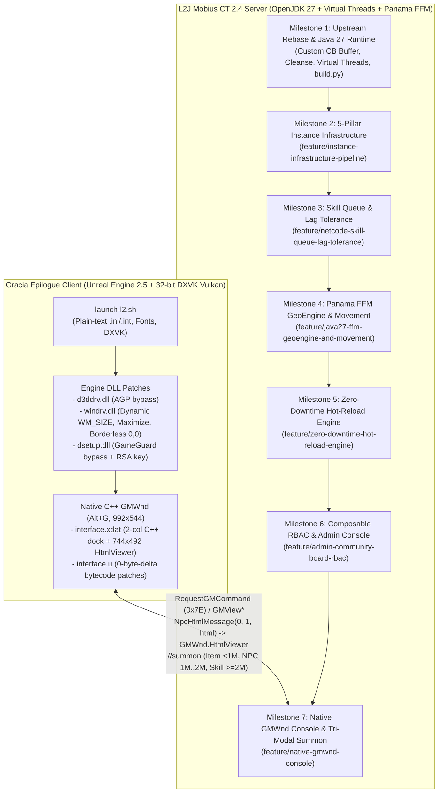

# Lineage 2 Gracia Epilogue (`CT2.4`) — Full Project Context & Engineering Ledger

**Repository:** `dwea0935/l2jmobius_dwea_fork.git` (`master` + 7 dedicated feature/client branches)  
**Server Workspace:** [`/home/dwea/Projects/L2/l2jmobius_dwea_fork`](file:///home/dwea/Projects/L2/l2jmobius_dwea_fork)  
**Client Workspace:** [`/home/dwea/Projects/L2/Client Lineage 2 Gracia Epilogue`](file:///home/dwea/Projects/L2/Client%20Lineage%202%20Gracia%20Epilogue) (and version-controlled [`client/system/`](file:///home/dwea/Projects/L2/l2jmobius_dwea_fork/client/system))  
**Target Runtime:** OpenJDK 27 (`javac --release 27`, Generational ZGC, Project Panama FFM, Project Loom Virtual Threads) + Unreal Engine 2.5 (`PE32` + 32-bit DXVK Vulkan)

---

## 1. Index of Persistent Project Documentation (Committed to `master`)

To keep project context durable across machines and future AI sessions, the repository maintains **8 specialized markdown documents** at the root of [`l2jmobius_dwea_fork`](file:///home/dwea/Projects/L2/l2jmobius_dwea_fork):

| Document | Scope & Purpose |
| :--- | :--- |
| 1. [`FULL_PROJECT_ENGINEERING_LEDGER.md`](file:///home/dwea/Projects/L2/l2jmobius_dwea_fork/FULL_PROJECT_ENGINEERING_LEDGER.md) | **This Master Index:** Chronological ledger of every milestone, branch, commit, binary patch, and server subsystem built since project inception. |
| 2. [`MASTER_HANDOFF_AND_CLIENT_SERVER_GUIDE.md`](file:///home/dwea/Projects/L2/l2jmobius_dwea_fork/MASTER_HANDOFF_AND_CLIENT_SERVER_GUIDE.md) | **Unified Client + Server Handoff Guide:** Consolidates work from both autonomous agents, including `GMWnd` (`Alt+G`) C++ console architecture, `interface.xdat`/`interface.u` patches, `.dat` catalog, and work-PC agent prompt. |
| 3. [`CLIENT_MASTER_ARCHITECTURE_AND_GUIDE.md`](file:///home/dwea/Projects/L2/l2jmobius_dwea_fork/CLIENT_MASTER_ARCHITECTURE_AND_GUIDE.md) | **Client Reverse-Engineering & Linux Guide:** Deep dive into `Lineage2Ver111`/`413` encryption, `d3ddrv.dll` & `windrv.dll` x86 patches, `launch-l2.sh`, DXVK Vulkan, TrueType fonts, and `JOYPAD` controller bindings. |
| 4. [`PROJECT_MASTER_CONTEXT_AND_ROADMAP.md`](file:///home/dwea/Projects/L2/l2jmobius_dwea_fork/PROJECT_MASTER_CONTEXT_AND_ROADMAP.md) | **Server Vision, 5-Pillar Instance Pipeline & Roadmap:** Server progression philosophy, Crystal Caverns / Hellbound / Tully / Naia forensics, the 5-Pillar Instance Pipeline, and next queued tasks (Tasks B & C). |
| 5. [`SKILL_QUEUE_AND_LAG_TOLERANCE.md`](file:///home/dwea/Projects/L2/l2jmobius_dwea_fork/SKILL_QUEUE_AND_LAG_TOLERANCE.md) | **Combat Netcode & Input Buffering:** Retail skill queue (`_queuedSkill`), cooldown-boundary tolerance (`_pendingReuseSkill`), `Ctrl` force-cast fix, cached `NetPing` RTT, and `.queue` / `.latency` player commands. |
| 6. [`GEOENGINE_AND_MOVEMENT_ARCHITECTURE.md`](file:///home/dwea/Projects/L2/l2jmobius_dwea_fork/GEOENGINE_AND_MOVEMENT_ARCHITECTURE.md) | **Java 27 Panama FFM GeoEngine & Movement:** Off-heap `MemorySegment` geodata (~15M heap objects eliminated), $O(1)$ multilayer cell offsets, fused `getNearestZAndNswe`, CAS `NodeBuffer` pool, and lock-free `MovementTaskManager`. |
| 7. [`HOT_RELOAD_ENGINE_ARCHITECTURE.md`](file:///home/dwea/Projects/L2/l2jmobius_dwea_fork/HOT_RELOAD_ENGINE_ARCHITECTURE.md) | **Zero-Downtime Script Hot-Reload Engine:** Child-first disposable `ScriptClassLoader`, Java 27 `ClassFile` bytecode validation, compile-before-unload transaction safety, live NPC adoption (`_handoverSpawns`), and `< 2ms` skill effect hot-swap. |
| 8. [`ADMIN_COMMUNITY_BOARD_RBAC_ARCHITECTURE.md`](file:///home/dwea/Projects/L2/l2jmobius_dwea_fork/ADMIN_COMMUNITY_BOARD_RBAC_ARCHITECTURE.md) | **Java 27 RBAC & Admin Console:** 13 composable `AdminScope` capabilities across 8 GM tiers (`10..100`), 2009 client HTML 3.2 crash fixes, automatic `NpcHtmlMessage` RBAC scrubber, and purge/consolidation of 11 legacy handlers (`80 -> 69`). |

---

## 2. End-to-End Architecture & Branch Topology

---

## 3. Chronological Engineering Ledger (All 7 Milestones)

### Milestone 1: Upstream Rebase, Chronicle Pruning & Java 27 Upgrade
* **Commits:** `074d3d6a33c`, `b4269b6fc70`, `bf4067a3553`
* **Key Accomplishments:**
  1. **Rebased Custom Epilogue Features onto Upstream Mobius (`074d3d6a33c`):** Preserved custom Community Board Buffer UI (`data/html/CommunityBoard/Custom/buffer/*.html`), `.cleanse`, and Premium Buff integration in [`HomeBoard.java`](file:///home/dwea/Projects/L2/l2jmobius_dwea_fork/L2J_Mobius_CT_2.4_Epilogue/dist/game/data/scripts/handlers/bypass/communityboard/HomeBoard.java) and [`PremiumManager.java`](file:///home/dwea/Projects/L2/l2jmobius_dwea_fork/L2J_Mobius_CT_2.4_Epilogue/java/org/l2jmobius/gameserver/managers/PremiumManager.java).
  2. **Single-Chronicle Focus (`b4269b6fc70`):** Removed non-Epilogue chronicle folders from the repository so the workspace exclusively targets `L2J_Mobius_CT_2.4_Epilogue`.
  3. **Java 27 & Project Loom Virtual Threads (`bf4067a3553`):**
     * Upgraded [`build.xml`](file:///home/dwea/Projects/L2/l2jmobius_dwea_fork/L2J_Mobius_CT_2.4_Epilogue/build.xml) and added [`build.py`](file:///home/dwea/Projects/L2/l2jmobius_dwea_fork/L2J_Mobius_CT_2.4_Epilogue/build.py) targeting `javac --release 27`.
     * Added `ThreadPool.executeVirtual(...)` (`Executors.newVirtualThreadPerTaskExecutor()`) in [`ThreadPool.java`](file:///home/dwea/Projects/L2/l2jmobius_dwea_fork/L2J_Mobius_CT_2.4_Epilogue/java/org/l2jmobius/commons/threads/ThreadPool.java) for non-blocking asynchronous database and I/O tasks.

---

### Milestone 2: The 5-Pillar Core Instance Infrastructure Pipeline
* **Branch:** `origin/feature/instance-infrastructure-pipeline` (Merged to `master`, commits `b3488df54f5`, `09dcbd9a178`)
* **Problem Solved:** Stock L2J Mobius suffered from catastrophic dungeon state loss whenever a player crashed or disconnected inside an instance (duo parties immediately disbanded, disconnected players logged back into empty "Instance 0" behind locked doors, and static `QuestTimer` names collided across concurrent party instances).
* **5 Architectural Pillars Implemented:**
  1. **Pillar 1 — Offline SQL Batch Evacuation & Instance 0 Sentinel:**
     * [`Instance.java`](file:///home/dwea/Projects/L2/l2jmobius_dwea_fork/L2J_Mobius_CT_2.4_Epilogue/java/org/l2jmobius/gameserver/entity/instancezone/Instance.java): When an instance expires or is destroyed, `removePlayers()` collects all offline player IDs and executes an async Virtual Thread SQL batch (`UPDATE characters SET x=?, y=?, z=? WHERE charId=?`) moving them to `_exitLocation`.
     * [`EnterWorld.java`](file:///home/dwea/Projects/L2/l2jmobius_dwea_fork/L2J_Mobius_CT_2.4_Epilogue/java/org/l2jmobius/gameserver/network/clientpackets/EnterWorld.java): If a player logs in with `instanceId == 0` inside a `ZoneId.NO_RESTART` dungeon boundary, they are automatically evacuated to the nearest town.
  2. **Pillar 2 — Party Slot Reservation & Disconnect Grace Period:**
     * [`Party.java`](file:///home/dwea/Projects/L2/l2jmobius_dwea_fork/L2J_Mobius_CT_2.4_Epilogue/java/org/l2jmobius/gameserver/entity/groups/Party.java): Added a `DisconnectedMember` state machine with a configurable 5-minute grace window (`GeneralConfig.INSTANCE_DISCONNECT_GRACE_PERIOD = 300` in [`General.ini`](file:///home/dwea/Projects/L2/l2jmobius_dwea_fork/L2J_Mobius_CT_2.4_Epilogue/dist/game/config/General.ini)). A duo party no longer implodes when one player disconnects; reconnecting within 5 minutes seamlessly restores party membership, leadership, and Party UI windows (`PartySmallWindowAll`) **after** `player.spawnMe()` in `EnterWorld.java`.
  3. **Pillar 3 — Re-Entry Coordinate Tracking & `getResumeLocation` Hook:**
     * [`InstanceWorld.java`](file:///home/dwea/Projects/L2/l2jmobius_dwea_fork/L2J_Mobius_CT_2.4_Epilogue/java/org/l2jmobius/gameserver/entity/instancezone/InstanceWorld.java) & [`InstanceScript.java`](file:///home/dwea/Projects/L2/l2jmobius_dwea_fork/L2J_Mobius_CT_2.4_Epilogue/java/org/l2jmobius/gameserver/mechanics/script/InstanceScript.java): Records last valid inside-dungeon coordinates on disconnect and exposes `getResumeLocation(Player, InstanceWorld)` for multi-wing dungeons (`CrystalCaverns`, `DarkCloudMansion`).
  4. **Pillar 4 — Instance-Scoped Timer Engine:**
     * [`InstanceWorld.java`](file:///home/dwea/Projects/L2/l2jmobius_dwea_fork/L2J_Mobius_CT_2.4_Epilogue/java/org/l2jmobius/gameserver/entity/instancezone/InstanceWorld.java): Added `scheduleTimer`, `scheduleRepeatingTimer`, and `cancelTimer` scoped strictly to the `InstanceWorld` lifecycle (`ConcurrentHashMap<String, ScheduledFuture<?>>`), automatically cancelling all tasks on `Instance.destroy()`.
  5. **Pillar 5 — Multi-Script `EventDispatcher` Chaining Verification:**
     * [`EventDispatcher.java`](file:///home/dwea/Projects/L2/l2jmobius_dwea_fork/L2J_Mobius_CT_2.4_Epilogue/java/org/l2jmobius/gameserver/mechanics/events/EventDispatcher.java): Verified and documented that multiple scripts (`TullyWorkshop` and `TowerOfNaia`) can safely register `onFirstTalk` listeners on shared NPC IDs (`32370`).

---

### Milestone 3: Combat Netcode — Skill Queue & Dynamic Action Lag Tolerance
* **Branch:** `origin/feature/netcode-skill-queue-lag-tolerance` (Merged to `master`, commit `6c824e6faf8`, plus `ctrlPressed` fix in `db33430559f`)
* **Documentation:** [`SKILL_QUEUE_AND_LAG_TOLERANCE.md`](file:///home/dwea/Projects/L2/l2jmobius_dwea_fork/SKILL_QUEUE_AND_LAG_TOLERANCE.md)
* **Key Accomplishments:**
  1. **Recast & Combo Buffering (`_queuedSkill` in [`Player.java`](file:///home/dwea/Projects/L2/l2jmobius_dwea_fork/L2J_Mobius_CT_2.4_Epilogue/java/org/l2jmobius/gameserver/entity/actor/Player.java)):** Eliminated the recast lockout in `Player.useMagic()` so mages and fighters can buffer consecutive casts (including same-skill recasts and `Ctrl`-forced casts via `SkillUseHolder.isCtrlPressed()`) with 0ms dead air between animations.
  2. **Pre-Cooldown Expiration Scheduling (`_pendingReuseSkill` in [`Player.java`](file:///home/dwea/Projects/L2/l2jmobius_dwea_fork/L2J_Mobius_CT_2.4_Epilogue/java/org/l2jmobius/gameserver/entity/actor/Player.java)):** If a player presses a skill within `queueWindow` (`50..500ms`) of its cooldown expiring, the server schedules execution on the exact millisecond the reuse timer finishes instead of dropping the input.
  3. **Mid-Movement Skill Queuing:** Allows buffering a spell while moving so it fires immediately on arrival.
  4. **Zero-Syscall RTT Tracking & `.queue` / `.latency` Voiced Commands:**
     * Added `NetPing` / `RequestNetPing` RTT measurement cached in `GameClient` (`player.getPing()`) and wired [`SkillQueue.java`](file:///home/dwea/Projects/L2/l2jmobius_dwea_fork/L2J_Mobius_CT_2.4_Epilogue/dist/game/data/scripts/handlers/chat/commands/voiced/SkillQueue.java) (`.queue auto`, `.queue <ms>`, `.queue off`).
     * Tuned [`Network.ini`](file:///home/dwea/Projects/L2/l2jmobius_dwea_fork/L2J_Mobius_CT_2.4_Epilogue/dist/game/config/Network.ini) (`UseNagle = False` / `TCP_NODELAY`, `128 KB` socket buffers).

---

### Milestone 4: Java 27 Project Panama FFM Off-Heap GeoEngine & Lock-Free Movement
* **Branch:** `origin/feature/java27-ffm-geoengine-and-movement` (Merged to `master`, commit `6b08afaa1d2`, plus dynamic mutation fix in `db33430559f`)
* **Documentation:** [`GEOENGINE_AND_MOVEMENT_ARCHITECTURE.md`](file:///home/dwea/Projects/L2/l2jmobius_dwea_fork/GEOENGINE_AND_MOVEMENT_ARCHITECTURE.md)
* **Key Accomplishments:**
  1. **Zero-Copy Off-Heap `MemorySegment` Geodata ([`Region.java`](file:///home/dwea/Projects/L2/l2jmobius_dwea_fork/L2J_Mobius_CT_2.4_Epilogue/java/org/l2jmobius/gameserver/geoengine/geodata/regions/Region.java), [`GeoEngine.java`](file:///home/dwea/Projects/L2/l2jmobius_dwea_fork/L2J_Mobius_CT_2.4_Epilogue/java/org/l2jmobius/gameserver/geoengine/GeoEngine.java)):**
     * Replaced `IBlock[65536]` (~15,000,000 heap objects across 130 regions, ~1.5 GB heap) with a Project Panama `MemorySegment` (`Arena.ofAuto()`) and a packed `int[65536] _blockDescriptors` table (`DESC_FLAT`, `DESC_COMPLEX`, `DESC_MULTILAYER`, `DESC_MUTATED` Copy-on-Write for Doors/Fences).
     * Parallelized startup `.l2j` region loading across Java 27 Virtual Threads.
  2. **$O(1)$ Multilayer Cell Offset Indexing & Fused `getNearestZAndNswe` ([`MultilayerBlock.java`](file:///home/dwea/Projects/L2/l2jmobius_dwea_fork/L2J_Mobius_CT_2.4_Epilogue/java/org/l2jmobius/gameserver/geoengine/geodata/blocks/MultilayerBlock.java), [`ComplexBlock.java`](file:///home/dwea/Projects/L2/l2jmobius_dwea_fork/L2J_Mobius_CT_2.4_Epilogue/java/org/l2jmobius/gameserver/geoengine/geodata/blocks/ComplexBlock.java), [`NodeBuffer.java`](file:///home/dwea/Projects/L2/l2jmobius_dwea_fork/L2J_Mobius_CT_2.4_Epilogue/java/org/l2jmobius/gameserver/geoengine/pathfinding/NodeBuffer.java)):**
     * Precomputed `_mlCellOffsets` / `_cellOffsets` tables (eliminating the $O(64)$ linear byte-scanning loop) and fused `getNearestZAndNswe(geoX, geoY, worldZ)` (cutting A* pathfinding `NodeBuffer.touch()` geodata lookups by **80%**, from 5 calls per node to 1).
  3. **Virtual-Thread-Safe Striped CAS `NodeBuffer` Pool ([`PathFinding.java`](file:///home/dwea/Projects/L2/l2jmobius_dwea_fork/L2J_Mobius_CT_2.4_Epilogue/java/org/l2jmobius/gameserver/geoengine/pathfinding/PathFinding.java)):**
     * Replaced `ThreadLocal<NodeBuffer[]>` with a bounded striped `AtomicReferenceArray<NodeBuffer>[]` pool leased via lock-free `AtomicBoolean.compareAndSet`.
  4. **Lock-Free Fibonacci-Sharded `MovementTaskManager` ([`MovementTaskManager.java`](file:///home/dwea/Projects/L2/l2jmobius_dwea_fork/L2J_Mobius_CT_2.4_Epilogue/java/org/l2jmobius/gameserver/taskmanagers/MovementTaskManager.java)):**
     * Removed global `synchronized` monitor contention and $O(P)$ `.contains()` scans, routing moving Players (`4` shards @ 50ms) and Creatures (`8` shards @ 100ms) in $O(1)$ lock-free time via Fibonacci hashing on `objectId`.

---

### Milestone 5: Zero-Downtime Transactional Script Hot-Reload Engine
* **Branch:** `origin/feature/zero-downtime-hot-reload-engine` (Merged to `master`, commit `40131d79438`)
* **Documentation:** [`HOT_RELOAD_ENGINE_ARCHITECTURE.md`](file:///home/dwea/Projects/L2/l2jmobius_dwea_fork/HOT_RELOAD_ENGINE_ARCHITECTURE.md)
* **Key Accomplishments:**
  1. **Disposable Child-First `ScriptClassLoader` & Java 27 `ClassFile` Validation ([`ScriptClassLoader.java`](file:///home/dwea/Projects/L2/l2jmobius_dwea_fork/L2J_Mobius_CT_2.4_Epilogue/java/org/l2jmobius/gameserver/scripting/engine/ScriptClassLoader.java), [`ScriptExecutor.java`](file:///home/dwea/Projects/L2/l2jmobius_dwea_fork/L2J_Mobius_CT_2.4_Epilogue/java/org/l2jmobius/gameserver/scripting/engine/ScriptExecutor.java)):**
     * Fixed the upstream static `SCRIPT_CLASS_LOADER` bug where `findLoadedClass` always returned stale boot-time classes.
     * Validates compiled bytecode with `java.lang.classfile.ClassFile.of().parse(bytes)` and groups `$` inner/lambda nestmates (`JEP 181`) in the same disposable loader while reusing unchanged base classes (`AbstractNpcAI`) in $O(1)$ time.
  2. **Compile-Before-Unload Transaction & Live Init-Spawn NPC Adoption ([`ScriptManager.java`](file:///home/dwea/Projects/L2/l2jmobius_dwea_fork/L2J_Mobius_CT_2.4_Epilogue/java/org/l2jmobius/gameserver/managers/ScriptManager.java), [`Quest.java`](file:///home/dwea/Projects/L2/l2jmobius_dwea_fork/L2J_Mobius_CT_2.4_Epilogue/java/org/l2jmobius/gameserver/mechanics/script/Quest.java)):**
     * Syntax errors abort compilation *before* `prepareHotReload` unloads the live script.
     * Alive constructor-spawned open-world NPCs are staged in `_handoverSpawns` and adopted by `Quest.addSpawn` (`tryAdoptInitSpawn`), preserving HP, aggro, and combat state without duplicate spawns.
  3. **In-Memory Skill `AbstractEffect` Hot-Swap (`< 2ms`, Zero XML I/O):**
     * Reloading any `AbstractEffect` script (`//reload script Blink`) automatically calls `SkillData.getInstance().refreshEffectHandler(name)`, swapping live `AbstractEffect` instances across all loaded `Skill`s in `< 2ms`.
  4. **Surgical Single-File Reloading (`//reload script <name|path>`):**
     * Upgraded all 8 `*Handler` registries to `ConcurrentHashMap` and added standalone handler/effect auto-registration (~29ms single-file hot-swap).

---

### Milestone 6: Java 27 Composable RBAC (`AdminScope`), 2009 Client HTML Safety & Cross-Pillar Audit
* **Branch:** `origin/feature/admin-community-board-rbac` (Merged to `master`, commits `8a6534aefce`, `db33430559f`)
* **Documentation:** [`ADMIN_COMMUNITY_BOARD_RBAC_ARCHITECTURE.md`](file:///home/dwea/Projects/L2/l2jmobius_dwea_fork/ADMIN_COMMUNITY_BOARD_RBAC_ARCHITECTURE.md)
* **Key Accomplishments:**
  1. **13 Composable `AdminScope` Capabilities ([`AdminScope.java`](file:///home/dwea/Projects/L2/l2jmobius_dwea_fork/L2J_Mobius_CT_2.4_Epilogue/java/org/l2jmobius/gameserver/data/enums/AdminScope.java), [`AccessLevels.xml`](file:///home/dwea/Projects/L2/l2jmobius_dwea_fork/L2J_Mobius_CT_2.4_Epilogue/dist/game/config/AccessLevels.xml)):**
     * Replaced flat integer checks with composable RBAC scopes across 8 functional staff roles (`10 Chat Moderator` through `100 Master`), while `User (0)` and `Banned (-1)` have `isGM="false"` and `scopes="NONE"`.
     * Synced `UserInfo.java` (`builderLevel = _player.isGM() && _player.getAccessLevel().allowAltG()`), `RequestGMCommand.java` (`PLAYER_SUPPORT` scope check), and `EnterWorld.java` (`EVENT_GM` scope check for GM special skills).
  2. **2009 Gracia Epilogue Client `ShowBoard` Crash Fixes ([`ShowBoard.java`](file:///home/dwea/Projects/L2/l2jmobius_dwea_fork/L2J_Mobius_CT_2.4_Epilogue/java/org/l2jmobius/gameserver/network/serverpackets/ShowBoard.java), [`HtmlUtil.java`](file:///home/dwea/Projects/L2/l2jmobius_dwea_fork/L2J_Mobius_CT_2.4_Epilogue/java/org/l2jmobius/gameserver/util/HtmlUtil.java)):**
     * Fixed `null` `"102\u0008null"` string corruption in `ShowBoard` and restored `4,090`-char per-packet chunking (`12,270` chars max across `101`/`102`/`103`) matching `NWindow.dll`'s buffer limits.
  3. **Dynamic `NpcHtmlMessage` Interceptor & RBAC HTML Scrubber ([`AdminBoardManager.java`](file:///home/dwea/Projects/L2/l2jmobius_dwea_fork/L2J_Mobius_CT_2.4_Epilogue/java/org/l2jmobius/gameserver/managers/AdminBoardManager.java)):**
     * Built 6 wide-screen 740px workspaces (`Dashboard`, `Support & Players`, `World & Spawns`, `Events & GM`, `Items & Chars`, `Server & Reload`) with max 2-level table nesting, automatic legacy `NpcHtmlMessage` capture, unauthorized button/link scrubbing, and `qbox` `<edit>` deduplication.
  4. **Legacy Admin Handler Purge & Consolidation (`80 -> 69` Handlers):**
     * Deleted 5 broken/obsolete 2004 handlers (`AdminCamera`, `AdminFightCalculator`, `AdminPathNode`, `AdminTargetSay`, `AdminTest`) and merged 6 redundant handlers (`AdminDisconnect` $\rightarrow$ `AdminKick`, `AdminSuperHaste` $\rightarrow$ `AdminGmSpeed`, `AdminInstanceZone` $\rightarrow$ `AdminInstance`, `AdminPledge` $\rightarrow$ `AdminClan`, `AdminZoneBuild` $\rightarrow$ `AdminZone`, `AdminShowQuests` $\rightarrow$ `AdminQuest`).

---

### Milestone 7: Client Reverse-Engineering, Linux/DXVK Launcher & Unified Native C++ `GMWnd` (`Alt+G`) Master Console
* **Branches:** `origin/feature/native-gmwnd-console` & `origin/client/gracia-epilogue-system` (Merged to `master`, commits `9a029c459a8`..`9ddf57e6c12`)
* **Documentation:** [`MASTER_HANDOFF_AND_CLIENT_SERVER_GUIDE.md`](file:///home/dwea/Projects/L2/l2jmobius_dwea_fork/MASTER_HANDOFF_AND_CLIENT_SERVER_GUIDE.md) & [`CLIENT_MASTER_ARCHITECTURE_AND_GUIDE.md`](file:///home/dwea/Projects/L2/l2jmobius_dwea_fork/CLIENT_MASTER_ARCHITECTURE_AND_GUIDE.md)
* **Key Accomplishments (Multi-Agent Collaboration):**
  1. **100% Decrypted Plain-Text `.ini` & `.int` Configs + `launch-l2.sh` (Agent 2):**
     * Stripped `Lineage2Ver111`/`413` encryption from all 30 `.ini`/`.int` files in [`client/system/`](file:///home/dwea/Projects/L2/l2jmobius_dwea_fork/client/system) (backups in [`client/system/backup_encrypted/`](file:///home/dwea/Projects/L2/l2jmobius_dwea_fork/client/system/backup_encrypted)).
     * Created [`launch-l2.sh`](file:///home/dwea/Projects/L2/l2jmobius_dwea_fork/client/launch-l2.sh) with 32-bit DXVK (`d3d9.dll` $\rightarrow$ Vulkan), TrueType UI fonts (`tahoma.ttf`, `times.ttf`, `arial.ttf`), `dsetup=n,b` override, CLI flags (`-server`, `-login`, `-pass`, `-slot`, `--res`, `--borderless`, `--windowed`, `--fullscreen`, `--gamepad`, `--check`), and modernized XInput/SDL2 `JOYPAD` bindings in `user.ini`.
  2. **Binary Engine DLL Patches (`d3ddrv.dll` & `windrv.dll` — Agent 2):**
     * [`d3ddrv.dll`](file:///home/dwea/Projects/L2/l2jmobius_dwea_fork/client/system/d3ddrv.dll) (`0xC2494`: `74 22` $\rightarrow$ `90 90`): Silenced obsolete 2004 AGP warning dialog.
     * [`windrv.dll`](file:///home/dwea/Projects/L2/l2jmobius_dwea_fork/client/system/windrv.dll) (5 x86 patches at `0x10FAF`, `0x11141`, `0x0D43A`, `0x0D4B9`, `0x0E865`): Enabled real-time drag window resizing (`WM_SIZE` $\rightarrow$ `SetRes`), OS Maximize button without cursor-trapping or forced exclusive fullscreen, XWayland async geometry safety, and `(0,0)` Borderless Windowed mode (`UseWindowFrame=False`).
  3. **Unified Native C++ `GMWnd` (`Alt+G`) Master Console ([`interface.xdat`](file:///home/dwea/Projects/L2/l2jmobius_dwea_fork/client/system/interface.xdat), [`interface.u`](file:///home/dwea/Projects/L2/l2jmobius_dwea_fork/client/system/interface.u), [`patch_gmwnd_client.py`](file:///home/dwea/Projects/L2/l2jmobius_dwea_fork/client/patch_gmwnd_client.py), [`AdminBoardManager.java`](file:///home/dwea/Projects/L2/l2jmobius_dwea_fork/L2J_Mobius_CT_2.4_Epilogue/java/org/l2jmobius/gameserver/managers/AdminBoardManager.java), [`AdminSummon.java`](file:///home/dwea/Projects/L2/l2jmobius_dwea_fork/L2J_Mobius_CT_2.4_Epilogue/dist/game/data/scripts/handlers/chat/commands/admin/AdminSummon.java) — Agent 1):**
     * Expanded `GMWnd` (`Alt+G`) to `992 x 544` px with a 2-column native C++ left control dock (`x=10..225`) and an embedded right-hand `GMWnd.HtmlViewer` (`744 x 492` px).
     * Patched 7 UnrealScript functions in `interface.u` with 0-byte size delta so `NpcHtmlMessage(0, 1, html)` (`EV_ItemDescWndLoadHtmlFromString`) renders directly into `GMWnd.HtmlViewer` with zero `PageLock`, `Alt+G` auto-triggers `//gmw`, `Administrator` triggers `//admin`, untargeting preserves `GMWnd.EditBox`, and `GMFindTreeWnd` -> `Skill Search` enables `Summon` with `+ 2,000,000` skill ID offset handled by `AdminSummon.java` and `AdminSkill.java`.

---

### Milestone 8: Local Dockerized Test Environment & `build.py` Packaging Fixes (Agent 3)
* **Files:** [`docker-compose.yml`](file:///home/dwea/Projects/L2/docker-compose.yml), [`docker/run-server.sh`](file:///home/dwea/Projects/L2/docker/run-server.sh), [`docker/db-init/01-l2jmobius-schema.sh`](file:///home/dwea/Projects/L2/docker/db-init/01-l2jmobius-schema.sh), [`build.py`](file:///home/dwea/Projects/L2/l2jmobius_dwea_fork/L2J_Mobius_CT_2.4_Epilogue/build.py), [`AGENT_SYNC_AND_RECONCILIATION.md`](file:///home/dwea/Projects/L2/AGENT_SYNC_AND_RECONCILIATION.md)
* **Key Accomplishments & Findings:**
  1. **3-Container Host-Networked Docker Stack (`l2-db`, `l2-login`, `l2-game`):**
     * `l2-db` (`mariadb:11.8` on `127.0.0.1:3306`) automatically initializes `l2jmobiusepilogue` with all **116 SQL tables** (`db_installer/sql/login/*.sql` + `sql/game/*.sql`) on first volume boot via `01-l2jmobius-schema.sh`.
     * `l2-login` (`0.0.0.0:2106`, GS link `127.0.0.1:9014`) and `l2-game` (`0.0.0.0:7777`, registered as **Server 2: Sieghardt**) run on `eclipse-temurin:27-jdk` with `-Djava.awt.headless=true` and `--enable-native-access=ALL-UNNAMED`.
  2. **Root-Cause Fix for `LoginServer.jar` Missing `gameserverpackets` (`InitLS`):**
     * Agent 3 discovered that [`build.py`](file:///home/dwea/Projects/L2/l2jmobius_dwea_fork/L2J_Mobius_CT_2.4_Epilogue/build.py#L125-L127) used `exclude_patterns=["*databaseinstaller*", "*gameserver*"]` when building `LoginServer.jar`. Because Python's `fnmatch` `*` matches `/`, `*gameserver*` inadvertently stripped `org/l2jmobius/loginserver/network/gameserverpackets/**` (18 classes including `InitLS`), crashing the GameServer↔LoginServer handshake.
     * Fixed `build.py` to anchor the exclusion to `"org/l2jmobius/gameserver/*"`, repacked `LoginServer.jar` (`153 -> 171` entries), and restored the full `META-INF/MANIFEST.MF` (`Main-Class` & `Class-Path`) in `GameServer.jar`.

---

### Milestone 9: Client Login Crash (`00010084 1289`) Forensic Resolution & Clean `2009-09-28` (`L2 Epilogue Clean`) Unification
* **Files:** [`client/system/l2.exe`](file:///home/dwea/Projects/L2/l2jmobius_dwea_fork/client/system/l2.exe), [`client/system/Engine.dll`](file:///home/dwea/Projects/L2/l2jmobius_dwea_fork/client/system/Engine.dll), [`client/system/Core.dll`](file:///home/dwea/Projects/L2/l2jmobius_dwea_fork/client/system/Core.dll), [`client/system/windrv.dll`](file:///home/dwea/Projects/L2/l2jmobius_dwea_fork/client/system/windrv.dll), [`client/system/d3ddrv.dll`](file:///home/dwea/Projects/L2/l2jmobius_dwea_fork/client/system/d3ddrv.dll), [`client/system/dsetup.dll`](file:///home/dwea/Projects/L2/l2jmobius_dwea_fork/client/system/dsetup.dll), [`client/system/interface.xdat`](file:///home/dwea/Projects/L2/l2jmobius_dwea_fork/client/system/interface.xdat), [`client/system/interface.u`](file:///home/dwea/Projects/L2/l2jmobius_dwea_fork/client/system/interface.u), [`client/launch-l2.sh`](file:///home/dwea/Projects/L2/l2jmobius_dwea_fork/client/launch-l2.sh), [`AGENT_SYNC_AND_RECONCILIATION.md`](file:///home/dwea/Projects/L2/AGENT_SYNC_AND_RECONCILIATION.md)
* **Root Causes Identified:**
  1. **Hybrid Binary / Vtable Mismatch (`2010-07-16` vs `2009-09-28`):** The original `system/` folder mixed **2010-07-16 (Protocol 152)** DLLs (`Core.dll`, packed `Engine.dll` at `26.1 MB`, `nwindow.dll`, `window.dll`, `windrv.dll`, which added a virtual method to `UObject`/`UConsole` and shifted vtable offsets by `+4` bytes) with **2009 / early-2010 (Protocol 148)** `l2.exe` (`2010-03-23`), `dsetup.dll` (`2009-11-01`), `fire.dll` (`2009-12-10`), and `unichat.dll` (`2010-01-16`, whose `DllMain` returned with `c3` instead of `__stdcall` `c2 0c 00`).
  2. **`dsetup.dll` Wine WoW64 Base Relocation & Section Permissions:** `dsetup.dll` was linked at `ImageBase = 0x00400000` (colliding with Wine's `locale.nls` mapping) with Read-Only `.idata` (`0x40000040`) and Execute-Only `.reloc` (`0x20000040`), and its backward scan from `?Destroy@UNetworkHandler@@UAEXXZ` (`53 57 8b f9`) could not match the packed `2010-07-16` `Engine.dll`.
  3. **32-Bit DXVK Placement on 64-Bit Wine Prefix:** 32-bit `l2.exe` under 64-bit Wine wow64 loads `d3d9.dll` and `dxgi.dll` from `drive_c/windows/syswow64` rather than `system32`.
  4. **`Lineage2Ver413` RSA-1024 Key Mismatch (`FL2GameData::LoadL2DataBin <- FL2GameData::EulaLoad`):** Unpacked `l2.exe` (`VA 0x10906090`) had the `l2encdec` modding RSA-1024 key (`75b4d6de...`, exponent `0x1d`) at `0x2F500` (`VA 0x10930300`), whereas all 45 `.dat` files in the clean NCSoft `L2 Epilogue Clean/system/` build are encrypted with NCSoft's official retail `Lineage2Ver413` RSA-1024 key (`97df3984...`, exponent `0x35`).
* **Step-by-Step Resolution Applied:**
  1. Unified `system/` with the **100% unpacked, version-matched `2009-09-28` (`0x4ac07b4f`..`0x4ac07c96`) DLLs, `.u` packages, and `.dat` files** from `/home/dwea/Projects/L2/L2 Epilogue Clean/system/` (preserving backups of the hybrid files in `system/backup_hybrid_152/` and removing `unichat.dll`).
  2. Patched `l2.exe` (`434,176` bytes) to alias `?GL2RunningFirstHandle@@3PAXA` $\rightarrow$ `?GIsServer@@3HA`, NOPed the 2-byte mutex handle store at `0x25CEE` (`89 01` $\rightarrow$ `90 90`), and updated the `Lineage2Ver413` RSA modulus (`0x2F500`) and exponent (`0x2F604`) from `75b4d6de...` (`0000001d`) to retail `97df3984...` (`00000035`).
  3. Patched `Engine.dll` (`6,885,120` bytes) at `0x39B750` (`VA 0x2039C350`: `55 8b ec 6a ff` $\rightarrow$ `33 c0 fe c0 c3`) to bypass the GameGuard check and at `0x4A3AE0` (`VA 0x204A46E0`) to report `$Revision: 152 $`.
  4. Re-applied the AGP check suppression to `d3ddrv.dll` (`0xC24A4`), all 5 dynamic window-resize/borderless patches to `windrv.dll` (`+0x70` offsets: `0x1101F`, `0x111B1`, `0x0D4AA`, `0x0D529`, `0x0E8D5`), and the 992×544 `GMWnd` (`Alt+G`) Master Console + 7 UnrealScript patches to `interface.xdat` and `interface.u`.

---

### Milestone 10: `2009-09-28` `Engine.dll` Full Server-Packet Alignment & `InventoryUpdatePacket` Crash Fix
* **Files:** [`AbstractItemPacket.java`](file:///home/dwea/Projects/L2/l2jmobius_dwea_fork/L2J_Mobius_CT_2.4_Epilogue/java/org/l2jmobius/gameserver/network/serverpackets/AbstractItemPacket.java), [`ItemInfo.java`](file:///home/dwea/Projects/L2/l2jmobius_dwea_fork/L2J_Mobius_CT_2.4_Epilogue/java/org/l2jmobius/gameserver/entity/item/holders/ItemInfo.java), [`ServerPackets.java`](file:///home/dwea/Projects/L2/l2jmobius_dwea_fork/L2J_Mobius_CT_2.4_Epilogue/java/org/l2jmobius/gameserver/network/ServerPackets.java), [`BuyList.java`](file:///home/dwea/Projects/L2/l2jmobius_dwea_fork/L2J_Mobius_CT_2.4_Epilogue/java/org/l2jmobius/gameserver/network/serverpackets/BuyList.java), [`ExBuySellList.java`](file:///home/dwea/Projects/L2/l2jmobius_dwea_fork/L2J_Mobius_CT_2.4_Epilogue/java/org/l2jmobius/gameserver/network/serverpackets/ExBuySellList.java), [`WareHouseDepositList.java`](file:///home/dwea/Projects/L2/l2jmobius_dwea_fork/L2J_Mobius_CT_2.4_Epilogue/java/org/l2jmobius/gameserver/network/serverpackets/WareHouseDepositList.java), [`WareHouseWithdrawalList.java`](file:///home/dwea/Projects/L2/l2jmobius_dwea_fork/L2J_Mobius_CT_2.4_Epilogue/java/org/l2jmobius/gameserver/network/serverpackets/WareHouseWithdrawalList.java), [`SortedWareHouseWithdrawalList.java`](file:///home/dwea/Projects/L2/l2jmobius_dwea_fork/L2J_Mobius_CT_2.4_Epilogue/java/org/l2jmobius/gameserver/network/serverpackets/SortedWareHouseWithdrawalList.java), [`TradeStart.java`](file:///home/dwea/Projects/L2/l2jmobius_dwea_fork/L2J_Mobius_CT_2.4_Epilogue/java/org/l2jmobius/gameserver/network/serverpackets/TradeStart.java), [`TradeOwnAdd.java`](file:///home/dwea/Projects/L2/l2jmobius_dwea_fork/L2J_Mobius_CT_2.4_Epilogue/java/org/l2jmobius/gameserver/network/serverpackets/TradeOwnAdd.java), [`TradeOtherAdd.java`](file:///home/dwea/Projects/L2/l2jmobius_dwea_fork/L2J_Mobius_CT_2.4_Epilogue/java/org/l2jmobius/gameserver/network/serverpackets/TradeOtherAdd.java), [`PetItemList.java`](file:///home/dwea/Projects/L2/l2jmobius_dwea_fork/L2J_Mobius_CT_2.4_Epilogue/java/org/l2jmobius/gameserver/network/serverpackets/PetItemList.java), [`PetInventoryUpdate.java`](file:///home/dwea/Projects/L2/l2jmobius_dwea_fork/L2J_Mobius_CT_2.4_Epilogue/java/org/l2jmobius/gameserver/network/serverpackets/PetInventoryUpdate.java), [`PrivateStoreManageListSell.java`](file:///home/dwea/Projects/L2/l2jmobius_dwea_fork/L2J_Mobius_CT_2.4_Epilogue/java/org/l2jmobius/gameserver/network/serverpackets/PrivateStoreManageListSell.java), [`PrivateStoreListSell.java`](file:///home/dwea/Projects/L2/l2jmobius_dwea_fork/L2J_Mobius_CT_2.4_Epilogue/java/org/l2jmobius/gameserver/network/serverpackets/PrivateStoreListSell.java), [`PrivateStoreManageListBuy.java`](file:///home/dwea/Projects/L2/l2jmobius_dwea_fork/L2J_Mobius_CT_2.4_Epilogue/java/org/l2jmobius/gameserver/network/serverpackets/PrivateStoreManageListBuy.java), [`PrivateStoreListBuy.java`](file:///home/dwea/Projects/L2/l2jmobius_dwea_fork/L2J_Mobius_CT_2.4_Epilogue/java/org/l2jmobius/gameserver/network/serverpackets/PrivateStoreListBuy.java), [`ExReplyPostItemList.java`](file:///home/dwea/Projects/L2/l2jmobius_dwea_fork/L2J_Mobius_CT_2.4_Epilogue/java/org/l2jmobius/gameserver/network/serverpackets/ExReplyPostItemList.java), [`ExReplyReceivedPost.java`](file:///home/dwea/Projects/L2/l2jmobius_dwea_fork/L2J_Mobius_CT_2.4_Epilogue/java/org/l2jmobius/gameserver/network/serverpackets/ExReplyReceivedPost.java), [`ExReplySentPost.java`](file:///home/dwea/Projects/L2/l2jmobius_dwea_fork/L2J_Mobius_CT_2.4_Epilogue/java/org/l2jmobius/gameserver/network/serverpackets/ExReplySentPost.java), [`ExRpItemLink.java`](file:///home/dwea/Projects/L2/l2jmobius_dwea_fork/L2J_Mobius_CT_2.4_Epilogue/java/org/l2jmobius/gameserver/network/serverpackets/ExRpItemLink.java), [`PackageSendableList.java`](file:///home/dwea/Projects/L2/l2jmobius_dwea_fork/L2J_Mobius_CT_2.4_Epilogue/java/org/l2jmobius/gameserver/network/serverpackets/PackageSendableList.java), [`GMViewWarehouseWithdrawList.java`](file:///home/dwea/Projects/L2/l2jmobius_dwea_fork/L2J_Mobius_CT_2.4_Epilogue/java/org/l2jmobius/gameserver/network/serverpackets/GMViewWarehouseWithdrawList.java)
* **Root Cause & Fix:**
  1. **6-Byte Per-Item `EnchantOptions` Mismatch:** The unpacked `2009-09-28` `Engine.dll` (`InventoryUpdatePacket` @ `VA 0x203c0940`, `ItemListPacket` @ `VA 0x203c1060`) parses each item using format string `'dddQhhhdhhhhdhhhhhhhhd'` (`VA 0x204984e0`), which ends right after `int time` (`d`). `AbstractItemPacket.writeItem` (and 17 other item packet classes) wrote 3 trailing `short`s (`6` bytes) for `item.getEnchantOptions()` (late mini-patch `optiondata_client` IDs for special items like *Olf's T-Shirt*; note that standard `+N` item enchant levels use `item.getEnchant()` at line 51 and are unaffected). When `InventoryUpdate` contained 2+ items (e.g., newbie quest turn-in), item #1's trailing 6 zero bytes shifted item #2's cursor, causing `NConsoleWnd::UpdateInventoryItem` (`NConsoleWindow.cpp:4212`) to read `iWorkType == 0` and assert.
  2. **Comprehensive 439-Handler Audit:** Extracted all 439 server packet registrations (`0x20687f70` table) and `Disassemble` (`VA 0x2039e460`) format strings from `Engine.dll` (`2009-09-28`), aligned all 22 item/shop/warehouse/trade/pet/store/mail packet classes, added a safe `default: _change = 2;` fallback in `ItemInfo.java`, and fixed the swapped `EX_BR_BROADCAST_EVENT_STATE` (`0xFE:0xBD`) / `EX_BR_EXTRA_USER_INFO` (`0xFE:0xBE`) opcodes in `ServerPackets.java`.
  3. **`ShortcutInit` Prerequisite Packet Ordering (`EnterWorld.java` & `Player.java`):** Disassembled `ShortCutInitPacket` (`Engine.dll` `VA 0x203af410`), `NConsoleWnd::AddShortCutItem` (`nwindow.dll` `VA 0x1023b2f0`), and `NCShortcutItemManager::AddShortcutItem` (`VA 0x101f2ac0`), confirming that `ShortCutInitPacket` wipes all 144 shortcut slots (`NCShortcutItemManager::Clear`) and validates each shortcut against the client's in-memory `ItemList` (`0x1020b490`), `SkillList` (`0x101fe020` / `0x101fe0e0`), and `ExBasicActionList` (`0x101f1220`). Moved `ShortcutInit` in [`EnterWorld.java`](file:///home/dwea/Projects/L2/l2jmobius_dwea_fork/L2J_Mobius_CT_2.4_Epilogue/java/org/l2jmobius/gameserver/network/clientpackets/EnterWorld.java) after `ExBasicActionList` and `player.sendSkillList()`, and updated [`Player.java`](file:///home/dwea/Projects/L2/l2jmobius_dwea_fork/L2J_Mobius_CT_2.4_Epilogue/java/org/l2jmobius/gameserver/entity/actor/Player.java) (`giveAvailableSkills` and subclass switch) to send `sendSkillList()` before `updateShortcuts()` and `ShortcutInit`.
  4. **Option C Dual-Protocol (`148` + `152`) Support & Broadcast-Cache Hardening (`ServerPacket.java`, `AdminBoardManager.java`, `Server.ini`, `ExBrExtraUserInfo.java`, `ExBrBroadcastEventState.java`, & 21 Item Packet Classes):** Restored native `$Revision: 148 $` at `0x004A3AE0` in `Engine.dll`, set `AllowedProtocolRevisions = 148;152` in `Server.ini`, added thread-safe `isProtocol152()` / `isProtocol152(GameClient)` and `isProtocolSensitive()` (bypassing `WritablePacket.sendInBroadcast()` caching with a `_broadcastRequested` warning tripwire) in [`ServerPacket.java`](file:///home/dwea/Projects/L2/l2jmobius_dwea_fork/L2J_Mobius_CT_2.4_Epilogue/java/org/l2jmobius/gameserver/network/serverpackets/ServerPacket.java), gated the 6-byte `EnchantOptions` suffix and `ExBrExtraUserInfo` / `ExBrBroadcastEventState` (`0xFE:0xBD` vs `0xFE:0xBE`) on `client.getProtocolVersion() >= 152`, and added automatic `BoardWnd` (`ShowBoard`) fallback in [`AdminBoardManager.java`](file:///home/dwea/Projects/L2/l2jmobius_dwea_fork/L2J_Mobius_CT_2.4_Epilogue/java/org/l2jmobius/gameserver/managers/AdminBoardManager.java) when a GM connects on a stock Protocol `152` client. Compiled and packed all 29 updated classes into `build/dist/libs/GameServer.jar`.

---

## 4. Queued Next Tasks (Ready for Work PC Session)

1. **Task B — The 5-Phase Expansion Gatekeeper & Dynamic 1–75 / 76–85 Progression Engine (`feature/expansion-phase-and-progression-engine`):**
   * Central `ExpansionPhaseManager` singleton (`Phase 1` Baseline/IoP $\rightarrow$ `Phase 2` Crystal Caverns/Baylor $\rightarrow$ `Phase 3` Hellbound/Tully/Naia $\rightarrow$ `Phase 4` Beleth $\rightarrow$ `Phase 5` Gracia Continent/Seeds), two-tier XP/SP/Drop curve (`1–75` accelerated, `76–85` endgame), `.phase` player command, and `//setphase <1-5>` integrated into the `GMWnd` / RBAC Admin Console.
2. **Task C — Endgame Instance & Hellbound Script Modernization (`feature/endgame-instance-script-refactor`):**
   * Decouple NPC `32370` (`DWARVEN_GHOST`) in `TullyWorkshop.java` and `TowerOfNaia.java`, and migrate `CrystalCaverns.java` and `DarkCloudMansion.java` onto `getResumeLocation(Player, InstanceWorld)` and `world.scheduleTimer(...)`.
