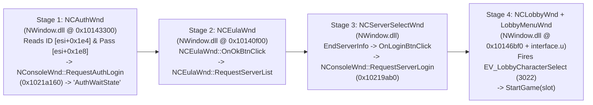

# Lineage 2 Gracia Epilogue (`CT2.4`) — Lessons Learned & Reverse-Engineering Forensics Dossier

This dossier consolidates the technical discoveries, root-cause analyses, and architectural lessons learned while reverse-engineering and modernizing the **Lineage 2 Gracia Epilogue (`CT2.4`)** client and **L2JMobius (Java 27)** server stack.

---

## 1. Why the Client Ignored `[AutoLogOn]` (`l2.ini`)

When configuring [`system/l2.ini`](file:///home/dwea/Projects/L2/Client%20Lineage%202%20Gracia%20Epilogue/system/l2.ini) for automatic login (`[AutoLogOn]`), two separate layers of failure were uncovered:

### 1.1 Layer 1: The Shipped `Ture` Typo
In the original encrypted [`l2.ini`](file:///home/dwea/Projects/L2/Client%20Lineage%202%20Gracia%20Epilogue/system/l2.ini) (line 56), NCSoft shipped the `[AutoLogOn]` section with a literal spelling mistake:
```ini
[AutoLogOn]
IsL2AutoLogOn=Ture
L2ID=test
L2Passwd=test
L2Slot=7
```

### 1.2 Layer 2: `#ifdef _L2_AUTOLOGON` Was Compiled Out of Retail Binaries
Even after fixing `Ture` $\rightarrow$ `True` and setting valid `L2ID`, `L2Passwd`, and `L2Slot` values via [`launch-l2.sh`](file:///home/dwea/Projects/L2/Client%20Lineage%202%20Gracia%20Epilogue/launch-l2.sh), the client still booted to the manual login screen and waited for keyboard input.

Scanning the entire ASCII and UTF-16LE string tables (`.rdata` / `.data`) and `GConfig` call sites across **every binary and package** in [`system/`](file:///home/dwea/Projects/L2/Client%20Lineage%202%20Gracia%20Epilogue/system) (`l2.exe`, `Core.dll`, `Engine.dll`, `NWindow.dll`, `WinDrv.dll`, `Window.dll`, and all 25 `.u` packages) proved why:
- **None of the strings `AutoLogOn`, `IsL2AutoLogOn`, `L2ID`, `L2Passwd`, or `L2Slot` exist anywhere in any retail binary or UnrealScript package.**
- In NCSoft's internal QA builds, an `#ifdef` developer block read `[AutoLogOn]` from `l2.ini` to bypass the login sequence. When compiling retail shipping builds, NCSoft compiled that `#ifdef` block out completely, leaving the `[AutoLogOn]` section in `l2.ini` as an **orphaned configuration stub** that no code ever reads.

### 1.3 How the 4-Stage Login State Machine Actually Works (`NWindow.dll` + `interface.u`)
Disassembling [`NWindow.dll`](file:///home/dwea/Projects/L2/Client%20Lineage%202%20Gracia%20Epilogue/system/nwindow.dll) and [`interface.u`](file:///home/dwea/Projects/L2/Client%20Lineage%202%20Gracia%20Epilogue/system/interface.u) revealed that—unlike in-game windows which are scripted in UnrealScript (`interface.u`)—the login and lobby sequence is driven by **4 native C++ window classes compiled directly into `NWindow.dll`**:



| Stage | C++ / UScript Class | Key Virtual Addresses (`NWindow.dll`) | What Happens Under the Hood |
| :--- | :--- | :--- | :--- |
| **1. Credentials** | `NCAuthWnd` | `ShowWindow` (`0x10143300`), `OnLoginBtnClick` (`0x101431b0`), `RequestAuthLogin` (`0x1021a160`) | `this+0x1e4` is `NCEditBox*` (ID), `this+0x1e8` is `NCEditBox*` (Password). Clicking Log In calls `NConsoleWnd::RequestAuthLogin` and enters `"AuthWaitState"`. |
| **2. License / EULA** | `NCEulaWnd` | `ShowWindow` (`0x10140f00`), `OnOkBtnClick`, `RequestServerList` | Transitions to `"EulaMsgState"` (or bypasses if server `ShowLicence = False`) and requests the GameServer list from LoginServer (`2106`). |
| **3. Server Select** | `NCServerSelectWnd` | `EndServerInfo`, `OnLoginBtnClick`, `RequestServerLogin` (`0x10219ab0`) | Populates the server list (`servername-e.dat`) and sends `RequestServerLogin` for the selected `server_id`. |
| **4. Character Lobby** | `NCLobbyWnd` + `LobbyMenuWnd` | `0x10145d0f`, `0x10146140`, `0x10146bf0` | Receives `CharSelectInfo`, fires `EV_LobbyCharacterSelect` (`3022`) and `EV_LobbyMenuButtonEnable`, and calls `StartGame(slot)` in `interface.u`. |

---

## 2. Why `l2.exe` Ignored Command-Line Arguments (`WinMain` Forensics)

Standard Unreal Engine 2.5 games accept server IP, port, map, and `.ini` overrides directly on the command line (e.g., `l2.exe 127.0.0.1:7777` or `l2.exe -ini=custom.ini`).

Disassembling `WinMain` in [`system/l2.exe`](file:///home/dwea/Projects/L2/Client%20Lineage%202%20Gracia%20Epilogue/system/l2.exe) (`VA 0x0041C900` / `0x1091C900` $\rightarrow$ helper `0x0041B234`) proved why passing CLI arguments to `l2.exe` does nothing:
1. Before calling `InitEngine` (`0x10926520`), `l2.exe` passes `lpCmdLine` to `0x0041B234`.
2. `0x0041B234` checks `lpCmdLine` for **only two hardcoded substrings**:
   - **`-L2ProtocolVersion`**: Pops up a modal `MessageBoxW` displaying the client's protocol revision (`148`) and immediately exits the process.
   - **`Seekori!`**: An internal NCSoft developer/launcher token.
3. **All other command-line arguments are stripped and never forwarded as an Unreal URL.** Instead, `Engine.dll` reads `ServerAddr` and `Port` exclusively from the `[URL]` section of [`system/l2.ini`](file:///home/dwea/Projects/L2/Client%20Lineage%202%20Gracia%20Epilogue/system/l2.ini).

---

## 3. Why Settings in `l2.ini` Were Ignored or Reset (`Option.ini` vs `l2.ini` Split-Brain)

During client bring-up, editing resolution, fullscreen, or console settings in `l2.ini` frequently appeared to have no effect. Reverse-engineering `l2.exe`, `Core.dll`, and `WinDrv.dll` uncovered **four interacting mechanisms**:

### 3.1 `Option.ini` Silently Overwrites `l2.ini` Viewport & Fullscreen Settings on Boot
Disassembling `UWindowsClient::StaticConstructor` (`0x11113b80`), `UWindowsClient::Init` (`0x11113a25`), and `UWindowsViewport::OpenWindow` (`0x1110f5b6`) in [`system/windrv.dll`](file:///home/dwea/Projects/L2/Client%20Lineage%202%20Gracia%20Epilogue/system/windrv.dll) revealed a split configuration architecture:

| Setting | Key in `l2.ini` (`[WinDrv.WindowsClient]`) | Key in `Option.ini` | Which File Actually Wins at Runtime? |
| :--- | :--- | :--- | :--- |
| **Resolution (`X × Y`)** | `WindowedViewportX/Y`, `FullscreenViewportX/Y` | `[Video] GamePlayViewportX/Y` | **`Option.ini` wins!** `UWindowsClient::Init` (`0x11113a25`) reads `GamePlayViewportX/Y` from `Option.ini` and overwrites `l2.ini`'s viewport sizes in memory. |
| **Fullscreen vs Windowed** | `StartupFullscreen` | `[Video] StartupFullScreen` | **`Option.ini` wins!** `UWindowsViewport::OpenWindow` (`0x1110f5b6`) reads `StartupFullScreen` from `Option.ini`. |
| **Borderless vs Titlebar** | `UseWindowFrame` | *(Not in `Option.ini`)* | **`l2.ini` wins!** `OpenWindow` (`0x1110f438`) computes `dwStyle = (UseWindowFrame ? 0x90CF0000 : 0) + 0x80000000` (`WS_OVERLAPPEDWINDOW` vs `WS_POPUP`). |
| **Controller (`JOYPAD`)** | `UseJoystick` | `[Game] UseJoystick` | **Both must be `True`!** `l2.ini` sets `Engine.dll`'s `GUseJoystick` (`0x11113c60`), while `Option.ini` controls the UI state. |

### 3.2 The `FirstRun < 2110` Configuration Reset Trap in `l2.exe`
Disassembling `InitEngine` $\rightarrow$ `SetInitialConfiguration` in [`system/l2.exe`](file:///home/dwea/Projects/L2/Client%20Lineage%202%20Gracia%20Epilogue/system/l2.exe) (`VA 0x1092671d`) revealed:
- On startup, `l2.exe` reads `FirstRun` from `system/Option.ini`.
- It compares `FirstRun` against **`2110` (`0x83E`)**. If `FirstRun < 2110`, `l2.exe` assumes the game is running for the first time after an update, **wipes custom video/option settings back to defaults**, and writes `FirstRun=2110`.
- Meanwhile, in `interface.u`, `OptionWnd.OnClickButton` writes `FirstRun=2` into `Option.ini`!

### 3.3 `FFileManagerL2` Explicitly Write-Protects `L2.ini` and `User.ini`
Disassembling `FFileManagerL2::CreateFileWriter` (`l2.exe` at `VA 0x1090a10c..0x1090a196`) showed that when Unreal Engine attempts to flush `GConfig` to disk on exit:
- `CreateFileWriter` checks the target filename against `"L2.ini"` and `"User.ini"` (case-insensitive).
- If matched, it **immediately returns `NULL`**, preventing the engine from ever saving runtime changes back into `l2.ini` or `user.ini`. Only `Option.ini`, `WindowsInfo.ini`, and `chatfilter.ini` are writable by the client process.

### 3.4 Four Windowing Bugs in Unpatched `windrv.dll`
Even when `Option.ini` and `l2.ini` were aligned, unpatched `windrv.dll` had four hardcoded behaviors from 2004 that broke modern desktop windowing:
1. **`ResizeViewport` (`0x1110e012`) Forced Borders Back On:** Whenever a windowed viewport resized, `ResizeViewport` called `GetWindowLongW`/`SetWindowLongW` and unconditionally added `WS_CAPTION | WS_THICKFRAME` back onto the window.
2. **Clicking OS Maximize (`wParam == SIZE_MAXIMIZED == 2` at `0x11111baf`):** Instead of resizing the window, it set `bMaximized = 1`, trapped the mouse cursor inside the old `1024×768` rectangle via `SetCapture`, hid the cursor, and forced the next resize into **Exclusive Fullscreen**.
3. **Redundant `MoveWindow` Loop (`0x1110e03a`):** On `WM_SIZE`, `ResizeViewport` called `MoveWindow` back onto the window the OS window manager had just resized, fighting GNOME Wayland / XWayland maximizing and tiling.
4. **Asynchronous XWayland `GetClientRect` Race (`0x1110e0b9`):** Immediately after `MoveWindow`, `ResizeViewport` called `GetClientRect` and overwrote `Viewport->SizeX/SizeY` with stale pre-resize dimensions (`1024×768`), desynchronizing mouse click coordinates from the rendered 3D backbuffer.

*(All four were permanently fixed via the 5 binary patches in [`system/windrv.dll`](file:///home/dwea/Projects/L2/Client%20Lineage%202%20Gracia%20Epilogue/system/windrv.dll) applied by [`launch-l2.sh`](file:///home/dwea/Projects/L2/Client%20Lineage%202%20Gracia%20Epilogue/launch-l2.sh).)*

---

## 4. Why the Original Client Crashed on Login (`00010084 1289`) — The 5-Layer Post-Mortem

When pressing **Enter** on the login screen in the original client folder, the game crashed with:
```text
History: UWindowsViewport::ViewportWndProc <- WWindow::StaticProc <- DispatchMessage <- 00010084 1289 <- MessagePump <- MainLoop
```
Here `1289` (`0x0509` = `WM_USER + 0x109`) is the `WSAAsyncSelect` socket connect callback (`UL2ConsoleWnd::DispatchSocketWindowMsg`). Five stacked root causes were behind this crash and the subsequent boot errors:

| # | Root Cause | Technical Mechanism | Resolution |
| :- | :--- | :--- | :--- |
| **1** | **"Frankenstein" Hybrid `system/` Folder (`2010-07-16` + `2009-09-28`)** | The original `system/` mixed `2010-07-16` (`Protocol 152`) core DLLs (`Core.dll`, packed `26.1 MB` `Engine.dll`, `nwindow.dll`, `windrv.dll` where NCSoft inserted a virtual method into `UObject`/`UConsole`, shifting all vtable offsets by **`+4` bytes**) with a `2009-11-01` `dsetup.dll` and `l2.exe` compiled for `2009-09-28` (`Protocol 148`). `dsetup.dll` failed to find the `UNetworkHandler` prologue in the packed `Engine.dll`, and `unichat.dll` ended `DllMain` with `ret` (`c3`) instead of `__stdcall` `ret 0xc` (`c2 0c 00`), corrupting `ESP` by 12 bytes. | Unified `system/` onto the clean, 100% unpacked **`2009-09-28` (`Protocol 148`)** DLLs, `.u` packages, and `.dat` tables from `L2 Epilogue Clean/system/`, and removed `unichat.dll`. |
| **2** | **`dsetup.dll` Wine WoW64 Base Collision & Section Flags** | `dsetup.dll` was linked with `ImageBase = 0x00400000` (mapped to `locale.nls` under Wine WoW64), Read-Only `.idata` (`0x40000040`), and Execute-Only `.reloc` (`0x20000040`), faulting during relocation. | Rebased `dsetup.dll` to `0x12000000` and fixed `.idata` (`0xC0000040`) and `.reloc` (`0x42000040`) section flags. |
| **3** | **Missing `?GL2RunningFirstHandle@@3PAXA` in `2009-09-28` `Core.dll`** | `l2.exe` (`2010-03-23`) imported `?GL2RunningFirstHandle@@3PAXA` from `Core.dll` and wrote the `CreateMutexW` handle to it once at `VA 0x10926AEE`. | Aliased the import in `l2.exe` (`0x68C32`) to `?GIsServer@@3HA` and NOPed the 2-byte write at `0x25CEE` (`89 01` $\rightarrow$ `90 90`). |
| **4** | **Dual `Lineage2Ver413` RSA-1024 Key Mismatch (`EulaLoad` Crash)** | `l2.exe` (`VA 0x10930300`) pushed the `l2encdec` modding RSA key (`75b4d6de...`, `e=0x1D`), whereas clean retail `.dat` files (`eula-e.dat`, `itemname-e.dat`) are encrypted with NCSoft's official retail `Lineage2Ver413` RSA key (`97df3984...`, `e=0x35`). | Patched `l2.exe` at `0x2F500` & `0x2F604` with the official retail RSA-1024 modulus (`97df3984...`) and exponent (`0x35`), and bypassed GameGuard in `Engine.dll` (`0x39B750`: `33 c0 fe c0 c3`). |
| **5** | **The `npkcrypt.dll` Static Import Catch-22** | `L2UseKeyCrypt=true` crashes Wine by attempting to load the Win98/XP ring-0 driver `npkcrypt.sys`, while deleting `npkcrypt.dll` breaks `NWindow.dll`'s static PE Import Table. | Kept `npkcrypt.dll` in `system/` to satisfy `NWindow.dll`'s import table and set `L2UseKeyCrypt=false` in `l2.ini`. |

---

## 5. Wire Protocol, Bytecode & PE Relocation Traps Discovered

### 5.1 Protocol `148` vs `152` Wire Differences & The Broadcast Cache Trap
Auditing all 439 packet handlers in `Engine.dll` (`0x20687f70`) revealed the exact 3 wire differences between early Gracia Epilogue (`Protocol 148`, `2009-09-28`) and late Gracia Epilogue (`Protocol 152`, `2010-07-16`):
1. **70-Byte vs 76-Byte Item Body (`EnchantOptions`):**
   - Protocol `152` appends `3 × short` (`6` bytes) of `EnchantOptions` after `item.getTime()` across 22 item/shop/warehouse/trade/mail packets.
   - **Why `InventoryUpdate` only crashed on 2+ items:** For a 1-item packet, the `148` client simply ignored the 6 trailing bytes at the end of the packet. When 2+ items were batched within 100ms (e.g., a quest reward removing a quest item and adding soulshots), the client read 72 bytes for item #1 and landed on item #1's trailing `EnchantOptions` (`0x0000`) as item #2's `iWorkType`, triggering `Assertion failed: iWorkType == IUT_ADD || iWorkType == IUT_UPDATE || iWorkType == IUT_DELETE`.
2. **Swapped Extended Opcodes (`0xFE:0xBD` vs `0xFE:0xBE`):**
   - In `148`, `ExBrBroadcastEventState` is `0xFE:0xBD` and `ExBrExtraUserInfo` is `0xFE:0xBE`. In `152`, they are swapped.
3. **`SystemMessageId` Range (`systemmsg-e.dat` `3,020` rows in `148`):**
   - Server `SystemMessageId`s `3093..3207` (such as `3108` spawn protection fade) do not exist in `148`'s `systemmsg-e.dat` (`0..3020`) and return an empty string that crashes `ChatWnd` unless converted to text via `SystemMessageId.S1_2` (`1987`) for Protocol `148` clients.
4. **The Broadcast Packet Cache Trap:**
   - L2JMobius caches the serialized `ByteBuffer` of broadcast packets (`ExBrExtraUserInfo`, `SystemMessage`) on the `ServerPacket` instance when broadcasting to nearby players. Any packet whose wire bytes depend on the recipient's protocol version **must** override `isProtocolSensitive() = true` so the broadcast loop serializes per client instead of sending a cached `152` buffer to a `148` client (or vice versa).

### 5.2 Unreal Engine `.u` Bytecode & `.xdat` Widget Invariants
1. **Disk Size vs In-Memory `UStruct::SerializeExpr` Size (`interface.u`):**
   - Modifying `interface.u` requires **0-byte file size delta** so none of the 14,785 Export Table `SerialOffset` pointers shift.
   - Furthermore, `UStruct::SerializeExpr` recursively counts **in-memory** bytecode size until it matches the function header's `ScriptSize`. Replacing a 5-byte `EX_IntConst` (`0x1D + int32`, 5 bytes on disk and 5 bytes in memory) with `EX_ByteConst` (`0x24 + uint8`, 2 bytes in memory) plus `EX_Nothing` (`0x0B`, 1 byte in memory) changes the in-memory deserialized size even if disk bytes match, crashing the package loader!
2. **`NCButton` Texture Naming Convention (`interface.xdat`):**
   - In `NWindow.dll`, `NCButton` automatically derives hover and pressed textures by stripping the base texture suffix and appending `_Down` and `_Over` (e.g., `L2UI_ct1.Button.Button_DF` $\rightarrow$ `Button_DF_Down`, `Button_DF_Over`). Setting a button's `normalTex` to `Tab_DF` fails to find `Tab_DF_Down` and eliminates visual click feedback.
3. **Custom Literal Strings Without Editing `sysstring-e.dat`:**
   - Setting `ButtonName = -9999` (`\xf1\xd8\xff\xff`) on a `Button` or `sysstring = -9999` on a `TextBox` in `interface.xdat` instructs `NWindow.dll` to render the literal `ButtonNameText` / `Text` string directly instead of looking up a row in `sysstring-e.dat`.

### 5.3 The PE `.reloc` Rebasing Trap When Binary-Patching DLLs (`NWindow.dll`)
When we patched [`NWindow.dll`](file:///home/dwea/Projects/L2/Client%20Lineage%202%20Gracia%20Epilogue/system/nwindow.dll) (`ImageBase = 0x10000000`) to unlock wide Unicode input (`U+00A0..U+04FF`) in `NCEditBox::OnChar` (`0x100d44ee`), `NCMultiEditBox::OnChar` (`0x100a3468`), and `IsObsceneWord` (`0x10215fbb`):
- Because `NWindow.dll` shares preferred `ImageBase = 0x10000000` with `Core.dll`, the Windows/Wine PE loader **always rebases `NWindow.dll` in memory** at startup.
- The original instructions at those 3 sites (`8b 0d [84 c3 2d 10]` = `mov ecx, [GLanguage]`) had **`IMAGE_REL_BASED_HIGHLOW` (`type = 3`)** entries in `.reloc` (`0x004c80c2`, `0x004cac1c`, `0x004e2024`) pointing at `+2` bytes into each instruction.
- When Wine rebased `NWindow.dll`, the PE loader added `BaseDelta` to the 4 bytes at `0x100d44f0`, corrupting our replacement instructions in memory!
- **Lesson Learned:** Whenever binary-patching any PE `.exe`/`.dll` that has a `.reloc` table, **always scan `.reloc` for entries overlapping the patched RVA range** and neutralize any superseded `IMAGE_REL_BASED_HIGHLOW` entries to `IMAGE_REL_BASED_ABSOLUTE` (`0x0000`).

---

## 6. Controller (`JOYPAD`) Forensics & Why Switching Targets Opened the GM NPC Menu

Testing a **DualSense (PS5)** controller in-game revealed several quirks in NCSoft's half-finished 2004 DirectInput controller subsystem (`WinDrv.dll` + `Engine.dll` + `interface.u`):

### 6.1 Why Controller Target Cycling (`L1` / `R1`) Opened the GM NPC Inspector Popup
- **Symptom:** Pressing `L1` (`Joy5` = `NPCTargetPrev`) or `R1` (`Joy6` = `NPCTargetNext`) on a GM character immediately popped open the server's GM NPC Info HTML window (`onActionShift` / `NpcViewMod`) instead of simply selecting the target.
- **Root Cause (`Engine.dll` @ `VA 0x202a5bf8` + [`Action.java`](file:///home/dwea/Projects/L2/l2jmobius_dwea_fork/L2J_Mobius_CT_2.4_Epilogue/java/org/l2jmobius/gameserver/network/clientpackets/Action.java#L150-L161)):**
  - Disassembling the `NPCTargetNext` / `NPCTargetPrev` handler in `Engine.dll` (`VA 0x202a5992..0x202a5c2d`) showed that at `0x202a5bf8`, the client pushes **`bShift = 1` (`6a 01`)** when calling `UNetworkHandler::Action(targetObjectId, playerLocation, 1)` (`vtable + 0xE0`).
  - Why did NCSoft pass `bShift = 1` (`_actionId = 1`) for controller target cycling? Because on normal players, `Action(objectId, ..., 1)` (`Shift+Click`) tells the server: *"Select this target (`obj.onAction(player, false)`), but do NOT run toward or attack it yet!"*
  - However, in L2JMobius's [`Action.java`](file:///home/dwea/Projects/L2/l2jmobius_dwea_fork/L2J_Mobius_CT_2.4_Epilogue/java/org/l2jmobius/gameserver/network/clientpackets/Action.java#L150-L161), receiving `_actionId == 1` from a GM (`player.isGM()`) unconditionally calls `obj.onActionShift(player)`—which opens the GM Shift-Click NPC stats window even when the GM was only cycling targets (`player.getTarget() != obj`)!

### 6.2 Why the Radial / Cross Shortcut UI Didn't Appear Automatically (`ShortcutWnd` in `interface.u`)
Extracting the embedded UnrealScript source of `ShortcutWnd` from [`system/interface.u`](file:///home/dwea/Projects/L2/Client%20Lineage%202%20Gracia%20Epilogue/system/interface.u) revealed that NCSoft actually built **two** controller hotbar layouts inside `ShortcutWnd`:
1. **`ShortcutWnd.ShortcutWndJoypad`:** A 4-button diamond/cross widget with `JoypadLButtonTex` (`L2UI_ch3.Joypad.joypad_L`) and `JoypadRButtonTex` (`L2UI_ch3.Joypad.joypad_R`) that displays 4 slots at a time and dynamically swaps between Center (`Slots 1–4`), Left (`Slots 5–8` while holding `Extend1`), and Right (`Slots 9–12` while holding `Extend2`).
2. **`ShortcutWnd.ShortcutWndJoypadExpand`:** An expanded 12-slot controller bar showing all 3 groups of 4 (`Left | Center | Right`) with a sliding highlight frame (`joypad2_back_over1/2/3`) that visually jumps between the 3 groups when holding `Extend1` (`Joy7`) or `Extend2` (`Joy8`).
3. **Why it stays hidden:** Pressing `Extend1`/`Extend2` fires `HandleJoypadLButtonDown` / `HandleJoypadRButtonDown` (`SetJoypadShortcut`), which updates the textures inside `ShortcutWndJoypad` / `ShortcutWndJoypadExpand`, **but never calls `ShowWindow` unless the user first clicks the tiny `JoypadBtn` icon on the main hotbar** (`OnJoypadBtn()` $\rightarrow$ `SetJoypad(true)`)!

### 6.3 Other Unfinished Retail Controller Gaps Identified for Future Polish
- **`user.ini` Regression on Clean `system/` Restore:** Copying `L2 Epilogue Clean/system/` in `7636477796b` overwrote the modernized `user.ini` with the 2004 defaults (`DeadZone=0.2`, `JoyZ=CameraYaw`, no `JoyPov*` D-Pad bindings). Restored in `293ec8acd1b` and refined in `1f152ce8abe` so Right Stick camera uses `JoyZ` (`Z`) and `JoyV` (`Rz`) while unbinding `;JoyU=` / `;JoyR=` (which are `-1.0` resting L2/R2 triggers on Sony DualSense PS5 under Linux `hid-playstation` + Wine DirectInput).
- **Target Acquisition Only on `L1`/`R1` (`Joy5`/`Joy6`):** If no target is currently selected, pressing an attack shortcut (`Joy1..Joy4`) does not auto-acquire the nearest hostile target (`NextTarget`), unlike modern action/tab-target MMOs on console.
- **DualSense Touchpad Curve:** Under Linux (`hid-playstation`), the DualSense touchpad acts as a 1:1 linear relative mouse without acceleration, requiring multiple swipes to drag icons across a `1920×1080` viewport.

---

## 7. Native Client Geodata Builder (`///buildzone` / `FWorldBuilder`) Forensics (`Engine.dll`)

Disassembling `FWorldBuilder::buildWorldStructure` (`VA 0x2018be10..0x2018df0d`, ordinal `9236`) and its companion `///` builder commands (`VA 0x202b37b4..0x202b45a2`) in [`Engine.dll`](file:///home/dwea/Projects/L2/Client%20Lineage%202%20Gracia%20Epilogue/system/Engine.dll) revealed how NCSoft originally generated Lineage 2 geodata:

1. **Why Lineage 2 Geodata `NSWE` Bits Are Ordered `East=1, West=2, South=4, North=8` (`VA 0x20467b08`):**
   - In `FWorldBuilder::FindReachable` (`VA 0x2018b825..0x2018b980`), each cell node (`0x3c` bytes) stores 4 directional passability flags at `[node+0x10]`, `[node+0x14]`, `[node+0x18]`, and `[node+0x1c]`, indexed by `edi = 0..3` against the constant `(dx, dy)` table at `VA 0x20467b08`:
     - `dir[0]` (`[node+0x10]`): `dx = +1, dy =  0` (**East** $\rightarrow$ `bit 0 = 0x01`)
     - `dir[1]` (`[node+0x14]`): `dx = -1, dy =  0` (**West** $\rightarrow$ `bit 1 = 0x02`)
     - `dir[2]` (`[node+0x18]`): `dx =  0, dy = +1` (**South** $\rightarrow$ `bit 2 = 0x04`)
     - `dir[3]` (`[node+0x1c]`): `dx =  0, dy = -1` (**North** $\rightarrow$ `bit 3 = 0x08`)
   - When read from MSB (`bit 3`) down to LSB (`bit 0`), the 4 bits spell **`N-S-W-E`**, whereas in `FWorldBuilder`'s array order (`0..3`) and in `<MapX>_<MapY>_path.txt` (`(<height>:<d0><d1><d2><d3>)`), they are emitted in **`E-W-S-N`** order (`d0=East, d1=West, d2=South, d3=North`).
2. **Why In-Game `///buildzone` Only Builds a Local Patch Around the Player Without Writing `<MapX>_<MapY>_path.txt`:**
   - `FWorldBuilder::buildWorldStructure` has two execution paths controlled by `this->Viewport` (`[ebx+0x04]`, passed as `arg3`):
     - When `Viewport == NULL` (`[ebx+0x04] == 0`, as called by `UnrealEd`), it spawns a temporary `LineageWarrior.FFighter` scout (`FWorldBuilder::getScout` at `VA 0x201899c0`), runs OpenMP 2-thread `SetInitialPoints` (`VA 0x2018a0d0`) and `FindReachable` (`VA 0x2018b9a0`) across the entire `2048 × 2048` region, and writes **`<MapX>_<MapY>_path.txt`** at `VA 0x2018dd39..0x2018dea9`.
     - When `Viewport != NULL` (`[ebx+0x04] != 0`, as passed by `///buildzone` at `VA 0x202b384c`: `mov edx, [esi+0xe78]; push edx`), it uses the player's own pawn, restricts the bounding box to `Width × Width` (default `128 × 128` units = `8 × 8` cells) around the player, steps the pawn visually while redrawing the viewport, and skips writing `<MapX>_<MapY>_path.txt` at `VA 0x2018dd39` (`cmp dword ptr [ebx+0x4], 0; jne 0x2018dee0`) so the built cells remain in `[0x206daf58]` for immediate 3D visualization via `///c_rmode geodata`.
   - Furthermore, at `VA 0x2018bf22` (`mov word ptr [ebp+eax*2-0x5d8], 0`), `FWorldBuilder::buildWorldStructure` strips the last **4 characters** (`.unr`) from `MapName` before formatting `"%S_path.txt"`, so `Map=` must include `.unr` (e.g. `Map=17_25.unr`).
3. **Why `GeoTestDuringBuild` Defaults to `1` Unless Overridden in `system/Unrealed.ini`:**
   - At `VA 0x2018c424..0x2018c49e`, `FWorldBuilder::buildWorldStructure` reads `RunWalkbuild`, `GeoTestDuringBuild`, and `RunPostbuild` from `[WorldBuildOptions]` in `Unrealed.ini`, defaulting all three to `1` (`TRUE`) if missing. When `GeoTestDuringBuild=1`, it executes three `2032 × 2032` debug verification passes (`%d_%d_BuildTest_1..3.txt`) and attempts to load `.\GeoData\%d_%d_conv.dat` (`VA 0x203902f0`). Setting `GeoTestDuringBuild=0` in `system/Unrealed.ini` bypasses all three debug test dumps.

---

## 8. Gracia Epilogue (`CT2.4`) Player Skill & Channelizer Forensics (`ff520e82973`)

Auditing all 1,082 player-learnable skills (`dist/game/data/stats/players/skillTrees/**/*.xml`), all `<!-- Epilogue Modification -->` backport edits across `dist/game/data/stats/skills/*.xml`, and the Java skill/effect core (`Skill.java`, `SkillChannelizer.java`, `Creature.java`, `dist/game/data/scripts/handlers/skill/effects/*.java`) exposed four classes of gameplay bugs caused by incomplete High Five (`CT2.5`) $\rightarrow$ Gracia Epilogue (`CT2.4`) backports:

1. **Gladiator / Duelist & Tyrant / Grand Khavatari Momentum Charges (`918`, `919`, `345`, `346`, `5127`, `54`):**
   - [`FocusMaxEnergy.java`](file:///home/dwea/Projects/L2/l2jmobius_dwea_fork/L2J_Mobius_CT_2.4_Epilogue/dist/game/data/scripts/handlers/skill/effects/FocusMaxEnergy.java) checked High Five passive skills `992` (*Sonic Mastery*) and `993` (*Focus Force Mastery*), which were commented out in [`00900-00999.xml`](file:///home/dwea/Projects/L2/l2jmobius_dwea_fork/L2J_Mobius_CT_2.4_Epilogue/dist/game/data/stats/skills/00900-00999.xml#L1773-L1774) for Epilogue, causing `Maximum Focus Sonic` (`919`) and `Maximum Focus Force` (`918`) to grant `0` charges. Updated [`FocusMaxEnergy.java`](file:///home/dwea/Projects/L2/l2jmobius_dwea_fork/L2J_Mobius_CT_2.4_Epilogue/dist/game/data/scripts/handlers/skill/effects/FocusMaxEnergy.java) and [`FocusEnergy.java`](file:///home/dwea/Projects/L2/l2jmobius_dwea_fork/L2J_Mobius_CT_2.4_Epilogue/dist/game/data/scripts/handlers/skill/effects/FocusEnergy.java) to resolve max charges (`1..8`) from Epilogue active skills **`8` (*Sonic Focus*)** and **`50` (*Focused Force*)**, raised the charge cap from `7` to `8` on `918`, `919`, `345` (*Sonic Rage*), `346` (*Raging Force*), and `5127` (*Recover Force*), and added `<player Charges="1" />` to `54` (*Force Blaster*).
2. **Channeling Skills (`Volcano` `1419`, `Cyclone` `1420`, `Raging Waves` `1421`, `Gehenna` `1423`, `Seven Arrow` `924`, `Soul Sucking` `1472`/`1545`):**
   - [`SkillChannelizer.java`](file:///home/dwea/Projects/L2/l2jmobius_dwea_fork/L2J_Mobius_CT_2.4_Epilogue/java/org/l2jmobius/gameserver/mechanics/skill/SkillChannelizer.java#L194) checked `LocationUtil.checkIfInRange(skill.getEffectRange(), ...)`, where `effectRange == -1` on `GROUND` channeling skills (`1419`, `1420`, `1421`, `1423`) rejected 100% of targets on every tick. Guarded the `effectRange` check with `(skill.getEffectRange() > 0) && (skill.getTargetType() != TargetType.GROUND)` and moved Soulshot/Spiritshot consumption outside the per-target loop so hitting $N$ targets consumes 1 shot per tick instead of $N$.
   - Restored `<channelingSkillId>924</channelingSkillId>`, `<channelingTickInterval>2</channelingTickInterval>`, and `<channelingEffects>` on `924` (*Seven Arrow*) so it fires 7 arrows (1 every 2s over 15s) instead of waiting 15s for 1 arrow.
3. **Archer `Arrow Rain` (`772`) & Mage `Meteor` (`1467`) / `Star Fall` (`1468`):**
   - Removed the leftover High Five `<effect name="CallSkill"><skillId>23299</skillId></effect>` from `772` (*Arrow Rain* in [`00700-00799.xml`](file:///home/dwea/Projects/L2/l2jmobius_dwea_fork/L2J_Mobius_CT_2.4_Epilogue/dist/game/data/stats/skills/00700-00799.xml#L1971-L1999)) which was broadcasting a nonexistent High Five skill ID (`23299`) to the Epilogue client, and uncommented `<effect name="DamOverTime" ticks="3"><power>111</power></effect>` on `1467` (*Meteor*) and `1468` (*Star Fall*) in [`01400-01499.xml`](file:///home/dwea/Projects/L2/l2jmobius_dwea_fork/L2J_Mobius_CT_2.4_Epilogue/dist/game/data/stats/skills/01400-01499.xml#L4526-L4591).
4. **`+Duel` Enchanted Skills vs. Doors & Siege Gates ([`Skill.java`](file:///home/dwea/Projects/L2/l2jmobius_dwea_fork/L2J_Mobius_CT_2.4_Epilogue/java/org/l2jmobius/gameserver/mechanics/skill/Skill.java#L1361)):**
   - Changed `pvpOrPveEffectScope` fallback from `effected.isAttackable() ? EffectScope.PVE : ... : null` to `effected.isPlayable() ? EffectScope.PVP : EffectScope.PVE` so skills with `<enchant7pveEffects>` / `<enchant7pvpEffects>` deal full PvE damage to `Door` and `SiegeFlag` instances.

---

## 9. Gracia Epilogue (`CT2.4`) 3rd-Profession Passives, Toggles & Triggers Forensics

Auditing all 35 3rd-profession passive skills (`operateType="P"` in `3rdClass/*.xml`), 7 3rd-profession toggles (`334`–`340`), Tank Lv83 Seed/Ultimate chains (`761`/`762`, `784`/`785`, `786`/`787`, `788`/`789`), and triggered sub-skills (`5426`–`6060`) against NCSoft Gracia Epilogue (`CT2.4`) PTS `skilldata.txt` uncovered 9 critical bugs:

1. **Ghost Sentinel (`classId=109`) Missing All 8 Lv81–82 Forgotten Scroll Skills (`e9a8b96d6a2`):**
   - In [`3rdClass/GhostSentinel.xml`](file:///home/dwea/Projects/L2/l2jmobius_dwea_fork/L2J_Mobius_CT_2.4_Epilogue/dist/game/data/stats/players/skillTrees/3rdClass/GhostSentinel.xml), all 8 of Ghost Sentinel's Lv81–82 Forgotten Scroll skills (`758` *Fighter's Will*, `759` *Archer's Will*, `773` *Ghost Piercing*, `924` *Seven Arrow*, `946` *Silent Mind*, `755`–`757` *Protection of Rune/Elemental/Alignment*) had been mistakenly pasted at the bottom of [`2ndClass/PhantomRanger.xml`](file:///home/dwea/Projects/L2/l2jmobius_dwea_fork/L2J_Mobius_CT_2.4_Epilogue/dist/game/data/stats/players/skillTrees/2ndClass/PhantomRanger.xml) (`classId=37`). Moved them to `3rdClass/GhostSentinel.xml`.
2. **[`TriggerSkillByDamageDealt.java`](file:///home/dwea/Projects/L2/l2jmobius_dwea_fork/L2J_Mobius_CT_2.4_Epilogue/dist/game/data/scripts/handlers/skill/effects/TriggerSkillByDamageDealt.java#L91) Rejecting 100% of Critical Hits When `<isCritical>false</isCritical>`:**
   - Line 91 checked `if (_isCritical != event.isCritical()) return;`. When `<isCritical>false</isCritical>` (`0` in PTS `p_trigger_skill_by_attack`, meaning *"does not require a critical hit"*) was set on `758` (*Fighter's Will*), `759` (*Archer's Will*), `1498` (*Mutual Response*), Subclass Master Abilities (`651`, `653`, `654`), and PvP Weapons (`3650`–`3657`), every critical hit (`event.isCritical() == true`) was rejected! Changed to `if (_isCritical && !event.isCritical()) return;`.
3. **All 4 Tank Lv83 Seed Skills (`761` *Seed of Revenge* $\rightarrow$ `5561`, `784` *Spirit of Phoenix* $\rightarrow$ `5562`, `786` *Eva's Will* $\rightarrow$ `5563`, `788` *Pain of Shilen* $\rightarrow$ `5564`) Failing Stage Growth (`TargetType.NONE`):**
   - In [`05500-05599.xml`](file:///home/dwea/Projects/L2/l2jmobius_dwea_fork/L2J_Mobius_CT_2.4_Epilogue/dist/game/data/stats/skills/05500-05599.xml), `5561`–`5564` had no `<targetType>` (`TargetType.NONE`), causing [`Creature.makeTriggerCast`](file:///home/dwea/Projects/L2/l2jmobius_dwea_fork/L2J_Mobius_CT_2.4_Epilogue/java/org/l2jmobius/gameserver/entity/actor/Creature.java#L7094) to print `"Target type of skill is not currently handled."` and abort stage growth, which also permanently locked out all 4 Tank Lv83 ultimates (`762` *Insane Crusher*, `785` *Flame Icon*, `787` *Touch of Eva*, `789` *Spirit of Shilen*). Added `<targetType>SELF</targetType>` to `5561`–`5564` and updated `Creature.makeTriggerCast` to fall back to `Collections.singletonList(target)` when `skill.getTargetType() == TargetType.NONE`.
4. **`5426` (*Counter Chance*, Triggered by `532` *Counter Chance*) Slowing Archer's Own Casting Spd. by 15% Instead of Increasing It by 15%:**
   - In NCSoft PTS `skilldata.txt` (`s_trigger_bow_skill_power_up1`), `5426` has `{p_magic_mp_cost;0;-5;per};{p_magic_speed;{all};15;per}` (`+15%` Casting Spd). Because the English client tooltip mistranslated Korean *"decreases skill casting time by 15%"* as *"decreases skill casting speed by 15%"*, [`05400-05499.xml`](file:///home/dwea/Projects/L2/l2jmobius_dwea_fork/L2J_Mobius_CT_2.4_Epilogue/dist/game/data/stats/skills/05400-05499.xml) had `<mul stat="mAtkSpd">0.85</mul>`. Changed to `<mul stat="mAtkSpd">1.15</mul>`.
5. **`945` (*Magician's Will*) `+5%` Magic Critical Rate Truncated to `0%` in [`CreatureStat.java`](file:///home/dwea/Projects/L2/l2jmobius_dwea_fork/L2J_Mobius_CT_2.4_Epilogue/java/org/l2jmobius/gameserver/entity/actor/stat/CreatureStat.java#L337):**
   - `int val = (int) calcStat(Stat.MCRITICAL_RATE, 1, target, skill) * 10;` cast `10.0 * 1.05 = 10.5` to `(int) 10` before `* 10 = 100`. Changed to `int val = (int) (calcStat(Stat.MCRITICAL_RATE, 1, target, skill) * 10);` (`105` = `10.5%`).
6. **`330`/`331` (*Skill Mastery*) Multiplying Passive/Toggle `time = -1` by `2` Into `-2` in [`Formulas.java`](file:///home/dwea/Projects/L2/l2jmobius_dwea_fork/L2J_Mobius_CT_2.4_Epilogue/java/org/l2jmobius/gameserver/mechanics/stats/Formulas.java#L2045):**
   - Guarded `calcEffectAbnormalTime` with `(time > 0)` and excluded passive/toggle/triggered skills in `calcSkillMastery`.
7. **`335` (*Fortitude*) Missing `MpConsumePerLevel` in [`00300-00399.xml`](file:///home/dwea/Projects/L2/l2jmobius_dwea_fork/L2J_Mobius_CT_2.4_Epilogue/dist/game/data/stats/skills/00300-00399.xml):**
   - Added `<effect name="MpConsumePerLevel" ticks="5"><power>0.5</power></effect>` to `<effects>`, `<enchant1effects>`, and `<enchant2effects>` of `335`.
8. **`767` / `5565` (*Expose Weak Point*) & [`TriggerSkillByDamageReceived.java`](file:///home/dwea/Projects/L2/l2jmobius_dwea_fork/L2J_Mobius_CT_2.4_Epilogue/dist/game/data/scripts/handlers/skill/effects/TriggerSkillByDamageReceived.java#L69):**
   - Removed active cast properties (`hitTime=1500, mpConsume=43, nextActionAttack=true`) from triggered debuff `5565`, added `isMagic=2`/`isTriggeredSkill=true`, and removed the `event.getAttacker().getTarget() != event.getTarget()` gate in `TriggerSkillByDamageReceived.java`.
9. **`1498` (*Mutual Response*), `758` (*Fighter's Will*), `759` (*Archer's Will*), and `1543` (*Great Fury*):**
   - Added `<targetType>SELF</targetType>` to all four passives, and added `<allowSkillAttack>true</allowSkillAttack>` to `1498` (*Mutual Response*) so Summoners attacking with magic skills trigger `5571` (*Mutual Response*).

---

## 10. GameServer Configs, Multi-Threaded XML Loader Spin-Loop & Custom Systems Forensics (`4c29c75ef25`)

Auditing all `dist/game/config/**/*.ini` files, `*Config.java` loaders, `IXmlReader` / `ItemData` / `SkillData`, the Custom Community Board Buffer (`HomeBoard.java` + `Custom/buffer/*.html`), and FakePlayers (`SpawnData.java`) uncovered four architectural and logic traps:

1. **100% CPU Busy-Wait Spin-Loop & Data Race in `ThreadsForLoading` (`IXmlReader.java`, `ItemData.java`, `SkillData.java`):**
   - When `ThreadsForLoading = True` in `Threads.ini`, legacy `ItemData` and `SkillData` scheduled XML file parsing onto `SCHEDULED_POOL` and then executed a busy-wait `while (!tasks.isEmpty())` spin-loop on the main startup thread while worker threads incremented a non-atomic `int count++` (a data race). Meanwhile, `IXmlReader.parseDirectory` created a fresh platform `Executors.newScheduledThreadPool(availableProcessors())` per recursive directory call.
   - Replaced with `try (ExecutorService loaderPool = Executors.newVirtualThreadPerTaskExecutor())` and `AtomicInteger`, which cleanly joins on `close()` with zero busy-wait CPU spinning and zero platform-thread pool leaks.
2. **50 of 70 Custom Community Board Buffer Skills Silently Skipped *After* Charging Currency (`HomeBoard.java` & `CommunityBoard.ini`):**
   - `Custom/buffer/*.html` (`main-buffs.html`, `main-dances.html`, `main-songs.html`, `main-resists.html`, `main-special.html`, `main-presets.html`) exposed 70 distinct buff/dance/song/resist/special skill IDs, but `CommunityAvailableBuffs` in `CommunityBoard.ini` only whitelisted 20 basic buffs.
   - Worse, `HomeBoard.java` deducted `COMMUNITYBOARD_BUFF_PRICE * buffCount` **before** checking `COMMUNITY_AVAILABLE_BUFFS.contains(skillId)`, charging players for 50 buffs (including 100% of Dances, Songs, and Special buffs) that were silently skipped!
   - Fixed by validating all requested skill IDs against `COMMUNITY_AVAILABLE_BUFFS` before charging currency, adding all 70 buffer skills to `CommunityBoard.ini`, fixing the `buffer/main-damces` typo in `main-dances.html`, and wiring `main-presets.html` into `main.html`.
3. **Impossible Boolean Guard in `SpawnData.java` (`(npcId < 80000) && (npcId > 89999)`):**
   - `SpawnData.java:164` gated FakePlayer NPC spawns (`80000..89999`) with `if (FakePlayersConfig.FAKE_PLAYERS_ENABLED || ((npcId < 80000) && (npcId > 89999)))`. Because no integer can be simultaneously `< 80000` and `> 89999`, disabling `FakePlayers` would have suppressed **every NPC spawn in the entire game world** if that branch had ever been reached! Fixed to `(npcId < 80000) || (npcId > 89999)`.
4. **13 Dead Config Keys Purged:**
   - Removed 13 unreferenced `.ini` keys and `*Config.java` fields (`PathnodePath`, `GameserverHostname`, `PrecautionaryRestartChecks`, `GMShowCritAnnouncerName`, `AllowWarehouse`, `CustomTeleportTable`, `AllowWyvernUpgrader`, `DecayTimeTask`, `AltRequireClanCastle`, `ReinforceKnightUnitCost`, `MaxFlagsPerClan`, `ListOfPetItems`, and `PathFindBuffers` count suffixes superseded by striped CAS `NodeBuffer` pools).

---

## 11. Local Docker Test Stack Architecture, Java 27 Lilliput/ZGC Tuning & `ansible/`/`terraform/` Read-Only Governance

1. **Strict Separation of Local Docker Stack vs. Remote Homelab IaC (`ansible/` & `terraform/`):**
   - `/home/dwea/Projects/L2/ansible/` and `/home/dwea/Projects/L2/terraform/` belong to a separate live-development Proxmox homelab track (`peak`, `10.9.0.0/24`) and are **strictly read-only** during internal/local development and testing.
   - All local compilation, testing, and verification run exclusively through `/home/dwea/Projects/L2/docker-compose.yml` and `/home/dwea/Projects/L2/docker/run-server.sh`.
2. **Java 27 (`Temurin-27+35`) Generational ZGC + Lilliput Compact Object Headers (`docker/run-server.sh`):**
   - Enabled `-XX:+UseCompactObjectHeaders` (JEP 519, shrinking 64-bit object headers from 96/128 bits to 64 bits), `-XX:+AlwaysPreTouch`, `-XX:+UseStringDeduplication`, `-XX:+ExplicitGCInvokesConcurrent`, `-XX:SoftMaxHeapSize=3g`, `-XX:ZUncommitDelay=300`, and rotating `-Xlog:gc*:file=log/gc.log:time,uptime,level,tags:filecount=5,filesize=10M`.
   - Reduced `l2-game` startup heap by **`-152 MB` (`-7.5%`)** (`2,018 MB` $\rightarrow$ `1,866 MB`) with a `9s` boot time.
3. **Zero-Packet Passive `/proc/net/tcp` Socket Healthchecks (`docker-compose.yml`):**
   - Active TCP connect probes (`nc` / `/dev/tcp`) against `:2106` (`LoginServer`) or `:7777` (`GameServer`) trigger `LoginServer` `EnableFloodProtection = True` (`FastConnectionTime = 350ms`) and allocate phantom `LoginClient`/`GameClient` sessions.
   - Inspecting `/proc/net/tcp` and `/proc/net/tcp6` for `st == 0A` (`TCP_LISTEN`) on `:083A` (`2106`), `:2336` (`9014`), and `:1E61` (`7777`) verifies readiness with zero network packets.
4. **`GameServer.jar` Packaging Invariant (`org/l2jmobius/log`):**
   - When manually repacking `build/dist/libs/GameServer.jar` via `jar cfm`, all four top-level packages in `build/bin` (`org/l2jmobius/commons`, `org/l2jmobius/gameserver`, `org/l2jmobius/log`, and `org/l2jmobius/tools`) MUST be included so `org.l2jmobius.log.ServerLogManager` is never omitted. Enforced automatically by `l2_auditor.py` (`has_log_pkg: True`).

---

## 12. `GMWnd` (`Alt+G`) v3 CT1 Top-Tab Overhaul (`abcc9bec4b6`), Client UE2.5/DXVK Tuning & Tiers 1–3 Forensic Bug Fixes (`decaf386a5e`)

1. **Native C++ `GMWnd` v3 CT1 Top-Tab Layout (`patch_gmwnd_client.py`) & `AdminBoardManager` v3 (`abcc9bec4b6`):**
   - Eliminated the 228px left-side button dock in `interface.xdat` (`1,306,456` B) and styled 7 contiguous top category tabs (`y=31.0, h=23, x=7..695`: `Dashboard`, `Players`, `World`, `Instances`, `Events & GM`, `Items & Char`, `Server & Reload`) with genuine CT1 `L2UI_CT1.tab.Tab_DF_Tab_Unselected`/`Selected` textures + `BoardWnd`'s `Tab_DF_bg_line` (`texDock1`) & `Tab_DF_bg` (`texBack`) frame, expanding `GMWnd.HtmlViewer` to **`968×472` px** (`x=12, y=58`) with a **0-byte delta** in `interface.u` (`4,061,011` B).
   - Added transactional delta script hot-reload (`ScriptEngine.reloadModifiedScripts()` / `//reload changed`), `948px` tables, per-GM `Deque<NavEntry>` breadcrumb navigation with `[ ^ Back 1 Level ]` (`//gmw back`), and the `Instances` tab (`//gmw instances`).
2. **Client UE2.5 Memory Cache & DXVK Frame-Pacing Optimizations (`l2.ini`, `Option.ini`, `launch-l2.sh`):**
   - Increased `[Engine.GameEngine] CacheSizeMegs=512` (16× from `32`) and `[URL] L2MaxPawnResourceLoad=5.0` (5× from `1.0`), set `ReduceMouseLag=False` (eliminating D3D9 backbuffer `LockRect()` stalls under DXVK), `UseTripleBuffering=True`, `LevelOfAnisotropy=16`, and `[Video] GPUAnimation=True` (GPU vertex shader skeletal mesh skinning).
3. **Pre-Public `CT2.4` Engine & Endgame Dungeon Forensic Fixes (`decaf386a5e`):**
   - **Tier 1 (`CrystalCaverns.java` & Baylor Raid):** Fixed Emerald Square `world.cleanedRooms` soft-lock (`roomsStatus[i] == 1 -> 2`), replaced all 18 global `cancelQuestTimers(String)` calls with instance-scoped `cancelQuestTimer(...)` / `cancelSteamTimers(CCWorld, ...)`, implemented `"baylor_despawn"` timer and `"BaylorMinions"` case-insensitive matching, spawned Darnel's chamber traps (`18379..18389`), and fixed disconnect re-entry stranding via `activeBranch` + `world.getStatus()` routing.
   - **Tier 2 (Gracia Seeds, Hellbound & Instances):** Fixed `HeartInfinityAttack.java` (`HIAWorld` per-instance fields, `_deadTumor` assignment in `TumorRevival`/`RegenerationCoffinSpawn`, and `handleEkimusStats(HIAWorld)` `FuncSet` stat modifiers), `TowerOfNaia.java` (removed duplicate `DWARVEN_GHOST` `32370` registration), `TullyWorkshop.java` (scheduled `3%` heal after `healSkill.getHitTime()`), `25700-25799.xml` + `Kamaloka.java` (restored Level 73/83 NPCs `25706..25712`), and `PailakaInjuredDragon.java` (`<= 900` distance + `GeoEngine.canSeeTarget` LOS check).
   - **Tier 3 (Core Engine, Sieges & Territory War):** Wired `_baseAccuracy`, `_baseEvasion`, and `_baseReuseDelay` across `CreatureTemplate.java`, `CreatureStat.java`, and `Creature.java`; implemented `TerritoryWarSuperClass.getTerritoryIdForThisNPCId(int)` (`36499..36599` $\rightarrow$ `81..89`); wired `castle.getTaxPercent()` in `CastleChamberlain.java`; and fixed per-talk `NpcHtmlMessage(npc.getObjectId())` + `_damageToNurka.clear()` in `FortressOfResistance.java`.

---

## 13. Tactical Utility-AI (`250ms`) + Java 27 Virtual-Thread LLM FakePlayer Engine (`3917083adbc`)

1. **`FakePlayerAiEngine.java` (`250ms` Non-Blocking Utility-AI Combat & Squad Brain):**
   - Classifies FakePlayers via Java 27 `switch` expressions on `PlayerClass` into `ARCHER`, `MAGE`, `DAGGER`, `HEALER`, `TANK`, or `WARRIOR` and manages per-bot `BotState` (`Posture`: `AGGRESSIVE`, `KITE_DEFENSIVE`, `ASSIST_PLAYER`, `GUARD`, `assistPlayerObjectId`, `squadSlot`).
   - Executes 6 real-time combat micro-tactics: 6-slot radial Squad Follow & Assist (`Posture.ASSIST_PLAYER`), Healer Triage (`1218` Greater Battle Heal `+22%` HP when ally `< 65%`), Tank Hate-Intercept (`28` Aggression `+4000..5000` hate), Archer/Mage `GeoEngine`-validated Standoff Kiting (`300` units away when melee `< 175` units), Dagger Backstab Flanking (`55` units behind target heading + `263` Deadly Blow), and `< 35%` HP Second Wind Potion (`2037` `+30%` HP).
2. **Java 27 Virtual-Thread LLM Bridge (`FakePlayerChatManager.java`, `FakePlayersConfig.java`, `FakePlayers.ini`):**
   - Replaced `ArrayList` with `CopyOnWriteArrayList<FakePlayerChatHolder>`, added instant whisper tactical directives (`"assist me"`, `"kite"`, `"aggressive"`, `"guard"`, `"heal me"`, `"status"`), and integrated a shared Java 27 `HttpClient` on `Executors.newVirtualThreadPerTaskExecutor()` connecting to any OpenAI-compatible endpoint (`FakePlayerLlmEndpoint = http://127.0.0.1:11434/v1/chat/completions`) with `[MODE:ASSIST|KITE|AGGRESSIVE|GUARD]` tag parsing and zero-latency XML fallback.
3. **Level 85 Tactical Squad Templates (`fpc_combat.xml`) & `948px` Control Center (`AdminFakePlayers.java`):**
   - Added 6 Level 85 archetype bots (`81001` `Gladus` Duelist, `81002` `Lyra` Sagittarius, `81003` `Seraphina` Cardinal, `81004` `Aegis` Phoenix Knight, `81005` `Vex` Adventurer, `81006` `Zephyr` Archmage) and built the `948px` `//fakeplayer` (`//fpc`) Control Center wired into `AdminBoardManager.java`.
